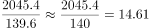
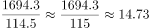
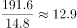
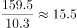
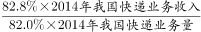
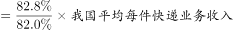
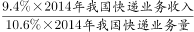
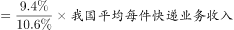
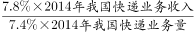
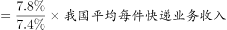

# 现期平均数计算与整体比较（单件平均收入）

考点：[[20-考点/资料分析/平均数/现期平均数计算与整体比较（单件平均收入）|平均数 / 现期平均数计算与整体比较（单件平均收入）]]
材料：[[15-材料/资料分析/310774 2014年我国快递服务企业业务发展情|310774 2014年我国快递服务企业业务发展情]]

**问法模型**：题干问'平均每件快递业务收入高于整体业务收入的有几个'→ 用平均数=收入÷业务量，分别求东中西部单件收入并与整体单件收入比大小，数个数

## 推理链
1. 第1步：从材料第1段提取整体数据：2014年快递业务量139.6亿件、快递业务收入2045.4亿元
2. 第2步：套用平均数公式（收入÷业务量）：整体单件收入=2045.4÷139.6≈14.65元/件（官方解析书写为14.61元，系截位笔误，不影响判断）
3. 第3步：东部=1694.3亿元÷114.5亿件≈14.8元/件＞14.65元，符合
4. 第4步：中部=191.6亿元÷14.8亿件≈13.0元/件＜14.65元，不符合
5. 第5步：西部=159.5亿元÷10.3亿件≈15.5元/件＞14.65元，符合
6. 第6步：符合条件的为东部、西部共2个地区，对照选项选C

**最快解法**：⚡ 比重比较法（免除法秒杀）：因东、中、西业务量比重（82.0%/10.6%/7.4%）与收入比重（82.8%/9.4%/7.8%）各自合计100%，'地区单件收入＞整体单件收入'⟺'该地区收入比重＞业务量比重'；直接对比：东部82.8%＞82.0%✓、中部9.4%＜10.6%✗、西部7.8%＞7.4%✓，即2个，选C，全程无需除法

## 易错点
- ⚠ 两套比重张冠李戴：必须用分地区比重（82.0%/10.6%/7.4%与82.8%/9.4%/7.8%），不能误用分业务比重（25.4%/72.3%/2.3%与13.0%/55.3%/15.4%）
- ⚠ 收入与业务量错配：东中西部各自量与收入必须一一对应相除（如中部是191.6÷14.8），拿错地区数据或把量除收入均会出错
- ⚠ 单位与基准值口径：亿元÷亿件=元/件，整体基准约14.6~14.7元/件，勿误作其他量级；另注意比较的是2014年现期平均数，无需换算基期

## 母题抽象
> 🧩 当题干问'某部分平均数高于整体平均数的有几个'且材料同时给出各部分的量比重与收入比重（各自合计100%）时，直接比较'该部分收入比重＞该部分数量比重'即可判定，免去多次除法运算

**同类特征**：平均每件快递业务收入、高于整体业务收入、东、中、西部地区、2014年（现期）、数个数（有几个）

## 相关题
- [[10-真题/资料分析/平均数/4737723 平均数的增长率（单件收入同比增速比较）|4737723]]（福建 2017，相关度1）

---

### 题干
在东部、中部、西部地区中，2014年平均每件快递业务收入高于整体业务收入的有（    ）个。

### 选项
- A. 0
- B. 1
- C. 2　✅
- D. 3

### 官方解析

根据题干“······2014年平均每件快递业务收入高于整体业务收入的有······”，可判定本题为现期平均数问题。

方法一：定位文字材料第一、三段可知：2014年我国快递服务企业业务量完成139.6亿件；快递业务收入完成2045.4亿元。全年东部地区完成快递业务量114.5亿件；实现业务收入1694.3亿元。中部地区完成快递业务量14.8亿件；实现业务收入191.6亿元。西部地区完成快递业务量10.3亿件；实现业务收入159.5亿元。根据公式：平均数，则全国平均每件快递业务收入为元，东部地区平均每件快递业务收入为元＞14.61元，符合题意；中部地区平均每件快递业务收入为元＜14.61元，不符合题意；西部地区平均每件快递业务收入为元＞14.61元，符合题意，故2014年平均每件快递业务收入高于整体业务收入的有东部和西部，共2个地区。

方法二：定位文字材料第三段可知：2014年，东、中、西部地区快递业务量比重分别为82.0%、10.6%和7.4%，快递业务收入比重分别为82.8%、9.4%和7.8%。根据公式：部分=整体×比重，平均数，则东部地区平均每件快递业务收入为：＞我国平均每件快递业务收入，符合题意；

中部地区平均每件快递业务收入为：＜我国平均每件快递业务收入，不符合题意；

西部地区平均每件快递业务收入为：＞我国平均每件快递业务收入，符合题意。

则2014年平均每件快递业务收入高于整体业务收入的有东部和西部，共2个地区。

故正确答案为C。

### 给定材料

        2014年我国快递服务企业业务量完成139.6亿件，同比增长51.9%；快递业务收入完成2045.4亿元，同比增长41.9%。快递业务收入占邮政行业总收入的比重为63.9%，比上年提高7.3个百分点。

        全年同城快递业务量完成35.5亿件，同比增长55.1%；实现业务收入265.9亿元，同比增长59.8%。异地快递业务快速增长。全年异地快递业务量完成100.9亿件，同比增长52.0%；实现业务收入1130.6亿元，同比增长36.4%。国际及港澳台快递业务稳定增长。全年国际及港澳台快递业务量完成3.3亿件，同比增长24.7%；实现业务收入315.9亿元，同比增长16.7%。同城快递业务占比上升。同城、异地、国际及港澳台快递业务量占全部比例分别为25.4%、72.3%和2.3%，业务收入占全部比例分别为13.0%、55.3%和15.4%。

        全年东部地区完成快递业务量114.5亿件，同比增53.2%；实现业务收入1694.3亿元，同比增长41.3%。中部地区完成快递业务量14.8亿件，同比增长49.2%；实现业务收入191.6亿元，同比增长44.3%。西部地区完成快递业务量10.3亿件，同比增长42.4%；实现业务收入159.5亿元，同比增长45.3%。东、中、西部地区快递业务量比重分别为82.0%、10.6%和7.4%，快递业务收入比重分别为82.8%、9.4%和7.8%。

        民营快递企业持续快速发展。全年国有快递企业业务量完成18.7亿件，实现业务收入300亿元；民营快递企业业务量完成119.5亿件，实现业务收入1541亿元；外资快递企业业务量完成1.4亿件，实现业务收入204.2亿元。国有、民营、外资快递企业业务量市场份额分别为13.4%、85.6%和1.0%，业务收入市场份额分别为14.7%、75.3%和10.0%。

> [!warning] 疑点（官方解析可能有误，待人工复核）
> 官方解析将整体单件收入书写为14.61元/件，按2045.4÷139.6精确计算约为14.65元/件，属解析文字中的数值笔误或截位差异；因东部14.8、西部15.5均明显高于该基准而中部13.0明显低于，结论与答案C不受影响
