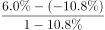
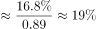

# 平均数增长率

考点：[[20-考点/资料分析/平均数/平均数增长率|平均数 / 平均数增长率]]
材料：[[15-材料/资料分析/310775 某市2015年科技创新发展情况（R&|310775 某市2015年科技创新发展情况（R&]]

**问法模型**：题干出现'平均每件……成交额较上年增长了'且选项为百分数 → 识别为平均数增长率模型，用公式 g=(1+a)/(1+b)-1=(a-b)/(1+b)，a为总量（成交金额）增速，b为份数（合同件数）增速

## 推理链
1. 第1步：从材料提取数据：全年认定登记技术合同2.25万件，比上年下降10.8%，即份数增速b=-10.8%；合同成交金额707.99亿元，增长6.0%，即总量增速a=+6.0%
2. 第2步：平均每件成交额=成交金额÷合同件数，平均数增长率公式为g=(1+a)÷(1+b)-1，等价变形g=(a-b)÷(1+b)
3. 第3步：代入计算：g=(6.0%-(-10.8%))÷(1-10.8%)=16.8%÷0.892≈18.8%
4. 第4步：与选项对照：18.8%与19%最接近，故选C；若漏除分母(1+b)只算16.8%会误选B(16%)，可反推B正是该陷阱项

**最快解法**：⚡ 平均数增长率公式法：g=(a-b)/(1+b)，分子=6.0%-(-10.8%)=16.8%，分母=1-10.8%=0.892，16.8%÷0.892≈18.8%，直接锁定C；亦可用截位直除1.06÷0.892≈1.188验证

## 易错点
- ⚠ 份数增速符号坑：件数是'下降10.8%'，b=-10.8%，分子a-b=6.0%+10.8%=16.8%，若按6.0%-10.8%=4.8%代入则完全算错
- ⚠ 漏除分母(1+b)坑：直接用a-b≈16.8%会误选B(16%)；分母0.892<1会把真实值放大到18.8%，这是本题最典型失分点
- ⚠ 升降混排与单位坑：技术合同'件数降、金额升'，分子分母基期方向相反；2.25万件=22500件需换算（707.99亿÷22500≈31.5万元/件），但用公式法则无需换算单位，直接用增速即可

## 母题抽象
> 🧩 当题干出现'平均每（件/人/单位）……较上年增长（下降）了……'且选项为百分数时，判定为平均数增长率题，用g=(a-b)/(1+b)（a=总量增速、b=份数增速，务必带上b的正负号），选与结果最接近的选项

**同类特征**：平均每件、成交额较上年增长、选项为百分数、件数下降金额上升、平均数增长率、技术交易合同

## 相关题
- [[10-真题/资料分析/平均数/10204497 平均数增长率（均价=值-量的比值增长率）|10204497]]（海南 2024，相关度2）
- [[10-真题/资料分析/平均数/16593089 平均数增长率|16593089]]（新疆 2024，相关度2）
- [[10-真题/资料分析/平均数/1752640 平均数增长率（人均收入增长率）|1752640]]（北京 2016，相关度2）
- [[10-真题/资料分析/平均数/2367793 平均数增长率（人均薪酬增速，份数增速为0的特例）|2367793]]（江苏 2019，相关度2）
- [[10-真题/资料分析/增长/9629 一般增长率计算（现期需由增量倒推）|9629]]（安徽 2009，相关度1）

---

### 题干
2015年，该市平均每件经认定登记的技术合同成交额较上年增长了：

### 选项
- A. 12%
- B. 16%
- C. 19%　✅
- D. 23%

### 官方解析

根据题干“2015年······平均每件······较上年增长了”，结合选项为百分数，可判定本题为平均数的增长率问题。定位文字材料第二段可得：2015年全年经认定登记的各类技术交易合同2.25万件，比上年下降10.8%（b）；合同成交金额707.99亿元，增长6.0%（a）。根据公式：平均数的增长率，可得2015年，该市平均每件经认定登记的技术合同成交额较上年增长了。

故正确答案为C。

### 给定材料

        2015年某市全年用于研究与试验发展（R&amp;D）经费支出925亿元，与上年同期相比增长了11%，增速较全国高出1.8个百分点。该市R&amp;D经费支出在该市生产总值中占比为3.7%，比全国水平高出1.6个百分点。

        全年受理专利申请100006件，比上年增长22.5%，其中受理发明专利申请46976件，增长20%。全年专利授权量为60623件，增长20.1%，其中发明专利授权量为17601件，增长51.5%。至年末，全市有效发明专利达69982件。全市科技小巨人企业和小巨人培育企业共1427家，高新技术企业6071家，技术先进型服务企业253家。年内全市认定和复审高新技术企业2089家。年内认定高新技术成果转化项目613项，其中电子信息、生物医药、新材料等重点领域项目占83.4%。至年末，共认定高新技术成果转化项目10500项。全年经认定登记的各类技术交易合同2.25万件，比上年下降10.8%；合同成交金额707.99亿元，增长6.0%。

