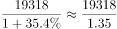
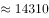
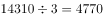

# 基期平均数（月均=基期总量÷月份数）

考点：[[20-考点/资料分析/平均数/基期平均数（月均=基期总量÷月份数）|平均数 / 基期平均数（月均=基期总量÷月份数）]]
材料：[[15-材料/资料分析/310902 2018年第一季度（含3月份当月）全|310902 2018年第一季度（含3月份当月）全]]

**问法模型**：题干出现'2017年（基期年份）+平均每月+亿元'→ 用基期平均数模型：现期总量÷(1+增速)÷月份数

## 推理链
1. 第1步：定位文字第二段，提取条件：2018年1-3月全国网上零售额19318亿元，同比增长35.4%；现期为2018年一季度，基期为2017年一季度，月份数为3
2. 第2步：公式：基期月均=现期总量/(1+r)÷3，即先求基期季度总量再除以3
3. 第3步：代入计算：2017年一季度总额=19318/1.354≈14267.36亿元，月均=14267.36/3≈4755.79亿元
4. 第4步：与选项对照：A项4755.79与计算值一致；B项14267.356恰为未除以3的基期季度总额，是陷阱项，故选A

**最快解法**：⚡ 截位直除：合并为一步19318/(1.354×3)≈19318/4.06≈4755，直接锁定A（或先19318/1.354≈14267，再÷3≈4756）

## 易错点
- ⚠ 忘记除以月份数3：算出2017年一季度总额14267.356后误选B，B项正是这一步之差的陷阱
- ⚠ 口径串用：应用网上零售总额19318亿元与增速35.4%，误用其中实物商品14567亿元或增速34.4%（兄弟题干扰数据）
- ⚠ 基期现期方向混淆：误将19318×(1-35.4%)或用错基期时间（应为2017年一季度）

## 母题抽象
> 🧩 当题干出现'基期年份+平均每月/日均'特征时，用基期平均数模型：现期总量÷(1+增速)÷月份数，并警惕选项中'未除以份数'的中间结果作为陷阱项

**同类特征**：2017年（基期年份）、平均每月、全国网上零售额、亿元、基期平均数、需除以月份数

## 相关题
- [[10-真题/资料分析/平均数/1689212 基期平均数计算|1689212]]（重庆 2015，相关度1）
- [[10-真题/资料分析/增长/50805 现期量计算（同比增速不变预测+求月平均数）|50805]]（甘肃 2009，相关度1）
- [[10-真题/资料分析/平均数/19797282 现期平均数（年均生产总值=多个年度GDP算术平均）|19797282]]（山西 2024，相关度1）
- [[10-真题/资料分析/其他/2394011 进出口顺差计算（顺差=出口-进口，简单作差）|2394011]]（青海 2019，相关度1）
- [[10-真题/资料分析/倍数/2443046 现期倍数（'累计−当月'拆分后求月均倍数）|2443046]]（辽宁 2019，相关度1）

---

### 题干
2017年第一季度，全国网上零售额平均每月（    ）亿元。

### 选项
- A. 4755.79　✅
- B. 14267.356
- C. 6439.33
- D. 4855.67

### 官方解析

根据题干“2017年第一季度······平均每月······亿元”，可判定本题为基期平均数问题。定位文字材料第二段可得：2018年1-3月份，全国网上零售额19318亿元，同比增长35.4%。根据公式：基期量，可求2017年第一季度全国网上零售额为亿元，平均每月亿元，与A项最接近。

故正确答案为A。

### 给定材料

        2018年第一季度，全国社会消费品零售总额90275亿元，同比增长9.8%。其中，3月份，社会消费品零售总额29194亿元，餐饮收入3099亿元，限额以上单位餐饮收入占餐饮总收入的23.2%；商品零售额26095亿元，限额以上单位商品零售总额11113亿元，同比增长8.9%。

        2018年1-3月份，全国网上零售额19318亿元，同比增长35.4%。其中，实物商品网上零售额14567亿元，增长34.4%，占社会消费品零售总额的比重为16.1%。在实物商品网上零售额中，吃、穿、用类商品分别增长46.5%、33.9%和33.3%。

