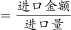
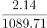
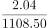
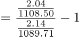
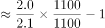
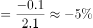

# 两期平均数增长率（平均进口价格环比变化）

考点：[[20-考点/资料分析/平均数/两期平均数增长率（平均进口价格环比变化）|平均数 / 两期平均数增长率（平均进口价格环比变化）]]
材料：[[15-材料/资料分析/311726 2015年1-12月中国多晶硅逐月进|311726 2015年1-12月中国多晶硅逐月进]]

**问法模型**：题干问'与上月相比，平均进口价格约上升/下降百分之几'→ 两期平均比较模型：增长率=(当月金额÷当月数量)÷(上月金额÷上月数量)−1

## 推理链
1. 第1步：从图中提取相邻两月数据——4月进口量1089.71万千克、金额2.14亿美元；5月进口量1108.50万千克、金额2.04亿美元（'与上月相比'的基期为4月）
2. 第2步：平均进口价格=进口金额÷进口数量；亿美元÷万千克虽隐含10^4美元/千克的量级换算，但换算因子两月相同，在比值中可完全约去
3. 第3步：代入计算——5月价格=2.04×10^8÷(1108.50×10^4)≈18.4美元/千克，4月价格=2.14×10^8÷(1089.71×10^4)≈19.6美元/千克
4. 第4步：求增长率=(18.4−19.6)/19.6≈−6.3%；等价交叉相乘验证：(2.04×1089.71)/(2.14×1108.50)−1≈2223.01/2372.19−1≈−6.3%
5. 第5步：与选项对照：'下降了6%'与−6.3%最接近，故选A

**最快解法**：⚡ 交叉相乘+量级约去：增长率=(2.04×1089.71)/(2.14×1108.50)−1≈2223/2372−1≈−6.3%；更快的拆解口算：金额2.14→2.04约降4.7%，数量1089.71→1108.50约增1.7%，价格变化≈(1−4.7%)÷(1+1.7%)≈0.937，即约下降6%，直接锁定A

## 易错点
- ⚠ 看错比较对象：若只比金额2.14→2.04（约降4.7%）会低估降幅、只比数量1089.71→1108.50（约增1.7%）会误选C'上升了2%'，本题必须做金额÷数量的跨轴相除才能得约−6%
- ⚠ 被双轴量级吓住不敢除：亿美元与万千克相除隐含10^4换算（约合18~20美元/千克），但两月换算因子相同、求增长率时自动约去，不必真换算；若两月换算口径不一致才会严重出错
- ⚠ 基期月取错：'与上月相比'=5月对4月（1089.71、2.14），误用3月（1029.66、2.14）或2月（755.80、1.47）会改变方向与幅度；另注意图上柱值（量，700~1100）与线值（额，1.2~2.2）量级悬殊，勿取错标签

## 母题抽象
> 🧩 当题干问'某平均价格/单价与上一期相比上升或下降约百分之几'（平均数=金额÷数量型）时，用两期平均增长率模型(A现/B现)÷(A基/B基)−1；两期单位一致则量级约去，直接交叉相乘(A现×B基)/(A基×B现)−1后与选项对照

**同类特征**：与上月相比（环比）、平均进口价格、上升/下降+百分数选项、双轴复合图量额并用、跨轴相除（金额÷数量）、相邻两月对比（5月对4月）

## 相关题
- [[10-真题/资料分析/平均数/4658508 平均数（单产）增长率——两期平均数比较|4658508]]（四川 2021，相关度1）
- [[10-真题/资料分析/增长/2280935 环比增长率计算（以限定时段内同比增速最高月为载体）|2280935]]（四川 2018，相关度1）

---

### 题干
与上月相比，2015年5月的多晶硅平均进口价格约：

### 选项
- A. 下降了6%　✅
- B. 下降了24%
- C. 上升了2%
- D. 上升了12%

### 官方解析

根据题干“与上月相比······平均进口价格约”，结合选项为上升/下降+百分数，可判定本题为平均数的增长率问题。定位统计图可得：2015年4月多晶硅进口量及金额分别为1089.71万千克、2.14亿美元；2015年5月多晶硅进口量及金额分别为1108.50万千克、2.04亿美元。根据平均进口价格，则2015年4月、5月多晶硅平均进口价格分别为：万美元/千克、万美元/千克。根据公式：增长率，则所求，即约下降了5%，与A项最接近。

故正确答案为A。

### 给定材料

> [!warning] 疑点（官方解析可能有误，待人工复核）
> 官方解析中间结论写'约下降了5%'，精确计算为约−6.3%（2223.01/2372.19−1），与选项A'下降了6%'本身即对应；解析措辞略不精确，但方向与选项判定均正确，答案A无疑义。

<!-- CODEX-ANSWER-REVIEW:BEGIN -->
### 本次独立复核

**复核状态：** `resolved`（答案与解析已核定）

**计分答案：** A（可计分）

**复核解析：**

5月均价相对4月的变化=(2.04/1108.50)/(2.14/1089.71)−1≈−6.4%，即下降约6%，选A。解析中“下降约5%”不够准确，应以精算值约6.4%表述。

**相关信息：**

两月单价分别由进口金额除进口量，金额单位相同，结果再比较增长率。

**题源依据：** [固定版本原题](https://github.com/Mentat-Uran/kaogongzhentizhengliu/blob/84ab93d4b64b61d897bece8a1c0a5bab06b4feb2/10-%E7%9C%9F%E9%A2%98/%E8%B5%84%E6%96%99%E5%88%86%E6%9E%90/%E5%B9%B3%E5%9D%87%E6%95%B0/4770009%20%E4%B8%A4%E6%9C%9F%E5%B9%B3%E5%9D%87%E6%95%B0%E5%A2%9E%E9%95%BF%E7%8E%87%EF%BC%88%E5%B9%B3%E5%9D%87%E8%BF%9B%E5%8F%A3%E4%BB%B7%E6%A0%BC%E7%8E%AF%E6%AF%94%E5%8F%98%E5%8C%96%EF%BC%89.md)；固定内容 commit `84ab93d4b64b61d897bece8a1c0a5bab06b4feb2`，Markdown blob `ab0f21de555730209067b9b35653d71d774ad54c`。
<!-- CODEX-ANSWER-REVIEW:END -->
