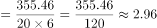

# 现期平均数（平均每家每月=总量÷家数÷月数）

考点：[[20-考点/资料分析/平均数/现期平均数（平均每家每月=总量÷家数÷月数）|平均数 / 现期平均数（平均每家每月=总量÷家数÷月数）]]
材料：[[15-材料/资料分析/312725 2021年上半年湖北省规模以上信息传|312725 2021年上半年湖北省规模以上信息传]]

**问法模型**：题干出现'平均每家每月……约为多少亿元'且材料时间为现期 → 用现期平均数模型：总营业收入÷企业前20家数÷6个月

## 推理链
1. 第1步：定位文字段，2021年上半年营业收入前20的企业共实现营业收入355.46亿元（注意676家是全部规上信息软件业企业数，本题只用前20家）
2. 第2步：现期平均数公式：平均每家每月营业收入=总营业收入÷企业数÷月份数，上半年对应6个月
3. 第3步：代入计算：355.46÷20=17.773亿元（前20家平均每家上半年收入），再÷6≈2.962亿元
4. 第4步：也可合并为355.46÷(20×6)=355.46÷120≈2.96，与D项2.96一致，排除A/B/C，故选D

**最快解法**：⚡ 截位直除+合并分母：先把家数与月数相乘20×6=120，再算355.46÷120≈2.96（355.46÷12≈29.6，再÷10），直接锁定D，无需精算

## 易错点
- ⚠ 误用676家做分母：676是全部规上信息软件业企业数，题干只问'营业收入前20的企业'，355.46亿元仅是前20家合计
- ⚠ 漏除月份数：355.46÷20≈17.77是上半年（6个月）平均，误选此值或不再÷6即错
- ⚠ 时间口径折算错误：'每月'应÷6个月（上半年），若误按全年÷12个月会得约1.48，掉入时间换算陷阱

## 母题抽象
> 🧩 当题干出现'平均每家每月/每人每天'等双层平均特征时，用总量÷(家数×时间份数)的现期平均数模型，并核对材料时间口径折算（上半年÷6、全年÷12）

**同类特征**：平均每家每月、营业收入前20的企业、共实现营业收入355.46亿元、2021年上半年（现期）、约为多少亿元、文字段取数（表中无此数据）

## 相关题
- [[10-真题/资料分析/增长/2456363 基期量计算|2456363]]（浙江 2020，相关度1）
- [[10-真题/资料分析/平均数/2579778 现期平均数计算（累计值−单月值做差求子时段总量后求月均）|2579778]]（浙江 2020，相关度1）
- [[10-真题/资料分析/平均数/4652180 现期平均数之两步拼接（单位企业利润=利润总额÷企业数，企业数由营业收入÷单位企业营业收入间接求出）|4652180]]（北京 2022，相关度1）
- [[10-真题/资料分析/增长/2388066 按上年价格计算的现期值折算（名义增速→实际增速）|2388066]]（河北 2019，相关度1）
- [[10-真题/资料分析/其他/2388239 累计值求当月值（相邻累计差值简单计算）|2388239]]（河北 2019，相关度1）

---

### 题干
2021年上半年湖北省规上信息软件业中营业收入前20的企业，平均每家每月营业收入约为多少亿元？

### 选项
- A. 1.18
- B. 2.25
- C. 2.32
- D. 2.96　✅

### 官方解析

根据题干“2021年上半年······平均每家每月营业收入约为多少亿元”，结合材料时间为2021年上半年，可判定本题为现期平均数问题。定位文字材料第二段：2021年上半年，湖北省676家规上信息软件业企业中营业收入前20的企业共实现营业收入355.46亿元。则所求亿元。

故正确答案为D。

### 给定材料

        2021年上半年，湖北省规模以上信息传输、软件和信息技术服务业（以下简称“规上信息软件业”）保持较快增长，推动全省规上服务业稳步发展。

        2021年上半年，湖北省676家规上信息软件业企业中营业收入前20的企业共实现营业收入355.46亿元，同比增长8.3%，拉动规上服务业营业收入增长1.1个百分点。

