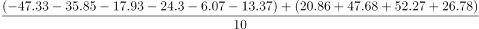
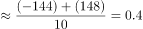

# 现期平均数（多年数据求年平均值，区间型选项）

考点：[[20-考点/资料分析/平均数/现期平均数（多年数据求年平均值，区间型选项）|平均数 / 现期平均数（多年数据求年平均值，区间型选项）]]
材料：[[15-材料/资料分析/323375 2011~2020年全国艺术表演团体|323375 2011~2020年全国艺术表演团体]]

**问法模型**：题干出现'2011~2020年……年平均值为'且选项为金额区间 → 十个年度值求和÷10，用基准削峰填谷快速判定落在哪个区间

## 推理链
1. 第1步：从表格'演出收入'列提取2011~2020十年数据：52.67、64.15、82.07、75.70、93.93、120.86、147.68、152.27、126.78、86.63（亿元）
2. 第2步：年平均值=十年合计÷10；采用'削峰填谷'，以100亿元为基准作差：-47.33、-35.85、-17.93、-24.30、-6.07、+20.86、+47.68、+52.27、+26.78、-13.37
3. 第3步：差值求和=+2.74，故平均值≈100+2.74÷10≈100.3亿元（精确验证：合计1002.74÷10=100.27亿元）
4. 第4步：100.3亿元落在95~105亿元区间内，对照选项选B

**最快解法**：⚡ 削峰填谷（基准100亿元）：各年与100作差，正负差值相抵净剩+2.74，平均值=100+0.274≈100.3亿元，直接锁定95~105亿元区间选B；亦可先毛估多数年份收入在90~150之间、仅2011/2012/2020偏低，快速排除A/C/D

## 易错点
- ⚠ 除数错误：十年数据应÷10，勿按'9个间隔'错除以9（1002.74÷9≈111.4会误选A），也不要误套年均增长量公式(末-初)÷9
- ⚠ 模型误判：题干问'年平均值'是现期平均数问题，不是年均增长量/年均增长率问题，勿用(86.63-52.67)÷9之类的增长公式
- ⚠ 查数与求和粗心：收入列单位为亿元，勿与观众人次（亿人次）、演出场次（万场）列混淆；勿漏加2020年86.63亿元或错用文字段落的公益演出口径数据

## 母题抽象
> 🧩 当题干出现'××年份区间内××指标的年平均值'且选项为区间时，以整数基准（如100）对各年数据作差削峰填谷，净差÷年数加回基准，再对照区间锁定答案

**同类特征**：2011~2020年、年平均值、演出收入（亿元）、选项为金额区间（大于/小于/之间）、十年逐年数据求平均、现期平均数

## 相关题
- [[10-真题/资料分析/平均数/13319360 现期平均数（总量÷份数）|13319360]]（江苏 2025，相关度1）
- [[10-真题/资料分析/平均数/13504650 现期平均数计算与多期排序比较|13504650]]（辽宁 2025，相关度1）
- [[10-真题/资料分析/平均数/18385424 现期平均数计算与比较（单价-均价=总额÷数量，跨双轴图取数）|18385424]]（浙江 2024，相关度1）
- [[10-真题/资料分析/平均数/18643712 现期平均数计算（累计值求月均）|18643712]]（天津 2026，相关度1）
- [[10-真题/资料分析/平均数/18643737 现期平均数比较（平均每船次进口量与固定值8万吨比较计数）|18643737]]（天津 2026，相关度1）

---

### 题干
2011~2020年全国艺术表演团演出收入的年平均值为：

### 选项
- A. 大于105亿元
- B. 95~105亿元之间　✅
- C. 85~95亿元之间
- D. 小于85亿元

### 官方解析

根据题干“2011~2020年······的年平均值”，可判定本题为现期平均数问题。定位表格材料可得：2011~2020年全国艺术表演团体演出收入分别为52.67亿元、64.15亿元、82.07亿元、75.70亿元、93.93亿元、120.86亿元、147.68亿元、152.27亿元、126.78亿元、86.63亿元。根据选项的范围设置，利用“削峰填谷”，以100为基准，分别作差为：-47.33、-35.85、-17.93、-24.3、-6.07、20.86、47.68、52.27、26.78、-13.37，，即所求年平均值约等于100.4亿元。

故正确答案为B。

### 给定材料

        2020年末，全国共有艺术表演团体17581个，从业人员43.69万人，其中各级文化和旅游部门所属艺术表演团体2060个，从业人员10.75万人。2020年，全国文化和旅游部门所属艺术表演团体共组织政府采购公益演出13.38万场，比上年下降14.9%；观众0.86亿人次，下降27.9%。

> [!warning] 疑点（官方解析可能有误，待人工复核）
> 官方解析末尾'约等于100.4亿元'与其所列差值之和不符：差值合计为+2.74，2.74÷10=0.27，应为约100.3亿元（精确值1002.74÷10=100.27亿元），疑为解析笔误，不影响答案B的判定
