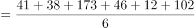
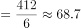

# 现期平均数（条件筛选后求算术平均）

考点：[[20-考点/资料分析/平均数/现期平均数（条件筛选后求算术平均）|平均数 / 现期平均数（条件筛选后求算术平均）]]
材料：[[15-材料/资料分析/323433 2021年第一季度全国15个重点旅游|323433 2021年第一季度全国15个重点旅游]]

**问法模型**：题干问'高于全国平均出租率（35.07%）的城市的星级饭店平均数量'→ 先用全国行基准值筛选出满足条件的城市，再对其数量列求和除以城市个数（412÷6）

## 推理链
1. 第1步：定位表中全国行的平均出租率35.07%，作为筛选基准
2. 第2步：逐一比较15个城市的平均出租率，筛出高于35.07%的6城：石家庄40.80%、哈尔滨35.36%、上海38.92%、南京43.32%、无锡39.96%、杭州38.94%
3. 第3步：提取这6城对应的星级饭店数量：41家、38家、173家、46家、12家、102家
4. 第4步：求和：41+38+173+46+12+102=412家
5. 第5步：代入平均数公式：平均数量=412÷6≈68.7家
6. 第6步：与选项对照：68.7最接近C项69，故选C

**最快解法**：⚡ 筛选+截位直除：先用基准35.07%快速筛出6城（重点盯临界值哈尔滨35.36%），数量求和得412；再口算412÷6：6×68=408、余4，故约68.7，直选C（69）

## 易错点
- ⚠ 筛选基准必须用全国行的35.07%，不能用15城均值或某一城市值替代；北京18.80%、秦皇岛7.28%等明显低于基准，勿误选
- ⚠ 临界值陷阱：哈尔滨35.36%仅比35.07%高0.29个百分点，极易漏筛；而长春30.88%、沈阳31.33%、苏州31.50%接近但低于基准，勿多选
- ⚠ 求平均的是'数量'列且为算术平均（412÷6），不是加权平均，也不要错拿营业收入、房价等其他列计算

## 母题抽象
> 🧩 当题干出现'高于/低于全国（整体）某指标值的对象的平均X'特征时，先用基准行数值筛选出满足条件的个体，再对目标列求和÷个数得算术平均，与选项对照

**同类特征**：高于全国平均出租率、以全国行为筛选基准、城市的星级饭店平均数量、筛选后求算术平均、现期静态计算、约多少家

## 相关题
（暂无）

---

### 题干
2021年第一季度15个重点旅游城市中，高于全国平均出租率的城市的星级饭店平均数量约为多少家？

### 选项
- A. 60
- B. 64
- C. 69　✅
- D. 72

### 官方解析

根据题干“2021年第一季度······平均数量约为多少家”，可判定本题为现期平均数问题。定位统计表可得：2021年第一季度全国平均出租率为35.07%，以及15个重点旅游城市星级饭店的平均出租率。其中高于35.07%的城市有：石家庄（40.8%）、哈尔滨（35.36%）、上海（38.92%）、南京（43.32%）、无锡（39.96%）、杭州（38.94%），共6个城市。相应的星级饭店数量分别为：41家、38家、173家、46家、12家、102家。星级饭店的平均数量家，与C项最接近。

故正确答案为C。

### 给定材料

