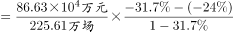

# 平均数增长量计算（两期平均数变化）

考点：[[20-考点/资料分析/平均数/平均数增长量计算（两期平均数变化）|平均数 / 平均数增长量计算（两期平均数变化）]]
材料：[[15-材料/资料分析/335237 2020年全国文化事业统计数据：艺术|335237 2020年全国文化事业统计数据：艺术]]

**问法模型**：“平均每场演出收入比上年增加/减少（以1000元为界）”→平均数增长量模型：Δ=现期平均数×(a−b)/(1+a)，先由a与b大小判方向，再估量级锁定选项。

## 推理链
1. 第1步：定位段2全国艺术表演团体全年数据：演出收入A=86.63亿元、同比a=−31.7%；演出场次B=225.61万场、同比b=−24.0%（勿误用段3公益演出13.38万场）。
2. 第2步：计算现期平均数=86.63亿元÷225.61万场≈0.384亿元/万场，换算量级=3840元/场（亿元÷万场=万元/场，需×10^4化为元）。
3. 第3步：判定方向：a=−31.7%＜b=−24.0%，分子（收入）降幅大于分母（场次），平均数必然下降，排除C、D。
4. 第4步：代入平均数增长量公式：Δ=3840×(−31.7%+24.0%)/(1−31.7%)=3840×(−7.7%)/0.683≈−433元/场（等价验证：基期收入86.63/0.683≈126.8亿元、基期场次225.61/0.76≈296.9万场，基期平均数≈4273元/场，4273−3840≈433元）。
5. 第5步：2020年平均每场演出收入比上年减少约433元，不到1000元，与选项对照锁定A。

**最快解法**：⚡ 方向+量级双重速判：①a=−31.7%＜b=−24.0%→平均数下降，排除C/D；②平均数增长率g=(a−b)/(1+b)=(−7.7%)/0.76≈−10.1%，而现期平均数仅3840元/场，10%量级的减少额只有约400元级，必不到1000元，直接锁A，无需精算。

## 易错点
- ⚠ 单位量级陷阱：86.63亿元÷225.61万场=0.384万元/场≈3840元/场，忘记×10^4换算成元会完全误判量级。
- ⚠ 方向误判：降幅更大的是分子（收入降31.7%），分子降得快→平均数下降；若把a、b角色对调或只看'场次也在降'会误选'增加'项C/D。
- ⚠ 取数与公式口径：须用段2全国演出流量数据，段3公益演出（13.38万场、降14.9%）主题相近不可混用；平均数增长量公式中现期平均数配分母(1+a)、基期平均数配分母(1+b)，混用会算错数值（本题两种算法均约400余元、均不到1000元，不影响选项）。

## 母题抽象
> 🧩 当题干出现'平均每X的Y比上年增加/减少（附具体金额/数量阈值）'时，用平均数增长量模型：先比较总量增速a与份数增速b定升降方向，再用现期平均数×|a−b|/(1+a)估算变化量级，与选项阈值比较即可，常无需精算。

**同类特征**：平均每场……创造收入（平均数+金额单位）、比上年增加/减少、选项以1000元为分界且分'增加/减少'两向、总量（收入）与份数（场次）各自给出同比增减率、全年流量数据（段2）取数、亿元与万场间的量级换算

## 相关题
（暂无）

---

### 题干
2020年，全国艺术表演团体平均每场演出创造收入比上年：

### 选项
- A. 减少了不到1000元　✅
- B. 减少了1000元以上
- C. 增加了不到1000元
- D. 增加了1000元以上

### 官方解析

根据题干“2020年······平均每场演出创造收入比上年”，结合选项为“增加/减少+元”，可判定本题为平均数的增长量问题。定位文字材料第二段可得：2020年，全国艺术表演团体共演出225.61万场（B），比上年下降24.0%（b）；演出收入86.63亿元（A），下降31.7%（a）。根据公式：平均数的增长量，故2020年，全国艺术表演团体平均每场演出创造收入的同比增长量元/场，即比上年减少了不到1000元。

故正确答案为A。

### 给定材料

        2020年末，全国共有艺术表演团体17581个，比上年末减少214个；从业人员43.69万人，增加2.44万人。其中各级文化和旅游部门所属艺术表演团体2060个，占11.7%，从业人员10.75万人，占24.6%。

        2020年，全国艺术表演团体共演出225.61万场，比上年下降24.0%；国内观众8.93亿人次，下降27.4%；演出收入86.63亿元，下降31.7%。

        2020年，全国文化和旅游部门所属艺术表演团体共组织政府采购公益演出13.38万场，比上年下降14.9%；观众0.86亿人次，下降27.9%。

        2020年末，全国公共图书馆实际使用房屋建筑面积1785.77万平方米，比上年末增长12.2%；全国图书总藏量117929.99万册，增长6.1%；阅览室坐席数126.47万个，增长6.2%；计算机226234台，增加419台；其中供读者使用的电子阅览终端143714台，减少2022台。

        2020年末，全国共有群众文化机构43687个，比上年末减少386个。其中乡镇综合文化站32825个，减少705个。年末全国群众文化机构从业人员185076人，比上年末减少4992人。其中具有高级职称的人员7075人，具有中级职称人员17969人。

