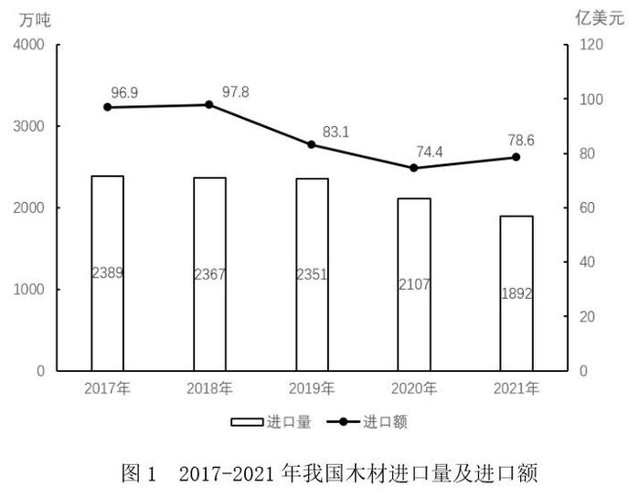
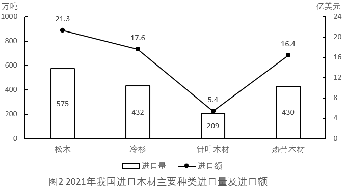

# 现期平均数（进口平均单价）逐年计算与阈值比较计数

考点：[[20-考点/资料分析/平均数/现期平均数（进口平均单价）逐年计算与阈值比较计数|平均数 / 现期平均数（进口平均单价）逐年计算与阈值比较计数]]
材料：[[15-材料/资料分析/338027 2017-2021年我国木材进口情况|338027 2017-2021年我国木材进口情况]]

**问法模型**：题干问'平均单价高于400美元/吨的年份有几个'→用单价=进口额÷进口量（亿美元/万吨×10⁴=美元/吨）逐年计算并与400比较后计数

## 推理链
1. 第1步：从图1读取五年双轴数据：2017年2389万吨/96.9亿美元、2018年2367/97.8、2019年2351/83.1、2020年2107/74.4、2021年1892/78.6
2. 第2步：平均单价=进口额÷进口量，单位换算：亿美元÷万吨=10⁸÷10⁴=10⁴，故单价(美元/吨)=(进口额/进口量)×10⁴
3. 第3步：2017年96.9/2389≈0.0406→约406美元/吨；2018年97.8/2367≈0.0413→约413美元/吨；2019年83.1/2351≈0.0354→约354美元/吨；2020年74.4/2107≈0.0353→约353美元/吨；2021年78.6/1892≈0.0415→约415美元/吨
4. 第4步：高于400美元/吨的年份为2017、2018、2021，共3个，对照选项选B

**最快解法**：⚡ 百化分+阈值转化：0.04=1/25，'单价>400美元/吨'等价于'进口额(亿美元)>进口量(万吨)÷25'，逐年代入：2389/25≈95.6<96.9✓、2367/25≈94.7<97.8✓、2351/25≈94.0>83.1✗、2107/25≈84.3>74.4✗、1892/25≈75.7<78.6✓，共3年，选B，全程免做5次除法

## 易错点
- ⚠ 单位量级陷阱：亿美元÷万吨直接相除得0.04左右，若忘了×10⁴换算成美元/吨，会误判所有年份远低于400而错选D；正确换算后0.04×10⁴=400美元/吨才可与阈值比较
- ⚠ 双轴图读数陷阱：柱对应左轴（万吨）、点对应右轴（亿美元），不能因柱的高低直接比较量额，须先分清读数所属轴
- ⚠ 计数方向陷阱：需与换算后的400美元/吨比较，2019、2020两年单价约353-354美元/吨易被进口额下降的视觉趋势误判，2021年进口额虽只回升至78.6但因进口量大降使单价最高（约415），勿漏计2021年

## 母题抽象
> 🧩 当题干出现'平均单价/均价高于某值的年份有几个'时，先把阈值换算成'分子>分母×换算系数'（如400美元/吨=0.04亿美元/万吨=1/25），再用百化分逐年代入比较计数，避免逐年硬除

**同类特征**：平均单价、高于400美元/吨、年份有几个、2017-2021年、进口额除以进口量、单位换算（亿美元/万吨→美元/吨）

## 相关题
- [[10-真题/资料分析/增长/13504272 一般增长率计算与计数比较（同比增速-5%年份计数）|13504272]]（云南 2025，相关度1）
- [[10-真题/资料分析/增长/16070145 同比增长率比较（逐年增速计算并计数年份）|16070145]]（贵州 2026，相关度1）
- [[10-真题/资料分析/增长/2024184 同比增长率比较（超阈值年份计数）|2024184]]（重庆 2016，相关度1）
- [[10-真题/资料分析/比重/2662229 现期比重比较（占比过半判断）|2662229]]（新疆 2020，相关度1）
- [[10-真题/资料分析/倍数/4673147 现期倍数比较（'多N倍'的转化判断）|4673147]]（广东 2022，相关度1）

---

### 题干
2017-2021年，我国木材进口平均单价高于400美元/吨的年份有几个？

### 选项
- A. 4
- B. 3　✅
- C. 2
- D. 1

### 官方解析
根据题干“2017-2021年······平均单价高于400美元/吨的年份有几个”，可判定本题为现期平均数问题。定位图1可知2017-2021年我国每年木材进口量及进口额。根据公式：进口平均单价，则2017-2021年我国木材进口平均单价分别为：2017年，美元/吨；2018年，美元/吨；2019年，美元/吨；2020年，美元/吨；2021年，美元/吨。因此，平均单价高于400美元/吨的年份有2017年、2018年、2021年，共3个。
故正确答案为B。

### 给定材料

