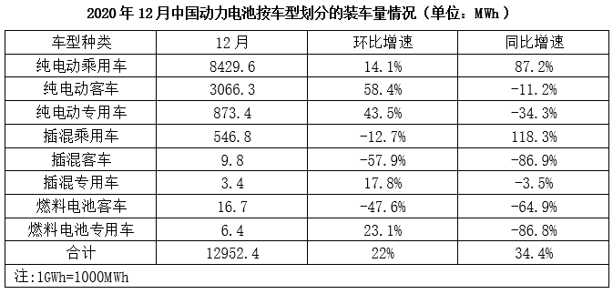

# 基期平均数（同比负增长反推基期量+日均）

考点：[[20-考点/资料分析/平均数/基期平均数（同比负增长反推基期量+日均）|平均数 / 基期平均数（同比负增长反推基期量+日均）]]
材料：[[15-材料/资料分析/341286 2018~2020年中国动力电池装车|341286 2018~2020年中国动力电池装车]]

**问法模型**：题干问上年同月（2019年12月）的日均装车量 → 先用现期量/(1+同比增速)反推基期总量，再除以当月天数31天

## 推理链
1. 第1步：题干定位'2019年12月插混客车日均装车量'，材料表1给出2020年12月插混客车装车量9.8MWh、同比增速-86.9%，判定为基期平均数问题
2. 第2步：公式一：基期量=现期量/(1+同比增速)；公式二：日均=基期总量÷当月天数，12月为31天
3. 第3步：代入计算：基期量=9.8/(1-86.9%)=9.8/0.131≈74.8MWh（负增长时分母0.131小于1，基期值被放大）
4. 第4步：日均=74.8÷31≈2.41MWh
5. 第5步：与选项对照，最接近A项2.4MWh，故选A

**最快解法**：⚡ 公式法+截位直除：负增长基期=9.8/(1-0.869)=9.8/0.131，截位估为10/0.131≈76，再除以31≈2.4，直接锁定A；亦可用9.8/0.131≈75，75/31≈2.4，无需精算

## 易错点
- ⚠ 负增长方向弄反：同比-86.9%应除以(1-86.9%)=0.131使基期放大，若误乘(1-86.9%)或除以(1+86.9%)会得到约1.3或0.52MWh的错误值
- ⚠ 单位口径陷阱：表1单位为MWh、图1单位为GWh（1GWh=1000MWh），本题取表1数据并以MWh作答，勿跨图表误用GWh量级
- ⚠ 日均基数陷阱：12月为31天，若误用30天会得约2.49MWh，虽仍靠近A但精度下降，且易在选项间徘徊

## 母题抽象
> 🧩 当题干出现'上年同期+日均/平均'且材料给同比增速（尤其负增长）时，用基期量=现期/(1+r)反推总量，再除以天数；负增长时分母为(1-|r|)使基期放大，切勿弄反方向

**同类特征**：2019年12月（基期、上年同月）、日均装车量、同比增速-86.9%（负增长）、插混客车9.8MWh（表1取数）、基期平均数、除以31天

## 相关题
- [[10-真题/资料分析/平均数/1689212 基期平均数计算|1689212]]（重庆 2015，相关度1）
- [[10-真题/资料分析/平均数/2453204 基期平均数计算（分子分母增速方向相反）|2453204]]（北京 2020，相关度1）
- [[10-真题/资料分析/平均数/2456364 基期平均数计算（基期量换算＋平均）|2456364]]（浙江 2020，相关度1）
- [[10-真题/资料分析/平均数/19283737 基期平均数（日均处理金额，现期量推基期量+天数平均）|19283737]]（国考 2025，相关度1）
- [[10-真题/资料分析/平均数/2136850 基期平均数（基期总量÷基期份数）|2136850]]（北京 2018，相关度1）

---

### 题干
2019年12月，我国插混客车的日均动力电池装车量约为（    ）。

### 选项
- A. 2.4MWh　✅
- B. 2.6MWh
- C. 2.8MWh
- D. 3.1MWh

### 官方解析
根据题干“2019年12月······日均······约为”，结合材料给出2020年12月相关数据，可判定本题为基期平均数问题。定位表格材料可得：2020年12月，我国插混客车动力电池装车量为9.8MWh，同比增速为-86.9%。根据公式：基期量，可得2019年12月我国插混客车动力电池装车量MWh，12月有31天，则题干所求MWh。
故正确答案为A。

### 给定材料

        2020年1~12月，中国新能源汽车市场共计72家动力电池企业实现装车配套，其中排名前3家、前5家、前10家的企业动力电池装车量分别占总装车量的71.3%、82.1%和91.8%。

