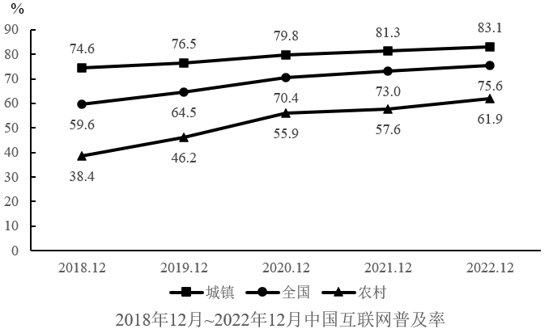

# 比重（占比）大小比较与排序

考点：[[20-考点/资料分析/比重/比重（占比）大小比较与排序|比重 / 比重（占比）大小比较与排序]]
材料：[[15-材料/资料分析/4197416 2022年12月我国网民规模、上网设|4197416 2022年12月我国网民规模、上网设]]

**问法模型**：题干问'上网前3位的设备'→ 直接提取各设备占网民的上网比例，降序排序取前三即可，无需任何计算

## 推理链
1. 第1步：定位文字材料第一段，提取2022年12月各设备上网比例：手机99.8%、电视25.9%、台式电脑34.2%、笔记本电脑32.8%、平板电脑28.5%
2. 第2步：五种比例均为'占网民整体'的同一口径占比，数值大小即代表使用人数多少，可直接比较
3. 第3步：降序排列得99.8%＞34.2%＞32.8%＞28.5%＞25.9%，前三为手机、台式电脑、笔记本电脑
4. 第4步：对照选项，仅A项'手机、台式电脑、笔记本电脑'与排序一致，故选A

**最快解法**：⚡ 数据查找+直接排序零计算：先锁定最大项手机99.8%（排除D），再比较台式34.2%与笔记本32.8%仅差1.4个百分点锁定第二、三位，秒选A

## 易错点
- ⚠ 台式电脑34.2%与笔记本电脑32.8%数值接近，勿凭'平板更常用'的生活常识误排B
- ⚠ 电视25.9%排名末位，C/D均为把电视误排进前三的干扰项
- ⚠ 无需将比例换算为人数（如手机网民=10.67亿×99.8%），同口径占比直接比大小即可，换算反而浪费时间

## 母题抽象
> 🧩 当题干出现'前N位/排名/最高（低）的……'且材料直接给出同一时点同口径的占比数据时，只需定位数据降序排序取前N项对照选项，无需计算

**同类特征**：上网前3位的设备、使用比例排序、直接数据查找、截至2022年12月同一时点、零计算量纯比较

## 相关题
（暂无）

---

### 题干
根据上述材料，截止2022年12月我国网民使用上网前3位的设备是：

### 选项
- A. 手机、台式电脑、笔记本电脑　✅
- B. 手机、笔记本电脑、平板电脑
- C. 手机、电视、台式电脑
- D. 电视、台式电脑、平板电脑

### 官方解析
定位文字材料第一段可知：截止2022年12月，我国网民使用手机上网的比例达99.8%，使用电视上网的比例为25.9%，使用台式电脑、笔记本电脑、平板电脑上网的比例分别为34.2%、32.8%和28.5%。故截止2022年12月我国网民使用上网前3位的设备是：手机（99.8%）、台式电脑（34.2%）、笔记本电脑（32.8%）。
故正确答案为A。

### 给定材料

        截止2022年12月，我国网民规模约为10.67亿，较2021年12月新增网民约3549万，互联网普及率达75.6%，较2021年12月提升2.6个百分点。我国网民使用手机上网的比例达99.8%，较2021年12月增加0.1个百分点；使用电视上网的比例为25.9%；使用台式电脑、笔记本电脑、平板电脑上网的比例分别为34.2%、32.8%和28.5%。我国城镇网民规模约为7.59亿，占网民整体的71.1%，农村网民规模约为3.08亿，较2021年12月增长约2371万，占网民整体的28.9%。

        2022年12月，20-29岁、30-39岁、40-49岁网民占比分别为14.2%、19.6%和16.7%；50岁及以上网民群体占比由2021年12月的26.8%提升至30.8%，互联网进一步向中老年群体渗透。

        2022年12月，线上办公用户规模约达5.4亿，较2021年12月增加7078万户，占整体网民的50.6%。互联网医疗用户规模约达3.63亿，较2021年12月增加约6466万，占网民整体的34%。农村地区在线教育和互联网医疗用户分别占农村网民整体的31%和21.5%，较上年分别增加2.7%和4.1%。

