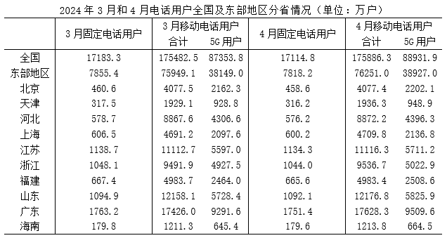

# 现期比重构成判断（饼图份额匹配，含间接求'其他'部分）

考点：[[20-考点/资料分析/比重/现期比重构成判断（饼图份额匹配，含间接求'其他'部分）|比重 / 现期比重构成判断（饼图份额匹配，含间接求'其他'部分）]]
材料：[[15-材料/资料分析/4857278 2024年3月和4月我国电话用户数统|4857278 2024年3月和4月我国电话用户数统]]

**问法模型**：'饼状图最能准确反映……比例关系'→ 先用'其他=全国-东部-西部'补齐三部分，再分别算现期比重，按占比区间（是否过半、是否超1/4、超1/3）与选项扇区匹配

## 推理链
1. 第1步：定位表格取2024年4月数据：全国固定电话17114.8万户、东部地区7818.2万户；题干补充西部地区5324.4万户
2. 第2步：'其他地区'材料未直接给出，用全国行间接求：17114.8-7818.2-5324.4=3972.2万户
3. 第3步：求各部分比重：东部7818.2/17114.8≈45.7%（约46%），西部5324.4/17114.8≈31.1%（约31%），其他3972.2/17114.8≈23.2%（约23%）
4. 第4步：东部占比不足50%，排除C项；西部占比约31%，介于1/4（25%）与1/3（33%）之间且明显超过1/4，排除A、B项
5. 第5步：D项扇区比例约46%:31%:23%（角度约166°:112°:82°），与计算结果吻合，故选D

**最快解法**：⚡ 特殊分数区间法（百化分）+截位直除：17114.8的一半≈8557＞7818.2，东部<50%排C；17114.8×30%≈5134＜5324.4＜17114.8/3≈5705，西部在30%~33%且明显＞25%排A、B；再用3972.2/17114.8≈23%＜25%验证'其他'为最小扇区，直接锁定D

## 易错点
- ⚠ 分母层级错配：必须用'全国'行17114.8作分母、'东部'汇总行7818.2作分子，勿误把东部行当全国或拿省份数值参与比重
- ⚠ '其他地区'是间接量：材料只给全国与东部，西部由题干补充，需做'全国-东部-西部'三步减法，易漏用全国行或只算东部/西部两块
- ⚠ 饼图判断只看排序不看份额：三块大小顺序为东>西>其他，但A、B等干扰项同样是'东>西>其他'，必须用46%:31%:23%与1/2、1/3、1/4的相对关系甄别扇区大小（31%≠接近25%）

## 母题抽象
> 🧩 当题干出现'饼状图最能准确反映……比例关系'且只给部分量时，先用'总量-已知部分'补齐剩余扇区，再对各部分占比做特殊分数区间判断（是否过半、是否过1/4、1/3），与选项扇区面积匹配即得答案

**同类特征**：饼状图/扇形图比例关系、现期比重构成、'其他'需用全国减已知部分间接求、题干额外补充一个部分量（西部5324.4万户）、2024年4月存量口径、单位万户、比值为百分数

## 相关题
（暂无）

---

### 题干
已知2024年4月我国西部地区固定电话用户数为5324.4万户，以下饼状图中，最能准确反映2024年4月我国东部地区（斜线）、西部地区（白色）和其他地区（灰色）固定电话用户数比例关系的是：

### 选项
- A. A
- B. B
- C. C
- D. D　✅

### 官方解析
根据题干“已知2024年4月我国······最能准确反映······比例关系的是”，结合材料时间为2024年4月，可判定本题为现期比重问题。定位统计表可得，2024年4月全国固定电话用户数17114.8万户，东部地区7818.2万户；结合题干可得，2024年4月西部地区固定电话用户数5324.4万户。根据公式：比重，则东部地区占比，占比不足，排除C项；西部地区占比，占比不足，且明显大于，排除A、B两项，D项当选。
故正确答案为D。

### 给定材料

