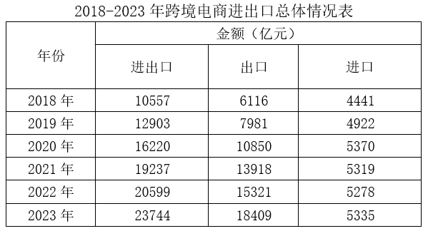

# 现期比重反推整体后求差值（货物贸易顺差=出口整体−进口整体）

考点：[[20-考点/资料分析/比重/现期比重反推整体后求差值（货物贸易顺差=出口整体−进口整体）|比重 / 现期比重反推整体后求差值（货物贸易顺差=出口整体−进口整体）]]
材料：[[15-材料/资料分析/5627209 2023年我国跨境电商进出口的规模、|5627209 2023年我国跨境电商进出口的规模、]]

**问法模型**：题干问'货物贸易顺差在哪个区间'，而材料只给'跨境电商出口/进口额+占货物贸易出口/进口总值的比重' → 用'整体=部分÷比重'分别反推货物贸易出口总额与进口总额，再作差对照区间

## 推理链
1. 第1步：从文字材料第一段提取：2023年跨境电商出口约1.84万亿元（表格精确值18409亿元），占同期我国出口总值的7.7%；跨境电商进口5335.2亿元，占同期我国进口总值的3%
2. 第2步：明确口径——跨境电商出口/进口是货物贸易出口/进口的'部分'，所给比重均为现期比重，故用整体=部分÷比重还原；顺差=货物贸易出口总额−货物贸易进口总额
3. 第3步：反推出口整体：18409亿元÷7.7%≈23.9万亿元（约1.84万亿×13≈23.9万亿）
4. 第4步：反推进口整体：5335.2亿元÷3%≈17.8万亿元（5335亿×33.3≈17.78万亿）
5. 第5步：作差求顺差：23.9万亿−17.8万亿≈6.1万亿元
6. 第6步：与选项对照：6.1万亿元落在5-7万亿元区间，故选C

**最快解法**：⚡ 公式法（部分÷比重反推整体）+截位直除+百化分：7.7%≈1/13，出口整体≈1.84万亿×13≈23.9万亿；3%=1/33.3，进口整体≈5335亿×33.3≈17.8万亿；作差≈6.1万亿，直接锁定C（5-7万亿元）

## 易错点
- ⚠ 量级跳升陷阱：部分为'亿元/万亿级'，除以3%、7.7%后整体跳升至十几万亿元级（如5335亿÷3%≈17.8万亿），切勿因数值突变误判小数点错位
- ⚠ 单位混用：文字'万亿元'与表格'亿元'混用，5335.2亿元=0.5335万亿元，作差时必须统一量纲，否则差值错一个数量级
- ⚠ 路径误选：误用'占货物贸易进出口总值5.7%'先反推进出口整体再拆分，绕远且还需拆分比重；直接用7.7%与3%分别反推再作差最快；另勿将7.7%与3%的百分点之差当作顺差比重直接套用

## 母题抽象
> 🧩 当题干给出'部分值+部分占整体A的比重+部分值+部分占整体B的比重'并求A与B的差值（顺差/差额/差多少区间）时，用'整体=部分÷比重'分别还原两个整体再作差，以截位直除+统一万亿元量纲验证落点区间

**同类特征**：货物贸易顺差在（区间型选项）、占同期我国出口总值的7.7%、占同期我国进口总值的3%、部分值+比重反推整体、万亿元/亿元量纲换算、文字段与统计表跨段拼接

## 相关题
（暂无）

---

### 题干
2023年，我国货物贸易顺差在：

### 选项
- A. 3万亿元以内
- B. 3-5万亿元
- C. 5-7万亿元　✅
- D. 7万亿元以上

### 官方解析

根据题干“2023年，我国货物贸易顺差在”，结合材料“2023年······出口······占同期我国出口总值的······，进口······占同期我国进口总值的······”，可判定本题为现期比重问题。定位文字材料第一段可得：（2023年）出口约1.84万亿元，占同期我国出口总值的7.7%，进口约5335.2亿元，占同期我国进口总值的3%。根据公式：整体，顺差=出口额-进口额，则所求，在C项范围内。

故正确答案为C。

### 给定材料

        2023年，我国跨境电商进出口2.37万亿元人民币，比2022年（下同）增长15.3%，占同期我国货物贸易进出口总值的5.7%，比重提升0.8个百分点。其中，出口约1.84万亿元，增长20.2%，占同期我国出口总值的7.7%，进口约5335.2亿元，增长1.1%，占同期我国进口总值的3%。

        从出口目的地看，美国（37.4%）、英国（8.7%）、德国（4.7%）、俄罗斯（4.6%）、法国（3.7%），合计占出口总额近6成；泰国（2.5%）、越南（2.4%）、马来西亚（2.4%）、澳大利亚（2.1%）等新兴市场活跃。美国（15.6%）、日本（13.5%）、澳大利亚（11.2%）、法国（7.9%）、韩国（7.2%）、新西兰（7%）、德国（6.4%）、意大利（3.6%）、英国（3.4%）、荷兰（3.3%）是主要进口来源地。

