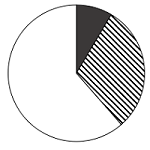

# 现期比重结构与饼图匹配（部分占比比较-倍数排除）

考点：[[20-考点/资料分析/比重/现期比重结构与饼图匹配（部分占比比较-倍数排除）|比重 / 现期比重结构与饼图匹配（部分占比比较/倍数排除）]]
材料：[[15-材料/资料分析/4538641 2019年全国群众文化机构统计公报式|4538641 2019年全国群众文化机构统计公报式]]

**问法模型**：题干要求选出最能准确反映三类人员（高级/中级/其他）占比结构的饼图 → 先用'总数−已知部分'求其他人员，再算各部分占比或两两倍数，按扇形大小逐项排除

## 推理链
1. 第1步：从文字材料第一段提取现期数据：2019年末从业人员190068人，其中高级职称6675人（黑色）、中级职称17503人（斜线）
2. 第2步：其他人员（白色）=总数−高级−中级=190068−6675−17503=165890人
3. 第3步：计算三块占比：高级6675/190068≈3.5%，中级17503/190068≈9.2%，其他165890/190068≈87.3%
4. 第4步：比较关键倍数：中级/高级=17503/6675≈2.62倍，介于2倍与3倍之间（高级黑色占比最小）
5. 第5步：对照选项：斜线不足黑色2倍的排除B、C；斜线达黑色3倍（即白色占比明显低于87%）的排除A，锁定D

**最快解法**：⚡ 倍数排除法（免算比重免算角度）：直接算17503÷6675≈2.6倍，斜线扇形应为黑色的2~3倍且黑色最小，唯一满足的是D；可再验算其他人员占比165890/190068≈87%作双保险

## 易错点
- ⚠ 其他人员不能从图中直接读数，必须做减法190068−6675−17503=165890；黑色（约3.5%）与斜线（约9.2%）扇形极小，易被视觉误导认为占比更大或差不多
- ⚠ 仅凭'中级明显大于高级'的粗略直觉无法区分四个选项，必须精确判断倍数落在2~3倍区间（>2倍排B、C，<3倍排A）
- ⚠ 时间口径：题干为2019年末现期数据，'比上年末增加4431人'是干扰信息，勿误推基期185637人再算比重

## 母题抽象
> 🧩 当题干出现'饼图中最能准确反映各部分占比'特征时，不求每块精确比重，而是求关键两部分的倍数（或部分÷总体）与阈值（2倍、50%等）比较，逐项排除选项验证答案

**同类特征**：饼图占比匹配、高级职称（黑色）、中级职称（斜线）、其他人员（白色）、2019年末现期比重、最能准确反映

## 相关题
- [[10-真题/资料分析/增长/16593068 增长量比较（多期同比增量趋势与柱状图匹配）|16593068]]（甘肃 2024，相关度1）
- [[10-真题/资料分析/比重/16593075 现期比重计算与饼图占比关系判断（排除法）|16593075]]（海南 2024，相关度1）
- [[10-真题/资料分析/比重/19283765 现期比重结构比较（饼图匹配）|19283765]]（国考 2025，相关度1）
- [[10-真题/资料分析/比重/2393936 现期比重计算（三年数据占合计比重＋饼图匹配）|2393936]]（青海 2019，相关度1）
- [[10-真题/资料分析/比重/2571801 基期比重还原（百分点变化反推）+饼图匹配|2571801]]（山东 2020，相关度1）

---

### 题干
以下饼图中，最能准确反映2019年末全国群众文化机构从业人员中，具有高级职称的人员（黑色）、具有中级职称的人员（斜线）及其他人员（白色）占比情况的是（    ）。

### 选项
- A. 

- B. 

- C. 

- D. 

　✅

### 官方解析

根据题干“以下饼图中，最能准确反映2019年末······占比情况的是”，结合材料时间为2019年末，可判定本题为现期比重问题。定位文字材料第一段可知：2019年末，全国群众文化机构从业人员190068人，比上年末增加4431人。其中具有高级职称的人员6675人，具有中级职称的人员17503人。

方法一：其他人员有190068-（6675+17503）=165890人。比较可知，高级职称的人员数（黑色）最少，排除B、C两项；根据公式：比重，可知其他人员占比为，排除A项。

方法二：倍。根据中级职称人员数（斜线）和高级职称人员数（黑色）倍数大于2倍，排除B、C两项；同时倍数小于3倍，排除A项。

故正确答案为D。

### 给定材料

        2019年末，全国共有群众文化机构44073个，比上年末减少391个。其中乡镇综合文化站33530个，比上年末减少328个。年末全国群众文化机构从业人员190068人，比上年末增加4431人。其中具有高级职称的人员6675人，具有中级职称的人员17503人。

        2019年末，全国群众文化机构实际使用房屋建筑面积4518.18万平方米，比上年末增长5.5%；业务用房面积3295.21万平方米，比上年末增长4.7%。年末全国平均每万人群众文化设施建筑面积322.72平方米，比上年末提高15.77平方米。

