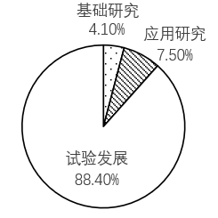
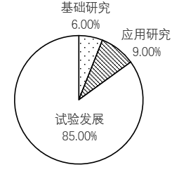
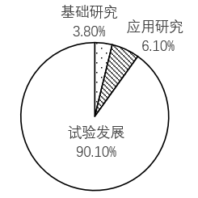
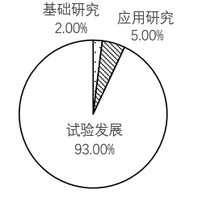

# 基期比重计算（饼图比例范围对照）

考点：[[20-考点/资料分析/比重/基期比重计算（饼图比例范围对照）|比重 / 基期比重计算（饼图比例范围对照）]]
材料：[[15-材料/资料分析/3798418 某省2022年R&D经费投入统计公报|3798418 某省2022年R&D经费投入统计公报]]

**问法模型**：题干问'2021年各活动类型的比例范围'→ 用基期比重公式：基期比重=现期比重×(1+总量增速)/(1+分量增速)，逐项求2021年占比后对照图形选项区间

## 推理链
1. 第1步：从材料提取总量与分量增速——2022年全省R&D经费2180.4亿元、同比增长12.1%（总量增速b）；基础研究89.5亿元（+21.4%）、应用研究163.8亿元（+37.2%）、试验发展1927.1亿元（+10.0%），2022年三者比重分别为4.1%、7.5%、88.4%
2. 第2步：判定题型为基期比重，公式为：基期比重=现期比重×(1+b)/(1+a)，a为各活动类型自身增速
3. 第3步：定性判向——基础研究21.4%、应用研究37.2%均大于总量增速12.1%，其2021年比重应低于现期（4.1%、7.5%以下）；试验发展10.0%小于12.1%，其2021年比重应高于88.4%
4. 第4步：代入精算基础研究：4.1%×1.121/1.214≈4.1%×0.923≈3.8%；应用研究：7.5%×1.121/1.372≈7.5%×0.817≈6.1%；试验发展：88.4%×1.121/1.100≈88.4%×1.019≈90.1%
5. 第5步：自洽验证——3.8%+6.1%+90.1%≈100%，符合三类之和为总体的口径
6. 第6步：与选项对照——基础研究约3.8%（低于4.1%）、应用研究约6.1%、试验发展约90.1%（高于88.4%），仅C项的区间范围与之吻合，故选C

**最快解法**：⚡ 基期比重公式法+增速比较定性排除：先看a与b的大小定升降（21.4%、37.2%>12.1%则基础/应用比重下降，10.0%<12.1%则试验发展比重上升至90%左右），再只精算一项——4.1%×1.121/1.214（截位直除1.121/1.214≈0.92）≈3.8%，对照选项中基础研究落在3.5%~4%区间的图形，直接锁定C

## 易错点
- ⚠ 现期当基期：4.1%/7.5%/88.4%是2022年比重，直接按此选图必错
- ⚠ 升降方向搞反：分量增速大于总量增速时基期比重应更小、小于时基期比重应更大，方向记反会选中与C相反的图
- ⚠ 增速张冠李戴与口径混淆：三类活动各有不同增速（21.4%/37.2%/10.0%），不能统一用12.1%；同时'提高x个百分点'不可当作增速代入公式

## 母题抽象
> 🧩 当题干出现'基期（上年）+各部分比重/比例范围'且选项为区间图时，用基期比重公式 现期比重×(1+总量增速)/(1+分量增速)，先按a与b大小定升降缩小范围，再精算一项对照选项区间验证

**同类特征**：基期时间（2021年）、各活动类型的比例范围、现期比重4.1%、7.5%、88.4%、分量增速与总量增速对比（21.4%/37.2%/10.0% vs 12.1%）、图形选项需区间对照、三类比重之和为100%可作验证

## 相关题
- [[10-真题/资料分析/增长/5514954 基期量计算（含单位换算）|5514954]]（广东 2023，相关度1）
- [[10-真题/资料分析/增长/10204588 基期和差计算（分别还原基期量再作差）|10204588]]（青海 2024，相关度1）

---

### 题干
以下哪个选项能够反映2021年各活动类型的比例范围？

### 选项
- A. 

- B. 

- C. 

　✅
- D. 

### 官方解析
根据题干“······2021年各活动类型的比例范围”，结合材料时间为2022年，可判定本题为基期比重问题。定位文字材料第一段可得：2022年，全省R&D经费投入比上年增长12.1%（b）；定位文字材料第二段可得：（2022年）分活动类型看，全省基础研究经费比上年增长21.4%（）；应用研究经费增长37.2%()；试验发展经费增长10.0%()。基础研究、应用研究、试验发展经费所占比重分别为4.1%、7.5%和88.4%。根据公式：基期比重，可得2021年基础研究占比，只有C项符合。
故正确答案为C。

### 给定材料

        2022年，全省R&amp;D经费投入达到2180.4亿元，比上年增长12.1%；全省R&amp;D经费投入强度（R&amp;D经费与地区生产总值之比）达到2.49%，比上年提高0.14个百分点。

       分活动类型看，全省基础研究经费89.5亿元，比上年增长21.4%；应用研究经费163.8亿元，增长37.2%；试验发展经费1927.1亿元，增长10.0%。基础研究、应用研究、试验发展经费所占比重分别为4.1%、7.5%和88.4%。

       分活动主体看，企业R&amp;D经费1943.2亿元，比上年增长11.3%；政府属研究机构R&amp;D经费79.1亿元，增长0.3%；高等学校R&amp;D经费114.3亿元，增长20.5%；其他主体R&amp;D经费43.8亿元，增长74.9%。企业、政府属研究机构、高等学校R&amp;D经费所占比重分别为89.1%、3.6%和5.2%。

        分行业看，规模以上工业企业R&amp;D经费投入为1728.7亿元，增长10.4%；其中高技术制造业R&amp;D经费363.6亿元，增长33.7%。规模以上工业企业R&amp;D经费投入强度（R&amp;D经费与营业收入之比）为1.59%，比上年提高0.08个百分点；其中高技术制造业投入强度达到3.86%，提高0.47个百分点。规模以上工业企业R&amp;D经费投入超过100亿元的行业大类有6个，分别为化学原料和化学制品制造业，计算机、通信和其他电子设备制造业，医药制造业，通用设备制造业，专用设备制造业，电气机械和器材制造业。这6个行业的R&amp;D经费占全部规模以上工业企业的比重为50.2%。

        分地区看，R&amp;D经费投入超过100亿元的市有8个，依次是青岛（400.2亿元）、济南（346.8亿元）、烟台（197.5亿元）、潍坊（169.1亿元）、临沂（129.6亿元）、淄博（129.4亿元）、滨州（110.7亿元）、德州（109.0亿元）。R&amp;D经费投入强度超过全省平均水平的市有10个，依次为滨州（3.72%）、日照（3.14%）、聊城（3.13%）、德州（3.00%）、淄博（2.94%）、济南（2.88%）、青岛（2.68%）、泰安（2.63%）、威海（2.55%）、东营（2.53%）。

