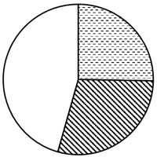
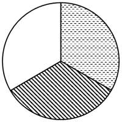

# 现期比重比较（同分母比重排序+图示验证）

考点：[[20-考点/资料分析/比重/现期比重比较（同分母比重排序+图示验证）|比重 / 现期比重比较（同分母比重排序+图示验证）]]
材料：[[15-材料/资料分析/6108424 2023年我国机电产品进出口总体规模|6108424 2023年我国机电产品进出口总体规模]]

**问法模型**：题干问'柴油机、汽油机和其他内燃机出口额占内燃机出口总额比重的大小关系'并配图示 → 三者分母相同（均为内燃机出口总额52.2亿美元），比重排序等价于分子金额排序，再验证最大项占比量级排除图示细节错误

## 推理链
1. 第1步：定位统计表提取数据：2023年内燃机出口总额52.2亿美元，柴油机出口13.2亿美元、汽油机15.2亿美元、其他23.8亿美元，且13.2+15.2+23.8=52.2，确认分母应取'内燃机'行52.2而非'合计'行223.4
2. 第2步：三者比重公式均为'分子÷52.2'，分母完全相同，故比重的大小关系等价于分子（出口额）的大小关系，无需逐个计算比重
3. 第3步：直接比较分子：其他23.8＞汽油机15.2＞柴油机13.2，故比重排序为其他＞汽油机＞柴油机，排除排序不符的B、C两项
4. 第4步：验证最大项占比量级：其他占比=23.8÷52.2≈45.6%，因分母一半为52.2÷2=26.1＞23.8，故其他占比不足50%（不到一半）
5. 第5步：D项图示中其他占比与45.6%（不足一半）不符，排除D；A项图示满足'其他＞汽油机＞柴油机且其他占比不足一半'，故选A

**最快解法**：⚡ 同分母比重比较+半分母法：分母同为52.2，直接比分子得其他23.8＞汽油机15.2＞柴油机13.2，秒排B、C；再用'分子 vs 分母一半'心算：23.8＜26.1=52.2÷2，其他占比<50%，据此排除把最大块画成过半的D，锁定A，全程无需精算比重

## 易错点
- ⚠ 分母层级锁定错误：误把'合计'出口223.4亿美元当分母（正确分母是'内燃机'行52.2亿美元，恰等于13.2+15.2+23.8，可自检），223.4是内燃机+零部件118.3+发电机组52.9的大合计
- ⚠ 思维定势多算：习惯性地把三个比重13.2/52.2、15.2/52.2、23.8/52.2逐个除出来再比较，实际同分母时比重排序=分子排序，直除纯属浪费时间
- ⚠ 图示细节陷阱：即便排序对，图示中最大项的占比画法可能错——其他占比≈45.6%不足一半，若选项图将'其他'画成超过一半（如D项）即为错，排序+量级需双重验证

## 母题抽象
> 🧩 当题干出现'几个部分占同一整体比重大小关系（图示/排序）'特征时，先确认各部分分母相同且加和等于整体（防层级取错），则比重排序等价于分子排序直接比分子，再用'最大分子 vs 分母一半'判断最大占比是否过半以排除图示量级错误的选项

**同类特征**：占内燃机出口总额比重、大小关系、图示正确的是、现期比重比较、柴油机、汽油机、其他、同分母

## 相关题
- [[10-真题/资料分析/比重/10204607 现期比重比较（与1-3判定，分母需由累计值差分）|10204607]]（辽宁 2024，相关度1）
- [[10-真题/资料分析/比重/18643847 现期比值计算与百分点差值比较（资产负债率=总负债÷总资产）|18643847]]（四川 2026，相关度1）
- [[10-真题/资料分析/比重/19283749 现期比重比较（逐组求比重比大小）|19283749]]（国考 2025，相关度1）
- [[10-真题/资料分析/比重/2042810 现期比重比较（子口径占全口径比重，逐部计数判断）|2042810]]（江苏 2017，相关度1）
- [[10-真题/资料分析/比重/2052082 现期比重比较|2052082]]（吉林 2017，相关度1）

---

### 题干
对于2023年我国柴油机、汽油机和其他内燃机出口额占内燃机出口总额比重的大小关系，下列图示正确的是：

### 选项
- A. 

　✅
- B. 

- C. 

- D. 

### 官方解析

根据题干“对于2023年······占······比重······”，结合材料时间为2023年，可判定本题为现期比重问题。定位统计表可得：2023年，我国内燃机出口总额为52.2亿美元，柴油机、汽油机和其他内燃机出口额分别为13.2亿美元、15.2亿美元、23.8亿美元。比较可知，其他内燃机出口额明显最大，排除B、C两项；根据公式：比重，则其他内燃机出口额占比，排除D项。

故正确答案为A。

### 给定材料

        2023年我国机电产品进出口总额29025亿美元，比上年增长0.1%，占货物进出口总额的比重为49.0%。其中，出口19750亿美元，增长2.6%，占货物出口总额的比重为58.5%；进口9275亿美元，下降5.5%，占货物进口总额的比重为36.3%。

