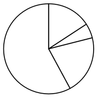
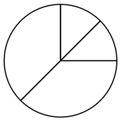

# 现期比重计算与饼图结构匹配（含单位换算与'其他'类补齐）

考点：[[20-考点/资料分析/比重/现期比重计算与饼图结构匹配（含单位换算与'其他'类补齐）|比重 / 现期比重计算与饼图结构匹配（含单位换算与'其他'类补齐）]]
材料：[[15-材料/资料分析/4478979 深圳市10个区（新区）的耕地、湿地、|4478979 深圳市10个区（新区）的耕地、湿地、]]

**问法模型**：题干给'若大鹏新区陆域面积为287平方公里'这一补充总量，问哪幅饼图最能准确反映四类土地占比结构 → 先统一单位算出'其他'类面积，再算四类比重与饼图扇区大小逐一匹配排除

## 推理链
1. 第1步：从图1读大鹏新区数据：耕地285公顷、湿地889公顷、林地22446公顷；从题干提取补充条件：陆域面积287平方公里
2. 第2步：单位换算（1平方公里=100公顷）：陆域面积=287×100=28700公顷；'其他类型'土地=28700-285-889-22446=5080公顷，饼图须含4个扇区
3. 第3步：代入比重公式计算：林地22446/28700≈78.2%，其他5080/28700≈17.7%，湿地889/28700≈3.1%，耕地285/28700≈1.0%
4. 第4步：定性排除：林地78.2%>75%（超过圆的3/4），排除林地扇区明显不足3/4的A、C两项；D项未包含4个区域扇区，排除D
5. 第5步：B项林地约占3/4强、其他约1/6强、湿地与耕地均为细小扇区，与计算所得结构（78.2%/17.7%/3.1%/1.0%）一致，故选B

**最快解法**：⚡ 排除法+特殊分数基准：算28700×3/4=21525<22446，林地占比必超3/4，直接锁定唯一林地扇区大于3/4的选项B；辅助用'饼图须含4个扇区'先排D，全程无需精确算出四个比重

## 易错点
- ⚠ 单位陷阱：题干给平方公里（287）、图1为公顷，须×100换算为28700公顷，不换算则四类比重全部错乱
- ⚠ 漏算'其他类型'：陆域总面积包含未单列的其他土地，28700-285-889-22446=5080公顷是饼图第4扇区，不能只把三类已知面积当整体
- ⚠ 口径混淆：图2是全市湿地内部构成（沿海滩涂86.54%等），与本题单区四类土地结构无关，切勿套用；另3D柱状图中深灰柱才是林地（22446），勿串系列读数

## 母题抽象
> 🧩 当题干出现'若某区域总面积为…（单位与统计图不一致）+选择饼图反映占比结构'时，先统一单位、用'其他=总面积-已知各部分之和'补齐扇区，再以主导类占比对照特殊分数（1/2、3/4等）做排除，即可锁定答案

**同类特征**：若…面积为…（题干补充假设条件）、最能准确反映…占比结构、饼图匹配、平方公里与公顷单位换算、含'其他类型'的四分结构、存量截面数据

## 相关题
（暂无）

---

### 题干
若大鹏新区陆域面积为287平方公里，则以下饼图中，最能准确反映该区耕地、湿地、林地及其他类型土地面积占比结构的是：

### 选项
- A. 

- B. 

　✅
- C. 

- D. 

### 官方解析

根据题干“······最能准确反映······占比结构的是”，可判定本题为现期比重问题。定位图1可知：大鹏新区耕地、湿地、林地面积分别为285公顷、889公顷、22446公顷。由于1平方公里=100公顷，则大鹏新区陆域面积为287×100=28700公顷，其他类型土地面积为28700-285-889-22446=5080公顷。根据饼图中需要包含4个区域的面积，排除D项；根据公式：比重，则大鹏新区林地面积占其陆域面积的比重为，即所占比重超过，排除A、C两项。

故正确答案为B。

### 给定材料

