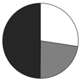

# 现期比重饼图识别（结构占比比较+排除法）

考点：[[20-考点/资料分析/比重/现期比重饼图识别（结构占比比较+排除法）|比重 / 现期比重饼图识别（结构占比比较+排除法）]]
材料：[[15-材料/资料分析/6362453 2024年1-6月T市自行车出口情况|6362453 2024年1-6月T市自行车出口情况]]

**问法模型**：题干问'饼图最能准确反映……比例关系'→转化为现期比重问题：先按各部分现期值排大小排除选项，再用'部分之和÷总量'的关键占比（约50%）二次排除验证

## 推理链
1. 第1步：从文字材料提取2024年1-6月累计口径数据：对东盟出口213.4万辆、对日本出口176.6万辆
2. 第2步：从统计表合计行提取T市1-6月出口总量778.3万辆（整体量）
3. 第3步：求第三部分：其他国家=778.3-213.4-176.6=388.3万辆
4. 第4步：排大小：东盟213.4＞日本176.6且均小于其他国家388.3，即白色扇区＞灰色扇区、黑色最大，排除东盟不大于日本的C、D两项
5. 第5步：算关键占比：(213.4+176.6)÷778.3=390.0÷778.3≈50.1%，白色+灰色合计应约占饼图一半（黑色约占49.9%）
6. 第6步：对照选项：B项白色+灰色合计明显不占约一半，排除B，A项符合，故选A

**最快解法**：⚡ 排除法+截位估算：第一步只比大小——东盟213.4＞日本176.6，白色＞灰色，秒杀排除C、D；第二步算'东盟+日本'合计占比——390÷778.3≈50%（约一半），凡白色+灰色不合计占半圆的排除，锁定A

## 易错点
- ⚠ 口径陷阱：'其他国家'=总量778.3-东盟213.4-日本176.6=388.3万辆，勿误用文字段中企业类型维度的'其他企业11.6万辆'冒充目的地维度的'其他国家'，两者是不同口径
- ⚠ 总量取数：整体量必须用统计表合计行778.3万辆（跨文字+表格拼数据），勿误用某一单月数据
- ⚠ 时间口径：题干限2024年1-6月为现期，直接用现期出口量比较，无需也不应求基期值；图中颜色与地区对应关系（白=东盟、灰=日本、黑=其他国家）需先锚定再比较

## 母题抽象
> 🧩 当题干出现'饼图最能反映……比例关系'特征时，用排除法：先用各部分现期值排大小（谁大谁小）排除明显不符项，再算'某几部分之和÷总量'的近似占比（如≈50%、≈1/4）做二次验证，无需精确计算各扇区角度

**同类特征**：饼图、最能准确反映……比例关系、东盟（白色）、日本（灰色）和其他国家（黑色）、2024年1-6月、现期比重、部分与整体（需自求'其他国家'）

## 相关题
- [[10-真题/资料分析/比重/4637459 现期比重计算与饼图占比对照|4637459]]（国考 2022，相关度2）
- [[10-真题/资料分析/比重/4792819 现期比重计算（多部分比重依次求解）|4792819]]（新疆 2014，相关度1）
- [[10-真题/资料分析/比重/827355 现期比重比较（部分占比过半速判）|827355]]（政法干警 2014，相关度1）
- [[10-真题/资料分析/比重/2272297 现期比重比较|2272297]]（选调 2015，相关度1）
- [[10-真题/资料分析/比重/2032972 现期比重计算（多地区占比求和）|2032972]]（吉林 2015，相关度1）

---

### 题干
以下饼图中，最能准确反映2024年1-6月T市对东盟（白色）、日本（灰色）和其他国家（黑色）出口量比例关系的是：

### 选项
- A. 

　✅
- B. 

- C. 

- D. 

### 官方解析
根据题干“以下饼图中，最能准确反映2024年1-6月······比例关系的是”，结合材料时间为2024年1-6月，可判定本题为现期比重问题。定位文字材料可得：2024年1-6月，T市对东盟、日本分别出口自行车213.4万辆、176.6万辆。则对东盟出口量（213.4万辆）&gt;对日本出口量（176.6万辆），排除C、D两项。定位统计表可得：2024年1-6月，T市自行车出口量为778.3万辆。可得T市对东盟和日本出口量之和所占的比重为，排除B项，A项当选。
故正确答案为A。

### 给定材料

        2024年1-6月，T市出口自行车占同期全国自行车出口比重为33.6%，位居全国首位。其中，民营企业出口414.9万辆，同比增加27.8%；国有企业出口351.8万辆，同比增加6.9%；其他企业出口11.6万辆。对东盟、日本分别出口213.4万辆、176.6万辆，同比分别增加4.9%、5.3%；对美国出口115.3万辆，同比增加10.1%。

