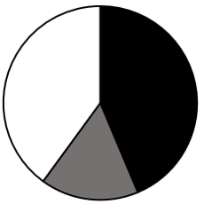
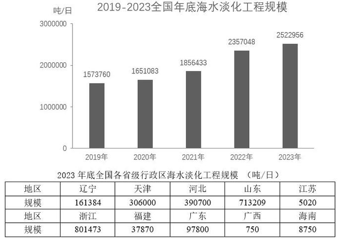

# 现期比重计算与饼图图形判断

考点：[[20-考点/资料分析/比重/现期比重计算与饼图图形判断|比重 / 现期比重计算与饼图图形判断]]
材料：[[15-材料/资料分析/7148419 2019-2023年全国年底海水淡化|7148419 2019-2023年全国年底海水淡化]]

**问法模型**：题干问'哪个饼图最能准确反映各部分占全国比重' → 现期比重模型：算出各部分占比与部分间倍数关系，再对照选项扇区相对大小排除

## 推理链
1. 第1步：从柱状图读取2023年底全国海水淡化工程规模2522956吨/日；从统计表准确定位浙江801473吨/日、山东713209吨/日（表格排列非按规模排序，勿取错行）
2. 第2步：先用'部分÷部分'倍数关系比较黑色与灰色：801473÷713209≈1.12，即黑色（浙江）约为灰色（山东）的1.1倍，两者仅相差约3.5个百分点（31.8% vs 28.3%）
3. 第3步：据黑色≈灰色1.1倍，排除黑色与灰色差距明显偏离1.1倍的A、B两项
4. 第4步：再用'部分之和÷整体'验证整体结构：(801473+713209)÷2522956=1514682÷2522956≈60.0%，黑色+灰色合计超过一半
5. 第5步：据黑+灰≈60%＞50%、白色（其余省）≈40%，排除黑灰合计不过半的C项，与D图扇区结构吻合，选D

**最快解法**：⚡ 倍数排除法+半圆判断：截位直除801473/713209≈1.1倍定黑灰相对大小（排除A、B）；再算(801473+713209)/2522956≈60%＞50%定黑灰合计过半（排除C），两步即得D，无需算出精确比重

## 易错点
- ⚠ 统计表省份排列非按规模大小排序，浙江（801473）与山东（713209）不能按表格顺序想当然取数，须先在实际规模排序（浙江＞山东＞河北＞天津＞辽宁…）中定位
- ⚠ 浙江与山东占比极接近（约31.8%与28.3%，仅差3.5个百分点），四个饼图选项差异细微，不能目测扇区大小，必须算出黑/灰≈1.1倍的倍数关系
- ⚠ 只比较黑灰倍数会漏排除C，还需验证'黑+灰是否过半'（60%＞50%）这一整体结构约束；同时数值为百万级，作商时注意位数避免量级错误

## 母题抽象
> 🧩 当题干出现'哪个饼图最能准确反映各部分占整体比重'时，先用部分/部分的倍数关系排除扇区大小明显不符的选项，再用部分之和/整体是否过半定剩余选项，全程用截位直除而非精算比重

**同类特征**：以下饼图中最能准确反映、占全国比重、现期比重、黑色/灰色/白色区域、部分间倍数关系、2023年底

## 相关题
- [[10-真题/资料分析/比重/5509785 现期比重结构判断（饼图识别，部分间倍数与占比分界排除）|5509785]]（四川 2023，相关度3）
- [[10-真题/资料分析/比重/10297102 现期比重计算（区间判断型）|10297102]]（天津 2025，相关度2）
- [[10-真题/资料分析/比重/13504527 现期比重计算（排序取前五求和后求占比）|13504527]]（贵州 2025，相关度2）
- [[10-真题/资料分析/比重/4792819 现期比重计算（多部分比重依次求解）|4792819]]（新疆 2014，相关度1）
- [[10-真题/资料分析/比重/827355 现期比重比较（部分占比过半速判）|827355]]（政法干警 2014，相关度1）

---

### 题干
以下饼图中，最能准确反应2023年底浙江（黑色），山东（灰色）和其他省级行政区（白色）海水淡化工程规模占全国比重的是：

### 选项
- A. 

- B. 

- C. 

- D. 

　✅

### 官方解析
根据题干“以下饼图中，最能准确反应2023年底······占全国比重的是”，结合材料时间为2023年底，可判定本题为现期比重问题。定位统计图可得：2023年底全国海水淡化工程规模2522956吨/日；定位统计表可得：2023年底浙江、山东海水淡化工程规模分别为801473吨/日、713209吨/日，则，即黑色区域约是灰色区域的1.1倍，排除A、B两项。根据公式：比重，则2023年浙江、山东海水淡化工程规模之和占全国比重，即黑色区域和灰色区域占比之和超过，排除C项。
故正确答案为D。

### 给定材料

        截至2023年底，全国现有海水淡化工程156个，同比增加了6个。其中，万吨级及以上海水淡化工程55个，工程规模2300723吨/日，千吨及以上万吨级以下海水淡化工程51个，工程规模208266吨/日，千吨级以下海水淡化工程50个，全国海水淡化工程分布点10个省级行政区。

