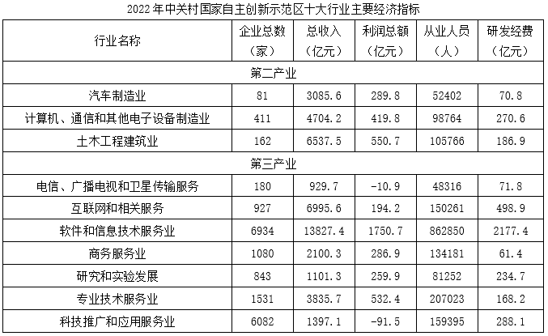

# 现期比值比较（研发经费÷总收入，两列相除取最大）

考点：[[20-考点/资料分析/比重/现期比值比较（研发经费÷总收入，两列相除取最大）|比重 / 现期比值比较（研发经费÷总收入，两列相除取最大）]]
材料：[[15-材料/资料分析/4773228 2022年中关村国家自主创新示范区十|4773228 2022年中关村国家自主创新示范区十]]

**问法模型**：题干出现'2022年研发经费与总收入比值最高的是'→现期比值比较模型：逐项定位两列数据，比值=研发经费÷总收入，做除法后取最大

## 推理链
1. 第1步：从统计表定位四个选项行业的'研发经费'与'总收入'两列数据（单位均为亿元）：汽车制造业70.8/3085.6，土木工程建筑业186.9/6537.5，互联网和相关服务498.9/6995.6，商务服务业61.4/2100.3
2. 第2步：模型为现期比值=研发经费÷总收入，四个选项分别做除法比较（表中未给该比率，需自行两列相除）
3. 第3步：截位直除取首位商：A项70.8/3085.6≈2.3%（首位2）；B项186.9/6537.5≈2.9%（首位2）；C项498.9/6995.6≈7.1%（首位7）；D项61.4/2100.3≈2.9%（首位2）
4. 第4步：C项首位商'7'远大于其余三项的'2'，无须精算即锁定最高；亦可用'分子倍数差>分母倍数差'判定：C的分子498.9为其余分子(70.8/186.9/61.4)的2.7~8倍，而分母6995.6仅为D分母2100.3的约3.3倍、与其余同量级，故C比值必最大
5. 第5步：与选项对照，比值最高者为C互联网和相关服务，与官方答案C一致

**最快解法**：⚡ 截位直除法：四项均以千位级收入为分母直除看首位商——A≈2、B≈2、C≈7、D≈2，C首位商最大直接选C；辅助快验：C分子(498.9)比其余分子大2.7~8倍而分母同量级，'分子倍数差远超分母倍数差'可秒排A、B、D

## 易错点
- ⚠ 比值方向写反：若误算成总收入÷研发经费，则A项(3085.6/70.8≈43.6)最大而误选A；必须牢记分子是研发经费、分母是总收入
- ⚠ 凭研发经费绝对值大小臆断：只比分子不除分母（本题C恰好分子最大属巧合，同表'科技推广288.1>研究234.7'但比值反低的情形即为反例），必须两列相除
- ⚠ 定位混淆：表内'互联网和相关服务'易与'软件和信息技术服务业'、'商务服务业'易与'专业技术服务业'看串行；另注意本题两列单位同为亿元，无需做'家/万人'量级换算，勿与兄弟小题的换算陷阱混用

## 母题抽象
> 🧩 当题干出现'某指标与总收入（或另一列）之比最高/最低'且为现期截面时，逐项定位两列数据，用截位直除取首位商比较，或用'分子倍数差大于分母倍数差则比值大'快速锁定，最后与选项对照

**同类特征**：研发经费与总收入比值最高、现期截面（2022年，无增长率）、四个指定行业逐项做除法、分母口径为总收入、同表多列定位+两列相除

## 相关题
（暂无）

---

### 题干
以下所列行业中，2022年研发经费与总收入比值最高的是（    ）。

### 选项
- A. 汽车制造业
- B. 土木工程建筑业
- C. 互联网和相关服务　✅
- D. 商务服务业

### 官方解析
根据题干“······2022年研发经费与总收入比值最高的是”，可判定本题为比值比较问题。定位统计表可知2022年汽车制造业、土木工程建筑业、互联网和相关服务以及商务服务业的研发经费与总收入。则各选项的比值分别为：
A项，汽车制造业：；
B项，土木工程建筑业：；
C项，互联网和相关服务：；
D项，商务服务业：。
比较发现，比值最高的是互联网和相关服务。
故正确答案为C。

### 给定材料

> [!warning] 疑点（官方解析可能有误，待人工复核）
> 官方解析中A、B、C、D各项比值的具体计算数值在文本中缺失（排版留空），但经核算C项498.9/6995.6≈7.1%确为四项最高，结论与答案无误
