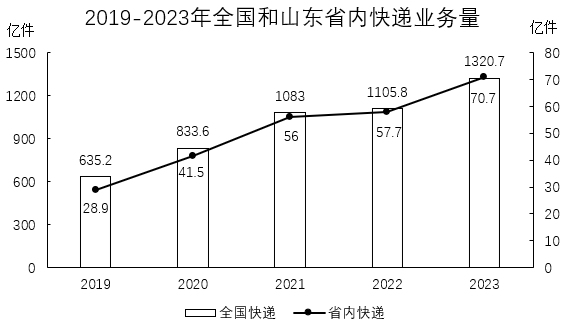

# 现期比重计算（部分占整体）

考点：[[20-考点/资料分析/比重/现期比重计算（部分占整体）|比重 / 现期比重计算（部分占整体）]]
材料：[[15-材料/资料分析/5651999 2023年我国邮政行业寄递业务量与业|5651999 2023年我国邮政行业寄递业务量与业]]

**问法模型**：题干出现'A占B的比重约为'且时间（2023年）与材料现期一致 → 直接套用现期比重公式：比重=部分÷整体，无需推基期

## 推理链
1. 第1步：题干时间为2023年，材料文字段直接给出2023年现期数据，判定为现期比重问题，不需要÷(1+增速)推基期
2. 第2步：识别包含关系——'邮政寄递业务总量1624.8亿件'为整体（分母），其中'快递业务量1320.7亿件'为部分（分子），快递是寄递的其中一项
3. 第3步：套用公式：比重=1320.7÷1624.8
4. 第4步：截位直除：1320.7/1624.8≈132/162.5≈0.813，即约81.3%
5. 第5步：与选项对照：81.3%与B项81%最接近（A 79%、C 83%、D 85%均偏离更远），故选B

**最快解法**：⚡ 截位直除：1320.7÷1624.8，分子分母各截三位得132/162≈0.81，首两位商'81'直接锁定B，无需精算

## 易错点
- ⚠ 分子分母颠倒或整体/部分误判：寄递业务量（1624.8）与快递业务量（1320.7）是包含关系，若把1624.8当分子会得约123%的荒谬结果；'寄递'与'快递'同名近似，必须分清哪个是整体
- ⚠ 误用基期：看到'+19.4%''+16.8%'等增速就÷(1+增速)，但题干问2023年现期比重，材料给的正是现期值，直接相除即可
- ⚠ 数据源误取：误用收入数据（12074.0/15293.0）或图中数据，本题只能用文字段业务量数据，量纲须为亿件

## 母题抽象
> 🧩 当题干出现'现期A占B的比重约为'特征时，先辨析A与B的包含关系确定分子分母（被包含者为分子），再直接部分÷整体，截位直除首两位对照选项

**同类特征**：占……的比重约为、2023年（与材料时间一致）、全国快递业务量（部分）、邮政寄递业务总量（整体）、选项为粗略百分数（间隔2个百分点）、取数于文字材料而非图表

## 相关题
- [[10-真题/资料分析/比重/2188468 现期比重（分子需差值构造：总数−其中一部分）|2188468]]（天津 2018，相关度1）
- [[10-真题/资料分析/比重/17764864 现期比重计算（部分占整体，单位量级统一）|17764864]]（湖北 2024，相关度1）

---

### 题干
2023年，全国快递业务量占邮政寄递业务总量的比重约为：

### 选项
- A. 79%
- B. 81%　✅
- C. 83%
- D. 85%

### 官方解析
根据题干“2023年······占······的比重约为”，结合材料时间为2023年，可判定本题为现期比重问题。定位文字材料可得：2023年全国邮政行业寄递业务量累计完成1624.8亿件，其中快递业务量（不包含邮政集团包裹业务）累计完成1320.7亿件 。根据公式：比重，则所求比重，与B项最接近。
故正确答案为B。

### 给定材料

        2023年，邮政行业寄递业务量累计完成1624.8亿件，同比增长16.8%。其中，快递业务量（不包含邮政集团包裹业务）累计完成1320.7亿件，同比增长19.4%。

        从收入来看，2023年，邮政行业业务收入（不包括邮政储蓄银行直接营业收入）累计完成15293.0亿元，同比增长13.2%。其中，快递业务收入累计完成12074.0亿元，同比增长14.3%。

