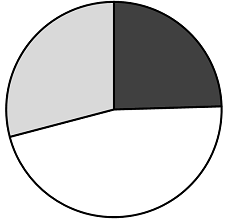

# 现期比重结构判断（饼图占比关系：最大项占比-50%）

考点：[[20-考点/资料分析/比重/现期比重结构判断（饼图占比关系：最大项占比-50%）|比重 / 现期比重结构判断（饼图占比关系：最大项占比<50%）]]
材料：[[15-材料/资料分析/3964000 2021年全国R&D经费投入情况（总|3964000 2021年全国R&D经费投入情况（总]]

**问法模型**：题干以'饼图反映三省经费占比关系'设问 → 转化为现期比重模型：饼图三块中最大块占比必小于50%，即'最大金额<其余两省金额之和'，逐项代入表格数值排除。

## 推理链
1. 第1步：题干问'2021年三省经费的占比关系'，对应统计表'投入金额'列，题目并未要求算出具体比重，只需判断能否构成饼图
2. 第2步：饼图三块中任何一块占比都必须小于50%，等价于'三者中金额最大的省 < 另外两省金额之和'，否则无法画成饼图
3. 第3步：A项北京2629.3 > 天津574.3+河北745.5=1319.8，北京占比超50%，排除；B项陕西700.6 > 甘肃129.5+宁夏70.4=199.9，排除；C项辽宁600.4 > 黑龙江194.6+吉林183.7=378.3，排除
4. 第4步：D项江苏3438.6 < 浙江2157.7+上海1819.8=3977.5，三块占比均低于50%（江苏约3438.6/(3438.6+3977.5)≈46%），可构成饼图，当选D

**最快解法**：⚡ 和差比较排除法：先对每组三省找最大值，再用口算求另两数之和与最大值比大小；A项北京2629.3明显约为1319.8的两倍、B项700.6约为199.9的3.5倍、C项600.4明显大于378.3，均可用目测/简单口算快速排除，只需精算验证D项3438.6<3977.5。

## 易错点
- ⚠ 误以为饼图允许某一块超过50%（半圆），核心判定条件'最大项<其余两项之和'不能省略
- ⚠ 只比较'最大vs第二大'或'最大vs最小'就下结论，如D项江苏3438.6>上海1819.8但江苏仍小于两省之和，单看两两比较会误判
- ⚠ 表格为左右双栏31行结构，取数易串行（如把河南1013.8误当安徽行数据），需按地区名对准金额列

## 母题抽象
> 🧩 当题干出现'饼图反映N个主体…占比关系'特征时，利用'饼图任一块占比必小于50%'转化为'最大数值<其余数值之和'，代入表格数据逐项排除即可，无需计算具体比重。

**同类特征**：饼图、同一区域内、省级行政区、占比关系、2021年、经费投入金额

## 相关题
- [[10-真题/资料分析/比重/14993583 现期比重比较（饼图扇区判断）|14993583]]（选调 2024，相关度2）
- [[10-真题/资料分析/比重/4651518 现期比重·结构占比饼图匹配（'其他'份额=全球−已列主体）|4651518]]（江苏 2022，相关度2）
- [[10-真题/资料分析/比重/19181372 现期比重计算与饼图扇区识别|19181372]]（吉林 2024，相关度1）
- [[10-真题/资料分析/比重/2571801 基期比重还原（百分点变化反推）+饼图匹配|2571801]]（山东 2020，相关度1）
- [[10-真题/资料分析/倍数/5514929 现期倍数（间隔年份基期定位）|5514929]]（广东 2023，相关度1）

---

### 题干

下列饼图反映了哪三个同一区域内的省级行政区2021年研究与试验发展（R&amp;D）经费的占比关系？

### 选项
- A. 北京、天津、河北
- B. 陕西、甘肃、宁夏
- C. 黑龙江、吉林、辽宁
- D. 江苏、浙江、上海　✅

### 官方解析
根据题干“······2021年······占比关系”，结合材料时间为2021年，可判定本题为现期比重问题。定位统计表可得2021年全国各省级行政区研究与试验发展（R&D）经费投入金额。结合饼图可知，三个省级行政区中，投入最高地区的经费金额小于其他两个区域之和，则各选项中大小关系分别为：
A项，北京的经费投入金额为2629.3亿元、天津的经费投入金额为574.3亿元、河北的经费投入金额为745.5亿元，2629.3&gt;574.3+745.5，不满足题意，排除；
B项，陕西的经费投入金额为700.6亿元、甘肃的经费投入金额为129.5亿元、宁夏的经费投入金额为70.4亿元，700.6&gt;129.5+70.4，不满足题意，排除；
C项，黑龙江的经费投入金额为194.6亿元、吉林的经费投入金额为183.7亿元、辽宁的经费投入金额为600.4亿元，600.4&gt;194.6+183.7，不满足题意，排除；
D项，江苏的经费投入金额为3438.6亿元、浙江的经费投入金额为2157.7亿元、上海的经费投入金额为1819.8亿元，3438.6&lt;2157.7+1819.8，满足题意，当选。
故正确答案为D。

### 给定材料

        2021年，全国共投入研究与试验发展（R&amp;D）经费27956.3亿元，同比增长14.6%，增速比上年加快4.4个百分点；研究与试验发展（R&amp;D）经费投入强度（与GDP之比）为2.44%，比上年提高0.03个百分点。

        分活动类型看，基础研究经费所占比重为6.50%，比上年提升0.49个百分点；应用研究和试验发展经费所占比重分别为11.3%和82.2%；应用研究经费同比增长14.1%；试验发展经费同比增长14.0%。

