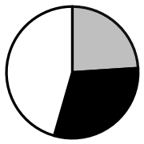

# 现期比重比较（饼图扇区判断）

考点：[[20-考点/资料分析/比重/现期比重比较（饼图扇区判断）|比重 / 现期比重比较（饼图扇区判断）]]
材料：[[15-材料/资料分析/3934064 2022年全国（分城乡）居民人均可支|3934064 2022年全国（分城乡）居民人均可支]]

**问法模型**：题干问'饼图能否准确反映各部分占总额的比重关系' → 采用现期比重比较模型：先比各分量现期值大小定扇区相对大小，再判断'两分量之和 vs 总量一半'，用排除法锁定图形。

## 推理链
1. 第1步：从统计表提取：2022年全国居民人均消费支出24539元，其中食品烟酒（灰色）7481元，居住（黑色）5882元，剩余6项之和为白色。
2. 第2步：规则一：饼图扇区面积与比重成正比，比重=分量/24539，故直接比较分量现期值即可定灰色与黑色的相对大小。
3. 第3步：7481 > 5882，即灰色扇区必须大于黑色扇区，据此排除灰色≤黑色的A、C两项。
4. 第4步：规则二：判断灰色+黑色是否过半：7481+5882=13363元，与总量一半24539÷2=12269.5元比较，13363>12269.5，占比约54.5%过半。
5. 第5步：白色（剩余各项之和）=24539−13363=11176元，占比约45.5%小于一半；B项中白色扇区≥一半，排除B，故选D。

**最快解法**：⚡ 观察排除法（比重比较+过半判断）：①直接比7481与5882的大小，灰色>黑色，秒排A、C；②心算7481+5882=13363，与总量一半12269.5比较，过半即灰色+黑色应占饼图一半以上，秒排B。全程无需计算精确百分比。

## 易错点
- ⚠ 用错板块数据：文字段是收入（36883元），表格才是支出（24539元），饼图问的是消费支出占比，若误用收入数据或收入增速则全盘皆错。
- ⚠ 表头两列口径看串：表中'支出'列为元、'增速'列为%，勿把增速（如4.2%）当支出额去比较扇区大小。
- ⚠ 只比大小不比过半：7481>5882只能排除A、C，B与D的区分必须靠'灰色+黑色=13363是否超过总量一半12269.5'这一步，跳过则无法锁定答案。

## 母题抽象
> 🧩 当题干出现'饼图/扇形图反映各部分占总额比重关系'时，用观察排除法：先比较各分量现期值大小确定扇区相对大小，再用'分量之和 vs 总量的一半'判断是否过半，验证扇区相对关系即可，无需精算比重。

**同类特征**：饼图、占比关系、人均消费支出总额、食品烟酒（灰色）、居住（黑色）、剩余各项之和（白色）

## 相关题
- [[10-真题/资料分析/比重/14993577 现期比重结构判断（饼图占比关系：最大项占比-50%）|14993577]]（选调 2024，相关度2）
- [[10-真题/资料分析/比重/4651518 现期比重·结构占比饼图匹配（'其他'份额=全球−已列主体）|4651518]]（江苏 2022，相关度2）
- [[10-真题/资料分析/比重/19181372 现期比重计算与饼图扇区识别|19181372]]（吉林 2024，相关度1）
- [[10-真题/资料分析/比重/2571801 基期比重还原（百分点变化反推）+饼图匹配|2571801]]（山东 2020，相关度1）
- [[10-真题/资料分析/比重/18643715 现期比重比较（扇形-饼图匹配）|18643715]]（天津 2026，相关度1）

---

### 题干
以下饼图中，能够准确反映2022年全国居民人均消费支出总额中，人均食品烟酒支出（灰色）、人均居住支出（黑色）以及剩余各项人均支出之和（白色）占比关系的是（    ）。

### 选项
- A. 

- B. 

- C. 

- D. 

　✅

### 官方解析
根据题干“以下饼图中······2022年全国居民人均消费支出总额中······占比关系的是”，可判定本题为现期比重问题。定位统计表可得：2022年，全国居民人均消费支出24539元，食品烟酒7481元，居住5882元。通过观察可知，人均食品烟酒支出7481元（灰色)&gt;人均居住支出5882元（黑色），排除A、C两项；根据公式：比重，则，即人均食品烟酒支出（灰色）和人均居住支出（黑色）之和占比超过一半，排除B项。
故正确答案为D。

### 给定材料

        2022年，全国居民人均可支配收入36883元，同比增长5.0%。分城乡看，城镇居民人均可支配收入49283元，同比增长3.9%；农村居民人均可支配收入20133元，同比增长6.3%。

        按收入来源分，2022年，全国居民人均工资性收入同比增长4.9%，占可支配收入的比重为55.8%；人均经营净收入同比增长4.8%，占可支配收入的比重为16.7%；人均财产净收入同比增长4.9%，占可支配收入的比重为8.8%；人均转移净收人同比增长5.5%，占可支配收入的比重为18.7%。

