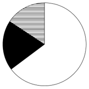
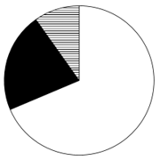
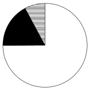

# 现期比重结构识别（饼图占比关系判断）

考点：[[20-考点/资料分析/比重/现期比重结构识别（饼图占比关系判断）|比重 / 现期比重结构识别（饼图占比关系判断）]]
材料：[[15-材料/资料分析/4141961 2023年11月—2024年11月证|4141961 2023年11月—2024年11月证]]

**问法模型**：题干给'饼图最能准确反映各类机构产品数量占比关系'→ 将五类机构按题干分组合并后，比较各扇区之间的倍数关系与占比量级，与选项饼图对照排除

## 推理链
1. 第1步：定位表1，2024年11月各类机构产品数量：证券公司及其资管子公司601支、证券公司私募子公司13支、基金管理公司168支、基金子公司86支、期货公司及其资管子公司60支
2. 第2步：按题干图例分组合并：白色=601支；黑色=证券公司私募子公司+基金管理公司=13+168=181支；横线（其他公司）=基金子公司+期货公司及其资管子公司=86+60=146支
3. 第3步：验证总量：601+181+146=928支，与正文'共计销售（备案）产品928支'一致，分组无遗漏
4. 第4步：算部分间倍数：白色/黑色=601/181≈3.3倍（白色是黑色的3倍多）；黑色/横线=181/146≈1.24倍（黑色是横线的1倍多）
5. 第5步：换算占比校验：白色601/928≈64.8%、黑色181/928≈19.5%、横线146/928≈15.7%，白色占近三分之二、黑与横线接近但黑略大
6. 第6步：对照选项：只有A项满足'白色区域是黑色区域的3倍多、黑色区域是横线区域的1倍多'的结构，故选A

**最快解法**：⚡ 倍数排除法（免算百分比）：三块数量601:181:146，先看最大块白色601>3×181，排除白色不足黑色3倍的选项；再看黑色181与横线146相差不大但黑略大（约1.2倍），排除黑≈横线或黑<横线的选项，唯一匹配A

## 易错点
- ⚠ '其他公司'是跨行拼接，需合并基金子公司86支+期货公司及其资管子公司60支=146支，直接取单行数据会错
- ⚠ 黑色区域对应两行合并：证券公司私募子公司13支+基金管理公司168支=181支，勿只取基金管理公司168支
- ⚠ 饼图反映的是产品数量（支）占比，不是设立规模（亿元）占比；若误用规模列（266.6/17.4+45.75/95.2+15.88）结构比例完全不同

## 母题抽象
> 🧩 当题干出现'饼图最能准确反映…占比关系'特征时，先按图例把类别合并分组，再用'部分间倍数'（大块/中块、中块/小块是几倍多）快速排除选项，无需精确计算各扇区百分比

**同类特征**：饼图占比关系、现期比重、类别合并（其他公司）、产品数量占比、部分间倍数比较、2024年11月

## 相关题
- [[10-真题/资料分析/比重/4792819 现期比重计算（多部分比重依次求解）|4792819]]（新疆 2014，相关度1）
- [[10-真题/资料分析/比重/827355 现期比重比较（部分占比过半速判）|827355]]（政法干警 2014，相关度1）
- [[10-真题/资料分析/比重/2272297 现期比重比较|2272297]]（选调 2015，相关度1）
- [[10-真题/资料分析/比重/2032972 现期比重计算（多地区占比求和）|2032972]]（吉林 2015，相关度1）
- [[10-真题/资料分析/比重/2187857 现期比重计算（部分量需先由'总量−其中量'减法间接求得）|2187857]]（山东 2018，相关度1）

---

### 题干
以下饼图中，最能准确反映2024年11月各类证券期货经营机构私募资管产品中，证券公司及其资管子公司（白色）、证券公司私募子公司、基金管理公司（黑色）和其他公司（横线）产品数量占比关系的是：

### 选项
- A. 

　✅
- B. 

- C. 

- D. 

### 官方解析

根据题干“以下饼图中，最能准确反映2024年11月······占比关系的是”，结合材料时间为2024年11月，可判定本题为现期比重问题。定位统计表可知，2024年11月证券公司及其资管子公司、证券公司私募子公司、基金管理公司、基金子公司、期货公司及其资管子公司产品数量分别为601支、13支、168支、86支、60支。则证券公司及其资管子公司（白色）产品数量为601支；证券公司私募子公司、基金管理公司（黑色）产品数量为13+168=181支；其他公司（横线）产品数量为86+60=146支。，即白色区域是黑色区域的3倍多，，即黑色区域是横线区域的1倍多，只有A项符合。

故正确答案为A。

### 给定材料

        2024年11月证券期货经营机构共计销售产品928支。

