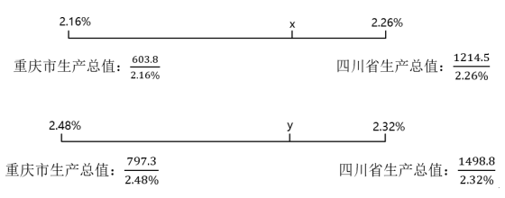

# 混合比重（两省市合并整体投入强度——GDP反推加权-线段法）

考点：[[20-考点/资料分析/比重/混合比重（两省市合并整体投入强度——GDP反推加权-线段法）|比重 / 混合比重（两省市合并整体投入强度——GDP反推加权/线段法）]]
材料：[[15-材料/资料分析/4216251 2021-2024年全国及14个省市|4216251 2021-2024年全国及14个省市]]

**问法模型**：'川渝（四川+重庆）合并整体投入强度2024年比2021年上升多少个百分点'→混合比重模型：先由GDP=经费÷强度反推各省GDP作权重，加权（线段法）求两期整体强度后作差对照区间

## 推理链
1. 第1步：跨双面板取数——2021年四川经费1214.5亿元、强度2.26%，重庆经费603.8亿元、强度2.16%；2024年四川经费1498.8亿元、强度2.32%，重庆经费797.3亿元、强度2.48%
2. 第2步：整体强度不能直接平均两省强度，须由'强度=经费÷GDP'反推GDP=经费÷强度作权重，混合比重用线段法（强度距离与GDP成反比）
3. 第3步：反推2021年GDP：四川1214.5÷2.26%≈53739亿元，重庆603.8÷2.16%≈27954亿元，合计≈81693亿元；经费合计1214.5+603.8=1818.3亿元，整体强度=1818.3÷81693≈2.23%
4. 第4步：反推2024年GDP：四川1498.8÷2.32%≈64603亿元，重庆797.3÷2.48%≈32149亿元，合计≈96753亿元；经费合计1498.8+797.3=2296.1亿元，整体强度=2296.1÷96753≈2.37%
5. 第5步：作差2.37%−2.23%≈0.15个百分点（官方线段法解得0.14个百分点），落在0.1～0.2个百分点区间
6. 第6步：对照选项A'不到0.1'、B'0.1～0.2'、C'0.2～0.3'、D'0.3以上'，仅B符合，故选B

**最快解法**：⚡ 线段法（十字交叉）+GDP反推：川:渝GDP=经费÷强度，两年均约2:1（2021年53739:27954，2024年64603:32149），按四川占2/3加权——2021年整体强度≈2.16%+2/3×(2.26%−2.16%)≈2.23%，2024年≈2.32%+1/3×(2.48%−2.32%)≈2.37%，差约0.14～0.15个百分点，直接锁定B

## 易错点
- ⚠ 整体强度不能直接平均：直接算(2.32+2.48)/2=2.40%、(2.26+2.16)/2=2.21%得差0.19，方法错误（虽本题仍误落B区间，但换题即出错），必须用GDP=经费÷强度反推权重后加权
- ⚠ 强度升降比较结果的单位是'百分点'而非'%'，选项口径为百分点区间，审题勿混淆
- ⚠ 跨面板取数易串列：经费4列+强度4列共8列并排，2021列与2024列易读错年份；且四川2022年强度由2.26降至2.14（经费1214.5→1215.0几乎持平），逐行核对时易怀疑看错而改数

## 母题抽象
> 🧩 当题干出现'多省市合并后的整体比重/投入强度两期比较（上升或下降多少）'特征时，不能平均个体强度，先用'整体量=部分量÷比重'反推各期权重（GDP），再用线段法/加权平均求两期整体值作差，对照区间选项

**同类特征**：川渝地区（四川和重庆）整体、R&D经费投入强度、2024年比2021年、上升了（百分点）、区间式选项（不到/～/以上）、混合比重·经费与强度双面板交叉

## 相关题
- [[10-真题/资料分析/平均数/13504661 基期平均数计算|13504661]]（辽宁 2025，相关度1）

---

### 题干
2024年，川渝地区（四川和重庆）整体R&D经费投入强度比2021年上升了：

### 选项
- A. 不到0.1个百分点
- B. 0.1～0.2个百分点　✅
- C. 0.2～0.3个百分点
- D. 0.3个百分点以上

### 官方解析

根据题干“2024年，川渝地区（四川和重庆）整体R&amp;D经费投入强度比2021年上升了”，结合材料给出了2021年、2024年四川、重庆的R&amp;D经费投入强度，且R&amp;D经费投入强度，可判定本题为混合比重问题。定位统计表可得：2021年四川和重庆的R&amp;D经费分别为1214.5亿元、603.8亿元，投入强度分别为2.26%、2.16%；2024年四川和重庆的R&amp;D经费分别为1498.8亿元、797.3亿元，投入强度分别为2.32%、2.48%。根据线段法“距离（投入强度差）与量（全省（市）生产总值）成反比”，设2021年川渝地区（四川和重庆）整体R&amp;D经费投入强度为，2024年为，可列式：，，解得，。则题干所求为，即上升了0.14个百分点，在B项范围内。

故正确答案为B。

### 给定材料

