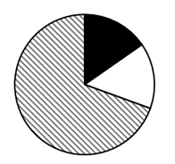

# 现期比重计算与饼图占比关系判断（排除法）

考点：[[20-考点/资料分析/比重/现期比重计算与饼图占比关系判断（排除法）|比重 / 现期比重计算与饼图占比关系判断（排除法）]]
材料：[[15-材料/资料分析/6109562 2019—2022年中国锂电池产业数|6109562 2019—2022年中国锂电池产业数]]

**问法模型**：题干问'饼图最能准确反映2022年三类锂电池出货量占比关系'→ 现期比重模型：先算各部分占总量比重（或部分间倍数关系），再与饼图扇形大小对照排除

## 推理链
1. 第1步：从图2提取2022年三类数据：储能锂电池130.0GWh、数码锂电池48.0GWh、动力锂电池480.0GWh；从文字段取2022年中国锂电池出货总量658GWh（验证：130+48+480=658，口径吻合）
2. 第2步：用比重公式：比重=部分量÷总量，关键算最大块（动力）并与75%基准比较，再算两小块的倍数关系
3. 第3步：动力占比=480÷658≈72.9%，略小于75%（因为658×75%=493.5>480）
4. 第4步：储能占比=130÷658≈19.8%，数码占比=48÷658≈7.3%；储能/数码=130÷48≈2.7倍，储能扇形应明显大于数码
5. 第5步：对照选项：A项动力恰好约75%、C项动力超过75%，均与72.9%不符，排除A、C
6. 第6步：B项中储能与数码两块占比相近，与'130.0是48.0的2倍多'矛盾，排除B；D项动力略小于75%且储能明显大于数码，当选D

**最快解法**：⚡ 两把尺子排除法（份数思想）：①拿480/658与3/4比，658×3/4=493.5>480→动力占比略小于75%，排除A（恰好75%）和C（超75%）；②拿130/48≈2.7倍比大小，储能块应约为数码块近3倍，排除B（两块相近）→直选D，全程无需精算比重

## 易错点
- ⚠ 总量口径：必须用中国出货量658GWh（文字段或图2三类加总），不能误用全球出货量957.7GWh，也不能混入装车量294.6GWh
- ⚠ 图例对应：黑=储能、白=数码、斜杠=动力，读饼图时勿把黑白色对应看反，否则会把'储能约为数码2.7倍'错判到别的扇形上
- ⚠ 精度陷阱：A项75%与真实72.9%很接近，只算动力一项可能误选A，必须再用'储能/数码≈2.7倍'这一比例关系二次排除

## 母题抽象
> 🧩 当题干出现'饼图最能准确反映…占比关系'时，先用部分/总量与75%（或50%）等基准值比较锁定最大块的范围排除明显项，再用两部分间的倍数关系（如130:48≈2.7:1）排除干扰项，无需算出全部精确比重

**同类特征**：饼图占比关系判断、最能准确反映、2022年现期比重、三类结构对比、图例颜色对应关系、排除法选图

## 相关题
- [[10-真题/资料分析/比重/5408652 现期比重比较·饼图占比判断|5408652]]（四川 2022，相关度2）
- [[10-真题/资料分析/比重/10297452 现期比重结构与饼图匹配（部分占比比较-倍数排除）|10297452]]（四川 2025，相关度1）
- [[10-真题/资料分析/比重/10718177 现期比重（饼图结构判断，分组加总后排除法选图）|10718177]]（深圳市考 2024，相关度1）
- [[10-真题/资料分析/增长/16593068 增长量比较（多期同比增量趋势与柱状图匹配）|16593068]]（甘肃 2024，相关度1）
- [[10-真题/资料分析/比重/19283765 现期比重结构比较（饼图匹配）|19283765]]（国考 2025，相关度1）

---

### 题干
以下饼图中，最能准确反映2022年中国锂电池出货量中，储能锂电池、数码锂电池和动力锂电池占比关系的是：
（黑色：储能锂电池  白色：数码锂电池  斜杠：动力锂电池）

### 选项
- A. 

- B. 

- C. 

- D. 

　✅

### 官方解析
根据题干“······最能准确反映2022年······占比关系的是”，结合材料时间为2022年，可判定本题为现期比重问题。定位统计图可得：2022年中国储能锂电池出货量为130.0GWh，数码锂电池出货量为48.0GWh，动力锂电池出货量为480.0GWh；定位文字材料可得：2022年中国锂电池出货量658GWh。根据公式：比重，则在2022年中国锂电池出货量中，动力锂电池出货量占比，A项中动力锂电池出货量占比为75%，C项中超过75%，排除A、C两项；储能锂电池出货量（130.0GWh）是数码锂电池出货量（48.0GWh）的2倍多，B项两部分占比相近，排除B项，D项当选。
故正确答案为D。

### 给定材料

        2022年中国锂电池出货量658GWh，同比增长101.1%。2022年中国动力锂电池装车量达294.6GWh，同比增长90.7%，高于全球同比增速18.9个百分点，占全球动力锂电池装车量的56.9%。

