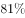

# 现期比重计算

考点：[[20-考点/资料分析/比重/现期比重计算|比重 / 现期比重计算]]
材料：[[15-材料/资料分析/180730 2014年全国市场主体情况：既有期末|180730 2014年全国市场主体情况：既有期末]]

**问法模型**：题干问'2014年……新登记注册市场主体中个体工商户所占比重约为'且材料时间同为2014年 → 直接用现期部分÷现期整体求比重，无需回推基期

## 推理链
1. 第1步：由题干'2014年……所占比重'且材料时间为2014年，判定为现期比重问题，部分与整体均为现期值
2. 第2步：定位材料第二段（2014年度新登记注册总量）：全国新登记注册市场主体1292.5万户，其中个体工商户896.45万户，题干限定'新登记注册'故整体、部分均取段2流量口径
3. 第3步：套用现期比重公式：比重=部分÷整体=896.45÷1292.5
4. 第4步：截位估算：896.45÷1292.5≈896÷1290≈0.694，即约69%
5. 第5步：与选项对照，计算值约69%与B项最接近，故选B

**最快解法**：⚡ 截位直除：896.45÷1292.5，分子分母各截前三位得896÷1290，首位商6、次位商9，得约0.694≈69%，直接锁定约69%量级的选项B

## 易错点
- ⚠ 同名词语口径混淆：'个体工商户'在段1是期末实有存量（4984.06万户），在段2才是当年新登记量（896.45万户）；题干问'新登记注册市场主体中'的比重，若误用4984.06÷6932.22≈71.9%即掉入存量陷阱
- ⚠ 整体误取：整体应是段2的新登记市场主体1292.5万户（流量），而非段1的期末实有6932.22万户（存量），存量与流量两套数据不能互充当整体或部分
- ⚠ 部分取错：段2'其中'含企业365.1万户、个体工商户896.45万户、农民专业合作社30.95万户三项，若部分误取为企业365.1万户会得到约28%的干扰项

## 母题抽象
> 🧩 当题干出现'某年+某部分占某整体的比重约为'且年份与材料一致时，用同一段落同口径的现期部分÷现期整体，截位直除估算；若材料对同一名称存在存量/流量两套数据，先依据题干限定词（如'新登记''实有'）确认口径再取数

**同类特征**：2014年、新登记注册市场主体、个体工商户、所占比重约为、现期比重、其中

## 相关题
- [[10-真题/资料分析/比重/2578488 现期比重计算|2578488]]（内蒙古 2020，相关度3）
- [[10-真题/资料分析/比重/2051444 现期比重计算|2051444]]（新疆 2017，相关度3）
- [[10-真题/资料分析/比重/2172326 现期比重计算|2172326]]（江苏 2018，相关度3）
- [[10-真题/资料分析/比重/2604234 现期比重计算|2604234]]（广东 2020，相关度2）
- [[10-真题/资料分析/比重/1751688 现期比重计算|1751688]]（江苏 2015，相关度2）

---

### 题干
2014年，全国新登记注册市场主体中个体工商户所占比重约为：

### 选项
- A. 

- B. 

　✅
- C. 

- D. 

### 官方解析

由题干“2014年······所占比重”且材料时间为2014年，可判定此题为现期比重问题。定位文字材料第二段，“2014年，全国新登记注册市场主体1292.5万户”，其中，“个体工商户896.45万户”。可计算出2014年，全国新登记注册市场主体中个体工商户所占比重为，与B项最接近。

故正确答案为B。

### 给定材料

        截至2014年12月底，全国实有各类市场主体6932.22万户，比上年末增长，增速较上年同期增加4.02个百分点；注册资本（金）129.23万亿元，比上年末增长。其中，企业1819.28万户，个体工商户4984.06万户，农民专业合作社128.88万户。

        2014年，全国新登记注册市场主体1292.5万户，比上年同期增加160.97万户；注册资本（金）20.66万亿元，比上年同期增加9.66万亿元。其中，企业365.1万户，个体工商户896.45万户，农民专业合作社30.95万户。

        2014年，新登记注册现代服务业企业114.10万户，同比增长。其中，信息传输、软件和信息技术服务业14.67万户，同比增长；科学研究和技术服务业26.26万户，同比增长；文化、体育和娱乐业6.59万户，同比增长；教育业0.68万户，同比增长。

        2014年，新登记注册外商投资企业3.84万户，同比增长。投资总额2763.31亿美元，同比增长；注册资本1796.39亿美元，同比增长。

