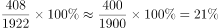
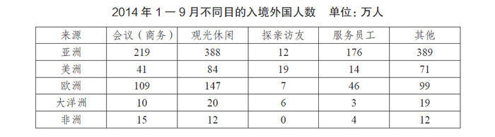

# 现期比重计算

考点：[[20-考点/资料分析/比重/现期比重计算|比重 / 现期比重计算]]

**问法模型**：题干问'某部分占总体总数的比重'且材料和题干同属现期（2014年1—9月）→ 直接用 部分/总体 计算现期比重

## 推理链
1. 第1步：从材料提取条件：2014年1—9月我国入境外国人总数为1922万人，其中来自欧洲的外国人为408万人
2. 第2步：所用公式：现期比重 = 部分值 ÷ 整体值 = 欧洲入境外国人数 ÷ 入境外国人总数
3. 第3步：代入计算：408 ÷ 1922 ≈ 0.2123，即约21.2%
4. 第4步：与选项对照：21.2%对应选项B（A为美洲229/1922≈11.9%的干扰项），故选B

**最快解法**：⚡ 截位直除：408/1922，先看首位：1922×0.2=384.4，408−384.4=23.6，23.6/1922≈1.2%，故结果≈21.2%，直选B

## 易错点
- ⚠ 数据定位错误：材料给出五个大洲数据，易把美洲229万人（229/1922≈11.9%）误当作欧洲数据而错选A
- ⚠ 首位估算不精细：1922×0.21≈403.6与408很接近，若只算一位有效数字易在B与C之间犹豫，需算到第二位
- ⚠ 整体值选取错误：总数应为入境外国人1922万人，勿误用表格中分目的数据或其他洲加和作分母

## 母题抽象
> 🧩 当题干出现'A占B（总）的比重'且材料直接给出部分与总体的现期数值时，用 部分÷总体 截位直除，首位不够则补第二位，与选项比对即得答案

**同类特征**：占……的比重、入境外国人、来自欧洲、现期数据直接查找、1—9月同一时期、四个选项为百分数

## 相关题
- [[10-真题/资料分析/比重/2742018 现期比重计算|2742018]]（江苏 2021，相关度3）
- [[10-真题/资料分析/比重/2172326 现期比重计算|2172326]]（江苏 2018，相关度3）
- [[10-真题/资料分析/比重/2604234 现期比重计算|2604234]]（广东 2020，相关度2）
- [[10-真题/资料分析/比重/2456370 现期比重计算|2456370]]（浙江 2020，相关度2）
- [[10-真题/资料分析/比重/2050970 现期比重计算|2050970]]（江西 2017，相关度2）

---

### 题干
2014年1—9月来自欧洲的入境外国人数占外国人总数的比重是：

### 选项
- A. 11.9％
- B. 21.2％　✅
- C. 28.1％
- D. 30.2％

### 官方解析

由材料可知2014年1—9月，我国入境外国人共有1922万人，其中来自欧洲的外国人为408万人，则2014年1—9月来自欧洲的入境外国人数占外国人总数的比重是。

故正确答案为B。

### 给定材料

       2014年1—9月我国入境外国人共有1922万人，其中来自亚洲、美洲、欧洲、大洋洲、非洲的外国人分别为1184万人、229万人、408万人、58万人和43万人。分不同目的的入境外国人数见下表。

