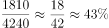
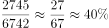

# 两期比重变化（比重差，百分点表述）

考点：[[20-考点/资料分析/比重/两期比重变化（比重差，百分点表述）|比重 / 两期比重变化（比重差，百分点表述）]]
材料：[[15-材料/资料分析/181128 2005—2013年中国科技人力资源|181128 2005—2013年中国科技人力资源]]

**问法模型**：题干出现'与2007年相比，2012年部分占整体的比重约…'且选项为'上升/下降N个百分点' → 分别求两期比重再做差，按差值方向与量级选答案

## 推理链
1. 第1步：从图中提取数据：2007年科技人力资源总量4240万人、本科及以上1810万人；2012年总量6742万人、本科及以上2745万人（均为左轴柱状数据，单位万人）
2. 第2步：两期比重差公式：2012年比重−2007年比重＝(2745/6742)−(1810/4240)
3. 第3步：代入计算：2007年比重1810/4240≈42.7%，2012年比重2745/6742≈40.7%
4. 第4步：差值＝40.7%−42.7%≈−2.0个百分点，即比重下降约2个百分点
5. 第5步：与选项对照：量级为个位数个百分点，排除A/C（20个百分点），方向为下降，排除B，锁定D

**最快解法**：⚡ 截位直除＋先定向再定量：分子本科及以上增速（1810→2745，约+52%）慢于分母总量增速（4240→6742，约+59%），故比重必下降，先排除A/B；再截位直除：18/42≈43%，27/67≈40%，差约2~3个百分点，直接选D

## 易错点
- ⚠ 百分点与百分比混淆：比重变化只能用'个百分点'表述，且选项A/C的'20个百分点'是量级陷阱，先由两期比重均在40%+且差值必小于42.7%排除
- ⚠ 跨指标取数错误：必须用'本科及以上柱（黑色柱）÷总量柱（白色柱）'，勿把折线'每万人口中科技人力资源数'（右轴、单位为人）代入计算
- ⚠ 方向误判：只看本科及以上绝对增量935万人>0而忽略其增速低于总量增速59%，会误判比重上升而错选B

## 母题抽象
> 🧩 当题干出现'与X年相比，Y年部分A占整体B的比重'且选项为'上升/下降N个百分点'时，先比较A、B增速定升降方向，再用截位直除分别算两期比重做差，按差值量级验证选项

**同类特征**：与2007年相比，2012年、本科及以上学历者占科技人力资源总数、比重、上升/下降、个百分点、跨指标取数（黑色柱÷白色柱）

## 相关题
- [[10-真题/资料分析/增长/2050644 两期增速变化比较（百分点差值）|2050644]]（吉林 2017，相关度2）
- [[10-真题/资料分析/增长/10718183 名义增速与实际增速之差（百分点计算）|10718183]]（深圳市考 2024，相关度1）
- [[10-真题/资料分析/比重/16070258 现期比重差值（两个部分占比相减）|16070258]]（重庆 2026，相关度1）
- [[10-真题/资料分析/比重/1789664 比重差值计算（百分点搭桥）|1789664]]（江苏 2016，相关度1）
- [[10-真题/资料分析/比重/2042846 两期比重差（比重差值计算）|2042846]]（江苏 2017，相关度1）

---

### 题干
与2007年相比，2012年本科及以上学历者占科技人力资源总数的比重约：

### 选项
- A. 上升了20个百分点
- B. 上升了2个百分点
- C. 下降了20个百分点
- D. 下降了2个百分点　✅

### 官方解析

根据题干“与2007年相比，2012年···占···的比重约变化多少个百分点”，可判定本题为两期比重计算问题。定位图形材料可知：2007年科技人力资源总量4240万人，本科及以上学历科技人力资源总量1810万人；2012年科技人力资源总量6742万人，本科及以上学历科技人力资源总量2745万人。所以本科及以上学历者占科技人力资源比重：2007年为，2012年为，，即比重下降3个百分点，与D项最为接近。

故正确答案为D。

### 给定材料

> [!warning] 疑点（官方解析可能有误，待人工复核）
> 官方解析称'比重下降3个百分点'，但精确计算42.7%−40.7%≈2.0个百分点，官方解析数值略有出入；其结论'下降约2个百分点，与D项最为接近'与正确答案D一致，不影响作答

<!-- CODEX-ANSWER-REVIEW:BEGIN -->
### 本次独立复核

**复核状态：** `resolved`（答案与解析已核定）

**计分答案：** D（可计分）

**复核解析：**

2007本科及以上科技人力资源占比=1810/4240≈42.7%；2012=2745/6742≈40.7%；变化约−2个百分点，下降2，D。

**相关信息：**

两期比重变化常用公式：现期比重×(部分增长率−整体增长率)/(1+部分增长率)；部分增速高于整体时比重上升。

**题源依据：** [固定版本原题](https://github.com/Mentat-Uran/kaogongzhentizhengliu/blob/84ab93d4b64b61d897bece8a1c0a5bab06b4feb2/10-%E7%9C%9F%E9%A2%98/%E8%B5%84%E6%96%99%E5%88%86%E6%9E%90/%E6%AF%94%E9%87%8D/1752600%20%E4%B8%A4%E6%9C%9F%E6%AF%94%E9%87%8D%E5%8F%98%E5%8C%96%EF%BC%88%E6%AF%94%E9%87%8D%E5%B7%AE%EF%BC%8C%E7%99%BE%E5%88%86%E7%82%B9%E8%A1%A8%E8%BF%B0%EF%BC%89.md)；固定内容 commit `84ab93d4b64b61d897bece8a1c0a5bab06b4feb2`，Markdown blob `ad2ad4958facf9ea20ee8d17abced664db18f5ad`。
<!-- CODEX-ANSWER-REVIEW:END -->
