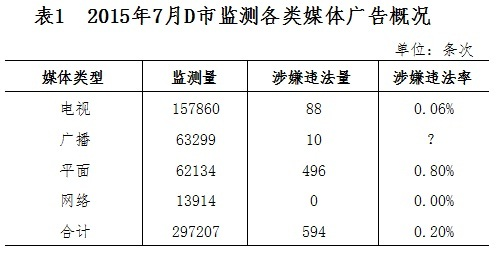
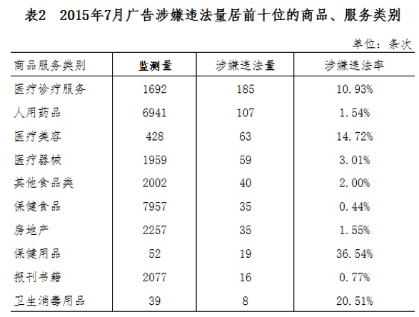

# 现期比重计算（表格空缺比率补值）

考点：[[20-考点/资料分析/比重/现期比重计算（表格空缺比率补值）|比重 / 现期比重计算（表格空缺比率补值）]]
材料：[[15-材料/资料分析/181118 2015年7月D市对电视、广播、平面|181118 2015年7月D市对电视、广播、平面]]

**问法模型**：表格中比率列出现'？'空缺 → 认定该列=分子列÷分母列（涉嫌违法率=涉嫌违法量÷监测量），代入同行数据直除并按选项量级锁定

## 推理链
1. 第1步：定位表1广播行，提取数据：监测量63299条次、涉嫌违法量10条次、涉嫌违法率为'？'空缺
2. 第2步：由表内其余行验证规则——涉嫌违法率=涉嫌违法量÷监测量（如平面496÷62134≈0.80%、合计594÷297207≈0.20%）
3. 第3步：代入计算：'？'=10÷63299≈0.000158，化为百分数约0.0158%，保留两位小数约0.02%
4. 第4步：量级校验排除干扰项——0.005%×63299≈3.2<10（A偏小），0.04%×63299≈25>10（C偏大）、0.08%×63299≈50>10（D偏大），仅0.02%×63299≈12.7与10最接近，选B

**最快解法**：⚡ 截位直除+选项反乘校验：10÷63299把分母截为6.33万，10÷63300≈0.016%≈0.02%，直接锁定B；亦可先用同行参照（电视88÷157860≈0.06%，广播分子10更小）判定必小于0.06%排除C、D，再排除偏小的A

## 易错点
- ⚠ 小数点错位：10÷63299≈0.000158，化为百分数是0.016%（≈0.02%），勿写成1.6%或多/少移两位小数而误选C(0.04%)或A(0.005%)
- ⚠ 看错行列：只取广播行63299与10，勿误拿平面行496、合计行594或电视行88
- ⚠ 受文字段'比6月下降0.07个百分点'干扰：本题为现期比率补值，6月数据未给出且无需使用，百分点差不可参与乘除

## 母题抽象
> 🧩 当表格比率列出现'？'或其他空缺时，先用表内完整行验证'该列=分子列÷分母列'，再代入同行两数截位直除，最后用选项反乘分母做量级校验锁定答案

**同类特征**：表1中'？'处应当填写、表格空缺比率补值、涉嫌违法率=涉嫌违法量÷监测量、现期比重计算、选项为小数级百分比且相邻项差2~4倍、单位条次、比率单位%

## 相关题
- [[10-真题/资料分析/比重/15527 现期比重计算（多子条件混合的加权平均）|15527]]（黑龙江 2010，相关度1）
- [[10-真题/资料分析/比重/2028300 现期比重计算+饼图扇区匹配|2028300]]（国考 2017，相关度1）
- [[10-真题/资料分析/比重/1758932 现期比重计算＋跨图表数值比对定位|1758932]]（上海 2016，相关度1）
- [[10-真题/资料分析/比重/2448500 现期比重计算（整体=部分÷比重，比重=部分÷整体）|2448500]]（国考 2020，相关度1）
- [[10-真题/资料分析/比重/4652175 现期比重计算＋条件充分性判断（双路径验证）|4652175]]（北京 2022，相关度1）

---

### 题干
表1中“？”处应当填写的数字是（  ）。

### 选项
- A. 0.005%
- B. 0.02%　✅
- C. 0.04%
- D. 0.08%

### 官方解析
根据题干“表1中‘？’处应当填写的数字是”，结合材料“？”处表示2015年7月广播涉嫌违法率即涉嫌违法量占监测量的比重，可判定本题为现期比重计算问题。定位表格材料1可知：2015年7月广播监测量为63299条次，涉嫌违法量为10条次。因为，故“？”=，与B最接近。
故正确答案为B。

### 给定材料

        2015年7月，D市共监测电视、广播、平面和重点网络媒体首页页面广告297207条次，涉嫌违法广告594条次，广告涉嫌违法率为0.20%，比6月下降0.07个百分点。

