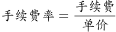
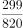
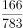
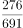
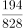

# 退票手续费率比较（定额费用÷票价的比值比较）

考点：[[20-考点/资料分析/比重/退票手续费率比较（定额费用÷票价的比值比较）|比重 / 退票手续费率比较（定额费用÷票价的比值比较）]]
材料：[[15-材料/资料分析/181280 某旅游网站推荐的M地至N地5月30日|181280 某旅游网站推荐的M地至N地5月30日]]

**问法模型**：题干问'哪个班次起飞前退票手续费率最高' → 用'起飞前退票手续费÷该班次单价'逐一换算成比值再比较大小（定额转费率的分数比较模型）

## 推理链
1. 第1步：从表格提取各班次单价与'起飞前'退票手续费：乙820元/¥299、丙783元/¥166、丁691元/¥276、戊828元/¥194（甲退票'不支持'，且选项未涉及甲）
2. 第2步：明确口径：手续费是定额'元/人'而非费率，费率=手续费÷票价；表注'退票取消相应优惠'说明按票面原价计，不预扣返现
3. 第3步：代入计算：乙299/820≈36.5%，丙166/783≈21.2%，丁276/691≈39.9%，戊194/828≈23.4%
4. 第4步：用分数性质排除：丁分子276大于丙166、戊194，且丁分母691小于783、828，故丁>丙、戊，排除B、D
5. 第5步：比较A、C：分子299与276很接近，但丁分母691明显小于乙的820，故丁>乙
6. 第6步：与选项对照，丁班次起飞前退票手续费率最高，选C

**最快解法**：⚡ 分数性质比较+截位直除：丁276/691分子大于丙166、戊194且分母最小，直接排除B、D；剩乙299/820与丁276/691，分子接近而丁分母小得多，直除首位（299/820≈36%+，276/691≈39%+）即锁定C，无需精算

## 易错点
- ⚠ 手续费是定额'元/人'而非费率，直接比金额会误选乙（¥299金额最大，但299/820≈36.5%低于276/691≈39.9%）
- ⚠ 忽略'起飞前'档位限定，误取'起飞后'列数据（乙¥369、丙¥349、丁¥310、戊¥297）比较
- ⚠ 把甲班次'不支持'误读为0元免费纳入比较，或把返现优惠（如丁返28元）预扣进票价充当分母；历史准点率列（61%—91%）为干扰信息，不得入算

## 母题抽象
> 🧩 当题干出现'××手续费率/费率最高（低）'且表格给的是定额费用与基数时，用'定额÷基数'化为分数，先用'分子大且分母小者大'排除明显项，再用截位直除比较接近的两项

**同类特征**：退票手续费率最高、起飞前、定额元/人转费率、比值大小比较、班次与选项一一对号、分数比较

## 相关题
- [[10-真题/资料分析/比重/2032204 比重比较（分子取当年、分母取上年末的错位分数比较取最大）|2032204]]（江苏 2016，相关度1）

---

### 题干
由上述资料可知，以下哪个班次起飞前退票手续费率最高?

### 选项
- A. 乙班次
- B. 丙班次
- C. 丁班次　✅
- D. 戊班次

### 官方解析

由表格可得单价及起飞前退票手续费，，A项乙班次=，B项丙班次=，C项丁班次=，D项戊班次=，可以看出C项分子部分大于B、D两项，分母部分小于B、D两项，故C项&gt;B、D两项。比较A、C两项分子部分非常接近，而A项分母明显大于C项，故丁班次起飞前退票手续费率最高。

故正确答案为C。

### 给定材料

下表是某旅游网站上推荐的从M地到N地的机票价格（5月30日）及在线支付的优惠活动。

注：如果发生退票，取消相应的优惠活动。

