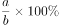
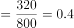
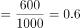
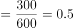
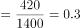

# 两步换算求上座率（票房÷票价求人次，Σ场次×各厅座位数求分母）并排序比较

考点：[[20-考点/资料分析/比重/两步换算求上座率（票房÷票价求人次，Σ场次×各厅座位数求分母）并排序比较|比重 / 两步换算求上座率（票房÷票价求人次，Σ场次×各厅座位数求分母）并排序比较]]
材料：[[15-材料/资料分析/181282 某影院6个影厅（1-5厅+VIP厅）|181282 某影院6个影厅（1-5厅+VIP厅）]]

**问法模型**：题干以留白定义'上座率=a/b'（a=观影人次=票房÷平均票价，b=该影片全部场次座位总数=Σ各厅场次×该厅座位数）→ 分别算出四部影片的a与b，再化成百分数由高到低排序对照选项

## 推理链
1. 第1步：从表头提取各片平均票价与昨天票房：甲9600元、乙18000元、丙9000元、丁16800元；票价甲乙丙均30元、丁40元
2. 第2步：按公式a=票房÷平均票价换算观影人次：甲=9600÷30=320，乙=18000÷30=600，丙=9000÷30=300，丁=16800÷40=420人次
3. 第3步：跨厅合并各影片场次：甲=1厅7场+VIP厅2场=9场，乙=2厅6场+5厅2场=8场，丙=3厅6场，丁=4厅4场+5厅3场=7场
4. 第4步：按公式b=Σ(场次×该厅座位数)：甲=100×7+50×2=800座，乙=100×6+200×2=1000座，丙=100×6=600座，丁=200×4+200×3=1400座（座位分50/100/200三档逐厅相乘）
5. 第5步：上座率=a÷b：甲=320÷800=40%，乙=600÷1000=60%，丙=300÷600=50%，丁=420÷1400=30%
6. 第6步：排序得乙60%＞丙50%＞甲40%＞丁30%，对照选项只有B符合

**最快解法**：⚡ 百分数化简法：分子分母均能整除约成简单百分数，乙600/1000=60%最大（四选项乙均排首可锁定含乙为首的选项），再算丙300/600=50%、甲320/800=40%、丁420/1400=30%即可秒排乙＞丙＞甲＞丁选B；丁务必用16800÷40

## 易错点
- ⚠ 丁片票价40元与其余三部30元不同，若统一按30元换算会得560人次、上座率40%，排序错选其他选项
- ⚠ 各厅座位数分50/100/200三档，b必须逐厅'场次×该厅座位数'求和，不能用统一座位数×总场次；VIP厅2场×50座=100座
- ⚠ 同名影片跨厅排片（甲1厅+VIP、乙2厅+5厅、丁4厅+5厅），且5厅同排乙与丁两部影片，只看单行/单列会把乙的2场误记到丁名下导致漏场、错场
- ⚠ 票房是'昨天'单日数据，排片表是'最近一周'每日安排，计算昨天上座率不得按一周天数放大场次或票房

## 母题抽象
> 🧩 当题干出现'某总量指标÷平均单价=实际数量、再除以容量合计=比率'的定义留白特征时，先按定义拆分分子（总额÷单价，注意单价是否唯一）与分母（跨单位Σ数量×容量，注意容量分档），化成简单百分数后排序，验证单价口径与跨行合并是否遗漏

**同类特征**：上座率由高到低排列、总观影人次a=票房÷平均票价、总座位数b=Σ场次×各厅座位数、定义留白需自行补全公式、丁片票价40元区别于其他30元、同名影片跨厅排片需合并统计

## 相关题
（暂无）

---

### 题干

如果某天一部影片的总观影人次是a，该影片所有放映场次包含的总座位数是b，那么当天上座率就是，那么在昨天的四部影片里，上座率由高到低排列正确的是（  ）。

### 选项
- A. 
乙&gt;丁&gt;甲&gt;丙

- B. 
乙&gt;丙&gt;甲&gt;丁
　✅
- C. 
乙&gt;丙&gt;丁&gt;甲

- D. 
乙&gt;丁&gt;丙&gt;甲

### 官方解析

根据票房总收入和平均票价可以确定观影人次a分别为：甲=9600÷30=320人次，乙=18000÷30=600人次，丙=9000÷30=300人次，丁=16800÷40=420人次；根据排片次数和座位数可以确定总座位数b分别为：甲=100×7+100=800个，乙=100×6+200×2=1000个，丙=100×6=600个，丁=200×7=1400个。故上座率分别为：甲，乙，丙，丁。

故正确答案为B。

### 给定材料

某影院有6个影厅，最近一周的排片情况和昨天的票房收入见下表：

