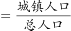
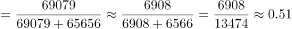
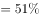

# 现期比重计算＋跨图表数值比对定位

考点：[[20-考点/资料分析/比重/现期比重计算＋跨图表数值比对定位|比重 / 现期比重计算＋跨图表数值比对定位]]
材料：[[15-材料/资料分析/181642 中国2005-2014年城镇与乡村人|181642 中国2005-2014年城镇与乡村人]]

**问法模型**：题干问'某年我国城镇化率处于哪类国家水平' → 先用现期比重公式（城镇人口÷总人口）算出我国该年城镇化率，再到图2同年份列找与各选项组别最接近的数值。

## 推理链
1. 第1步：题干要求2011年我国城镇化率，从图1提取2011年数据：城镇人口69079万人、乡村人口65656万人。
2. 第2步：总人口需自行加总（图1无总人口列）：69079+65656=134735万人。
3. 第3步：代入现期比重公式：城镇化率=城镇人口÷总人口=69079÷134735≈51.3%。
4. 第4步：定位图2'2011年'列：高收入国家80.50%、上中等收入国家60.62%、中等收入国家49.58%、低收入国家28.00%。
5. 第5步：比较差值：51.3%与中等收入国家49.58%仅差约1.7个百分点，与上中等收入国家60.62%差约9.3个百分点，与高收入、低收入差距更大。
6. 第6步：51.3%最接近中等收入国家水平，对照选项选C。

**最快解法**：⚡ 截位直除＋最接近比对：69079÷134735截位为69.08÷134.7≈51.3%；只需与图2'2011年'列四个选项数值比差值，49.58（中等收入国家）最近，秒选C。无需精确计算，估算到51%左右即可锁定。

## 易错点
- ⚠ 图1没有'总人口'列，必须城镇人口+乡村人口自行加总（69079+65656=134735万），易误把城镇人口当分母或漏加乡村人口。
- ⚠ 图2无'中国'一行，必须由图1计算后再跨图比对；注意数值上51.3%与'世界'51.99%也很接近，但'世界'是地区总体而非'类国家'，且不在选项中，不能据此误判。
- ⚠ 年份口径：必须用图2'2011年'列数据，不能用2010年列（如上中等收入国家2010年为59.75%，与2011年的60.62%不同），也不能插值。

## 母题抽象
> 🧩 当题干出现'某指标处于哪类（组别）水平'特征时，先按现期比重=部分÷整体算出本国该年比率，再锁定对比表中同一年份的列，与各选项数值比差值取最接近者，且注意排除'世界'等非选项总体。

**同类特征**：某年城镇化率、处于……类国家的水平、现期比重计算、跨图表拼接比对、与组别数值最接近、图1算率、图2定位

## 相关题
- [[10-真题/资料分析/比重/15527 现期比重计算（多子条件混合的加权平均）|15527]]（黑龙江 2010，相关度1）
- [[10-真题/资料分析/比重/2028300 现期比重计算+饼图扇区匹配|2028300]]（国考 2017，相关度1）
- [[10-真题/资料分析/比重/1752662 现期比重计算（表格空缺比率补值）|1752662]]（北京 2016，相关度1）
- [[10-真题/资料分析/比重/2448500 现期比重计算（整体=部分÷比重，比重=部分÷整体）|2448500]]（国考 2020，相关度1）
- [[10-真题/资料分析/比重/4652175 现期比重计算＋条件充分性判断（双路径验证）|4652175]]（北京 2022，相关度1）

---

### 题干
2011年，我国的城镇化率处于（    ）类国家的水平。

### 选项
- A. 高收入国家
- B. 上中等收入国家
- C. 中等收入国家　✅
- D. 低收入国家

### 官方解析

根据题干“2011年我国的城镇化率”，可判定本题为现期比重计算问题。定位图1柱状图，2011年我国的城镇化率。定位表2最后一列，与中等收入国家的城镇化率水平最接近。

故正确答案为C。

### 给定材料

 

