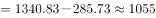
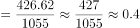

# 现期比重计算（整体需由注释等式反推的跨图表联动）

考点：[[20-考点/资料分析/比重/现期比重计算（整体需由注释等式反推的跨图表联动）|比重 / 现期比重计算（整体需由注释等式反推的跨图表联动）]]
材料：[[15-材料/资料分析/181454 全国水稻生产情况：2013年种植面积|181454 全国水稻生产情况：2013年种植面积]]

**问法模型**：题干问'2012年人工成本占总成本的百分比'→现期比重模型：先由'产值合计=总成本+净利润'从图1反推总成本，再算人工成本÷总成本

## 推理链
1. 第1步：表1倒数第二列给出2012年人工成本426.62元/亩（分子），题干要求其占总成本的比重
2. 第2步：总成本未直接给出，依据材料注释'产值合计=总成本+净利润'，需从图1反推：图1给出2012年产值合计1340.83元/亩、净利润285.75元/亩
3. 第3步：代入等式反推整体：2012年总成本=1340.83−285.75=1055.08元/亩
4. 第4步：现期比重公式：比重=人工成本÷总成本=426.62÷1055.08
5. 第5步：截位直除：426.62/1055.08≈426/1055≈40.4%
6. 第6步：与选项对照，与B项最接近，故选B

**最快解法**：⚡ 桥梁公式法＋截位直除：先用注释'总成本=产值合计−净利润'反推分母1055.08，再算426.62/1055.08≈426/1055，商首两位40，即约40.4%，秒选B（也可先估算：1055×40%=422，接近426.62，略高于40%）

## 易错点
- ⚠ 总成本在材料中从未直接给出，若不利用注释'产值合计=总成本+净利润'反推，会拿人工成本与产值合计1340.83或其他量相比而错
- ⚠ 表1是'主要成本'六项，2012年六项之和约979.59元/亩＜总成本1055.08元/亩，不能把六项之和当总成本做分母
- ⚠ 图1中现金收益797.47与净利润285.75口径不同，现金收益不能替代净利润参与'产值合计=总成本+净利润'的换算

## 母题抽象
> 🧩 当题干问'某项占总成本的比重'而整体（总成本）未直接给出时，找材料注释/括号里的等量关系（产值合计=总成本+净利润）反推整体，再用部分÷整体截位直除

**同类特征**：现期年份（2012年）占…的百分比、比重计算、整体量未直接给出需反推、跨图表联动（表1＋图1＋注释）、选项为百分比且数值接近需精算首位、单位为元/亩（每亩口径）

## 相关题
- [[10-真题/资料分析/比重/12881988 现期比重计算|12881988]]（广东 2025，相关度1）

---

### 题干
2012年生产水稻的人工成本占总成本的百分比约为（    ）。

### 选项
- A. 

- B. 

　✅
- C. 

- D. 

### 官方解析

根据题干“2012年······占······的百分比为”，可判定本题为现期比重问题。定位表格材料倒数第二列，2012年水稻生产人工成本为426.62元/亩，定位柱状图，2012年产值合计为1340.83元/亩，净利润为285.73元/亩，因为产值合计等于总成本与净利润之和，则2012年的元/亩，则占比，与B项最接近。

故正确答案为B。

### 给定材料

        2013年全国水稻种植面积达4.55亿亩，比上年增加260多万亩。但由于强降雨及洪涝灾害，总产量较上年减少62万吨，总产量为20361万吨。下图反映的是20082012年我国水稻每亩的产值情况及水稻生产的主要成本构成情况。

注：产值合计等于总成本与净利润之和。

> [!warning] 疑点（官方解析可能有误，待人工复核）
> 官方解析中净利润写作285.73元/亩，图1标注为285.75元/亩，属解析笔误；按285.75计算总成本=1055.08元/亩、占比≈40.4%，与官方答案B一致，不影响结论

<!-- CODEX-ANSWER-REVIEW:BEGIN -->
### 本次独立复核

**复核状态：** `resolved`（答案与解析已核定）

**计分答案：** B（可计分）

**复核解析：**

水稻人工成本426.62元/亩。2012年产值1340.83元/亩、净利润285.75元/亩，故总成本=1340.83−285.75=1055.08元/亩；人工成本占比=426.62÷1055.08≈40.4%，对应B。

**相关信息：**

净利润=产值−总成本；成本比重以总成本作分母，不以产值作分母。

**题源依据：** [固定版本原题](https://github.com/Mentat-Uran/kaogongzhentizhengliu/blob/84ab93d4b64b61d897bece8a1c0a5bab06b4feb2/10-%E7%9C%9F%E9%A2%98/%E8%B5%84%E6%96%99%E5%88%86%E6%9E%90/%E6%AF%94%E9%87%8D/1758942%20%E7%8E%B0%E6%9C%9F%E6%AF%94%E9%87%8D%E8%AE%A1%E7%AE%97%EF%BC%88%E6%95%B4%E4%BD%93%E9%9C%80%E7%94%B1%E6%B3%A8%E9%87%8A%E7%AD%89%E5%BC%8F%E5%8F%8D%E6%8E%A8%E7%9A%84%E8%B7%A8%E5%9B%BE%E8%A1%A8%E8%81%94%E5%8A%A8%EF%BC%89.md)；固定内容 commit `84ab93d4b64b61d897bece8a1c0a5bab06b4feb2`，Markdown blob `11d534668c57369ac436c761286ba06f5c7600de`。
<!-- CODEX-ANSWER-REVIEW:END -->
