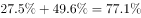
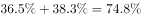
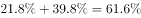
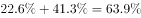

# 现期比重加和比较（分列比重求和比大小）

考点：[[20-考点/资料分析/比重/现期比重加和比较（分列比重求和比大小）|比重 / 现期比重加和比较（分列比重求和比大小）]]
材料：[[15-材料/资料分析/182182 2015年国家统计局社情民意调查中心|182182 2015年国家统计局社情民意调查中心]]

**问法模型**：题干问'某两项占比之和占本类总数的比重最高的是哪类'→按表逐列将'满意+基本满意'两个占比相加（或用100%减去'不满意+不清楚'）后比较大小，无需计算人数

## 推理链
1. 第1步：从统计表按列提取'满意'与'基本满意'两行数据：国有工矿21.8/39.8、国有垦区（农场）36.5/38.3、国有林区（林场）27.5/49.6、城中村22.6/41.3（城市危房23.0/38.9、其他24.8/36.5需一并排查防漏）
2. 第2步：每列四项评价合计为100%，故'满意+基本满意'占比=两数直接相加=100%−（不满意+不清楚），比重可直接加和比较
3. 第3步：代入计算：国有工矿21.8+39.8=61.6%；国有垦区36.5+38.3=74.8%；国有林区27.5+49.6=77.1%；城中村22.6+41.3=63.9%；城市危房61.9%、其他61.3%，均低于国有林区
4. 第4步：六类中77.1%最大，对应国有林区（林场），与选项A对照，故正确答案为A

**最快解法**：⚡ 反面加和排除法：每列'满意+基本满意'=100%−（不满意+不清楚），只比'不满意+不清楚'谁最小即可——国有林区15.3+7.6=22.9%为六类最小（国有垦区25.2%、国有工矿38.4%、城中村36.1%），故正面占比必最高，选A；亦可先看'基本满意'行，国有林区49.6%为全表最高且'满意'27.5%不低，直加27.5+49.6=77.1%锁定

## 易错点
- ⚠ 看串行陷阱：国有垦区'满意'36.5%与'其他'类'基本满意'36.5%数值相同但分属不同行列，按列定位时易错配
- ⚠ 口径分裂：文字段的23.4%/40.2%是全部受访居民总体占比，本题须用表中分类型列数据，两组不可混用、更不可求六类平均
- ⚠ 本题只需比较比重无需人数，切勿用10100去乘或虚构各类受访人数；另注意每列合计100%可作加和校验

## 母题抽象
> 🧩 当题干出现'某两项之和占本类/该列总数的比重最高（最低）'特征时，直接在统计表按列加和相关行占比（或用100%减其余行取反面）比较大小，全程停留在比重层面、不涉及总人数

**同类特征**：各类棚户区中…比重最高的是、满意+基本满意求和、占本类棚户区受访居民总数、分类型（分列）横向比较、单一时期占比截面数据、只比大小不算人数

## 相关题
（暂无）

---

### 题干
各类棚户区中，表示“满意”“基本满意”的受访居民之和占本类棚户区受访居民总数的比重最高的是：

### 选项
- A. 国有林区（林场）　✅
- B. 国有垦区（农场）
- C. 国有工矿
- D. 城中村

### 官方解析

由题目问“满意”“基本满意”的受访居民之和占本类棚户区受访居民总数的比重最高，判定本题为现期比重问题。各类棚户区评价均由“满意”“基本满意”“不满意”“不清楚”构成，则国有林区（林场）、国有垦区（农场）、国有工矿、城中村的“满意”“基本满意”的比重分别为、、、，则国有林区（林场）中表示“满意”“基本满意”的受访居民之和占本类棚户区受访居民总数的比重最高。 故正确答案为A。

### 给定材料

        为了解城镇棚户区改造情况，国家统计局社情民意调查中心2015年选取20个省（市、区）城镇棚户区的10100位居民进行了调查，调查显示，对于棚户区配套公共服务设施改造状况，受访棚户区居民中23.4%表示满意，40.2%表示基本满意，具体调查结果见下表：

