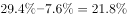

# 比重极差比较（同一行占比最大值−最小值）

考点：[[20-考点/资料分析/比重/比重极差比较（同一行占比最大值−最小值）|比重 / 比重极差比较（同一行占比最大值−最小值）]]
材料：[[15-材料/资料分析/182182 2015年国家统计局社情民意调查中心|182182 2015年国家统计局社情民意调查中心]]

**问法模型**：'各类型中某项占比最多相差'→ 锁定表格中该评价项所在行，取六列占比的最大值减最小值求极差，答案单位为百分点

## 推理链
1. 第1步：题干求六类棚户区中'不清楚'占本类受访居民总数的比重的最大差距，且每列合计100%（本类内部结构占比），故只需比较表格'不清楚'一行的六个数据，无需人数
2. 第2步：读取'不清楚'行数据：国有工矿22.5%、国有垦区（农场）11.5%、国有林区（林场）7.6%、城中村19.4%、城市危房25.9%、其他29.4%
3. 第3步：扫描得最大比重为'其他'类29.4%，最小比重为'国有林区（林场）'类7.6%
4. 第4步：代入极差公式：29.4%−7.6%=21.8，占比之差单位为百分点
5. 第5步：与选项对照，21.8个百分点即C项；D项29.4个百分点是最大占比本身的干扰项，予以排除

**最快解法**：⚡ 一行定位+目测极差法：先在'不清楚'行快速目测出最大29.4（'其他'列）与最小7.6（'国有林区'列），心算29.4−7.6=21.8，直接选C，无需动笔列式

## 易错点
- ⚠ 误选D项29.4个百分点——把最大占比29.4%本身当作差值，'最多相差'求的是极差29.4−7.6=21.8
- ⚠ 比重之差是'百分点'而非'%'，题干与选项均按百分点表述，概念上须分清
- ⚠ 数字撞车看串行：'其他'列'基本满意'36.5与'国有垦区''满意'36.5数值相同，须锁定'不清楚'行再取数，避免横向窜行

## 母题抽象
> 🧩 当题干出现'各类型中某项占比最多相差/极差'特征时，锁定该指标所在行取最大−最小，直接得出百分点差值，并用'最大值本身'这一干扰项自查

**同类特征**：各类棚户区中、占本类棚户区受访居民总数的比重、'不清楚'、最多相差、个百分点

## 相关题
- [[10-真题/资料分析/增长/10718183 名义增速与实际增速之差（百分点计算）|10718183]]（深圳市考 2024，相关度1）
- [[10-真题/资料分析/比重/16070258 现期比重差值（两个部分占比相减）|16070258]]（重庆 2026，相关度1）
- [[10-真题/资料分析/比重/1752600 两期比重变化（比重差，百分点表述）|1752600]]（北京 2016，相关度1）
- [[10-真题/资料分析/比重/1789664 比重差值计算（百分点搭桥）|1789664]]（江苏 2016，相关度1）
- [[10-真题/资料分析/比重/2042846 两期比重差（比重差值计算）|2042846]]（江苏 2017，相关度1）

---

### 题干
各类棚户区中，表示“不清楚”的受访居民数占本类棚户区受访居民总数的比重最多相差：

### 选项
- A. 12.7个百分点
- B. 16.9个百分点
- C. 21.8个百分点　✅
- D. 29.4个百分点

### 官方解析

由题目问各类型棚户区中，表示“不清楚”的受访居民数占本类棚户区受访居民总数的比重的差，且表格中已知各类型中其所占比重，故可判定本题为简单加减计算问题，由表格可知，比重最大的为29.4，最小的为7.6，故最多相差。

故正确答案为C。

### 给定材料

        为了解城镇棚户区改造情况，国家统计局社情民意调查中心2015年选取20个省（市、区）城镇棚户区的10100位居民进行了调查，调查显示，对于棚户区配套公共服务设施改造状况，受访棚户区居民中23.4%表示满意，40.2%表示基本满意，具体调查结果见下表：

