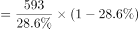
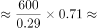
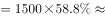
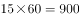

# 现期比重计算（部分量÷占比反推总体，再乘新占比求另一部分量，两步链式）

考点：[[20-考点/资料分析/比重/现期比重计算（部分量÷占比反推总体，再乘新占比求另一部分量，两步链式）|比重 / 现期比重计算（部分量÷占比反推总体，再乘新占比求另一部分量，两步链式）]]
材料：[[15-材料/资料分析/182186 2015年6月某市统计局对应届毕业生|182186 2015年6月某市统计局对应届毕业生]]

**问法模型**：问'因缺乏启动资金而不打算创业的毕业生有多少人' → 用593÷28.6%先反推总样本，再求不创业人数，最后乘图1中58.8%得目标人数（部分量=总体×占比两步套用）

## 推理链
1. 第1步：文字段给出有创业打算593名、占28.6%，总样本未直接给出，需反推
2. 第2步：总体=部分量÷占比，总样本=593÷28.6%≈2073名
3. 第3步：没有创业打算的人数=2073−593≈1480名（即2073×71.4%≈1480名）
4. 第4步：图1《不打算创业的原因（多选）》的基数为'没有创业打算的受访者'，其中缺乏启动资金占58.8%
5. 第5步：部分量=基数×占比=1480×58.8%≈870名
6. 第6步：与选项对照：349（A，误用593当基数）、870（B）、1219（C，误用总样本2073当基数）、1480（D，中间量陷阱），故选B

**最快解法**：⚡ 两步截位直除+百化分放缩：①593÷28.6%≈593÷0.286≈2070名；②不创业者≈2070−593≈1480名，再1480×58.8%≈1480×0.6≈888（把58.8%放缩为60%），与B项870最接近，秒选B；考场可先记住兄弟题1算好的总样本≈2073、不创业≈1480直接复用

## 易错点
- ⚠ 把593名误当总人数作分母：593×58.8%≈349，误选A；593是'有创业打算'的部分量，不是图1的基数
- ⚠ 忽略图1基数是'没有创业打算'的子样本而非全体受访者：2073×58.8%≈1219，误选C；且图1是多选题，各项占比之和远超100%，不能按100%分配
- ⚠ 把中间量1480（不创业人数）直接当成答案误选D，漏乘58.8%这一步

## 母题抽象
> 🧩 当题干给出'某部分量及其占比'但所求部分量的基数（总体）未直接给出时，用'部分量÷占比=总体、总体×目标占比=所求'两步现期比重法，先核对两步各自基数是哪个子样本再代入

**同类特征**：因缺乏启动资金而不打算创业的毕业生有、问人数而非比重、需先反推总样本（593÷28.6%）、图1基数为不打算创业者、多选题占比不能加和为100%、选项含中间量1480与错误基数1219的陷阱

## 相关题
（暂无）

---

### 题干
本次调查中，因缺乏启动资金而不打算创业的毕业生有：

### 选项
- A. 349人
- B. 870人　✅
- C. 1219人
- D. 1480人

### 官方解析

根据资料和题目，可以判定本题为现期比重问题。定位文字资料第一段，本次调查中，有创业打算的毕业生有593名，占28.6，故没有创业打算的毕业生人数。再由条形图可知，因缺乏启动资金而放弃创业的人数占到58.8，故因缺乏启动资金而放弃创业的人数，与B项最接近。

故正确答案为B。

### 给定材料

        2015年6月某市统计局对应届毕业生的抽样调查显示：有593名受访者打算创业，占28.6%。其中，大专生打算创业的比重比平均水平高7.0个百分点，本科生打算创业的比重比平均水平低3.9个百分点，31.4%的研究生打算创业，有34.5%的受访男生打算创业，比女生高11.2个百分点。

        在没有创业打算的受访者应届毕业生中，因缺乏启动资金，缺乏社会经验，缺乏创业方向等原因不打算创业的情况见图1，有创业打算的受访应届毕业生能承担的创业资金额度情况见图2.

> [!warning] 疑点（官方解析可能有误，待人工复核）
> 官方解析文本中'故没有创业打算的毕业生人数'之后脱漏具体数值（按口径应为593÷28.6%×71.4%≈1480名），属排版脱字；其计算逻辑与结果870人、答案B均正确，不影响结论

<!-- CODEX-ANSWER-REVIEW:BEGIN -->
### 本次独立复核

**复核状态：** `resolved`（答案与解析已核定）

**计分答案：** B（可计分）

**复核解析：**

有创业打算者593人，占28.6%，故没有创业打算者约593×71.4%/28.6%≈1480人；其中因缺乏启动资金约占58.8%，人数约1480×58.8%≈870人，选B。

**相关信息：**

先用已知子集和占比还原总调查人数，再求无意愿群体及其中原因人数。

**题源依据：** [固定版本原题](https://github.com/Mentat-Uran/kaogongzhentizhengliu/blob/84ab93d4b64b61d897bece8a1c0a5bab06b4feb2/10-%E7%9C%9F%E9%A2%98/%E8%B5%84%E6%96%99%E5%88%86%E6%9E%90/%E6%AF%94%E9%87%8D/1789666%20%E7%8E%B0%E6%9C%9F%E6%AF%94%E9%87%8D%E8%AE%A1%E7%AE%97%EF%BC%88%E9%83%A8%E5%88%86%E9%87%8F%C3%B7%E5%8D%A0%E6%AF%94%E5%8F%8D%E6%8E%A8%E6%80%BB%E4%BD%93%EF%BC%8C%E5%86%8D%E4%B9%98%E6%96%B0%E5%8D%A0%E6%AF%94%E6%B1%82%E5%8F%A6%E4%B8%80%E9%83%A8%E5%88%86%E9%87%8F%EF%BC%8C%E4%B8%A4%E6%AD%A5%E9%93%BE%E5%BC%8F%EF%BC%89.md)；固定内容 commit `84ab93d4b64b61d897bece8a1c0a5bab06b4feb2`，Markdown blob `5c029da8790d8c4f0a508794c85033e5ec238db9`。
<!-- CODEX-ANSWER-REVIEW:END -->
