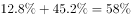
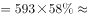
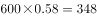
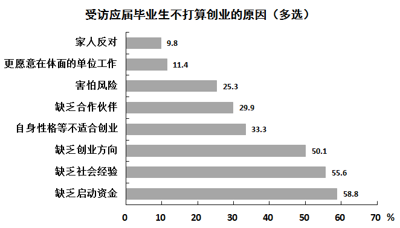
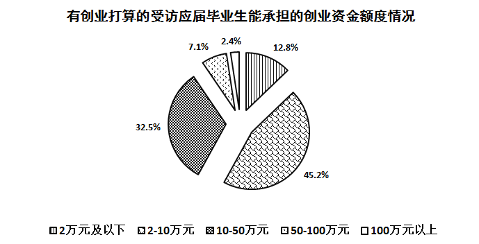

# 现期比重计算（饼图多档位占比合并×基数求人数）

考点：[[20-考点/资料分析/比重/现期比重计算（饼图多档位占比合并×基数求人数）|比重 / 现期比重计算（饼图多档位占比合并×基数求人数）]]
材料：[[15-材料/资料分析/182186 2015年6月某市统计局对应届毕业生|182186 2015年6月某市统计局对应届毕业生]]

**问法模型**：'低于10万元的人数是多少'→先识别'低于10万元'跨哪些档位并把占比相加，再用'部分量=基数×合计占比'求解，若无精确匹配选项则取最接近项

## 推理链
1. 第1步：题干求'有创业打算的毕业生中能承担资金低于10万元'的人数，基数即图2的总体——有创业打算的593名，而非总样本（593÷28.6%≈2073名）
2. 第2步：图2饼图中'低于10万元'须覆盖'2万元及以下7.1%'与'2-10万元45.2%'两档，合并占比7.1%+45.2%=52.3%（最易漏掉7.1%小扇区）
3. 第3步：代入部分量=总体×比重：593×52.3%=593×0.523≈310名
4. 第4步：选项中无310，比较距离：|310−344|=34 < |310−268|=42 < |310−249|=61 < |310−193|=117，与310最接近的是A项344，故选A

**最快解法**：⚡ 同基数占比加和+估算法：7.1%+45.2%=52.3%，把593看作600，600×52%≈312（精确约310）；对照选项，268恰为593×45.2%（漏加7.1%的陷阱值）、193恰为593×32.5%（扇区错位陷阱值），仅344在310的合理邻域，直接锁定A

## 易错点
- ⚠ 漏加'2万元及以下7.1%'小扇区：只算45.2%得593×45.2%≈268，正中B项陷阱
- ⚠ 基数用错：误把593当总体、或用总样本2073/不创业人数1480当基数；本题比重与人数均出自图2，基数就是有创业打算的593名
- ⚠ 扇区与图例错位：按图例顺序2.4%是'100万元以上'、12.8%是'50-100万元'、32.5%是'10-50万元'，若错位会把10-50万元档并入'低于10万元'，得593×32.5%≈193误选D
- ⚠ 算出≈310后选项中无此数，误以为自己算错而反复重算；应按'与A项最接近'的官方口径直接取344

## 母题抽象
> 🧩 当题干问'某区间/某类别的人数'且材料给出'总体人数+各档位占比'时，先锁定与占比同源的基数，再把该区间覆盖的所有档位占比相加，用'部分量=基数×合计占比'计算，选项无精确值时选最接近者

**同类特征**：低于10万元（区间跨多个档位）、能承担的创业资金额度、人数是、饼图分档占比、基数为有创业打算的593名、现期比重求部分量

## 相关题
- [[10-真题/资料分析/比重/48527 现期部分量计算（总人数×录取百分比）比较|48527]]（湖南 2009，相关度1）
- [[10-真题/资料分析/比重/1789644 现期比重计算·部分量之差（占比差×总量求人数）|1789644]]（江苏 2016，相关度1）
- [[10-真题/资料分析/比重/2042320 现期比重计算（部分量=整体量×比重）|2042320]]（江苏 2017，相关度1）
- [[10-真题/资料分析/比重/2030154 现期比重求部分量（占比×样本总量）|2030154]]（四川 2016，相关度1）
- [[10-真题/资料分析/比重/2144603 现期比重求部分量（整体为新增流量，比重需作1−x互补转换）|2144603]]（选调 2018，相关度1）

---

### 题干
本次调查中有创业打算的毕业生能承担的创业资金额度低于10万元的人数是：

### 选项
- A. 344　✅
- B. 268
- C. 249
- D. 193

### 官方解析

根据材料和题目已知求相应人数，可判定此题为现期比重问题。定位饼形图可以得出，能承担创业资金额度低于10万元的毕业生所占比重。调查中共有593人打算创业。故所求人数人，与A项最接近。

故正确答案为A。

### 给定材料

        2015年6月某市统计局对应届毕业生的抽样调查显示：有593名受访者打算创业，占28.6%。其中，大专生打算创业的比重比平均水平高7.0个百分点，本科生打算创业的比重比平均水平低3.9个百分点，31.4%的研究生打算创业，有34.5%的受访男生打算创业，比女生高11.2个百分点。

        在没有创业打算的受访者应届毕业生中，因缺乏启动资金，缺乏社会经验，缺乏创业方向等原因不打算创业的情况见图1，有创业打算的受访应届毕业生能承担的创业资金额度情况见图2.

> [!warning] 疑点（官方解析可能有误，待人工复核）
> 精确计算593×(7.1%+45.2%)=593×52.3%≈310名，四个选项中均无310；官方解析明确表述'与A项最接近'取A(344)，且解析正文'故所求人数人'处数字缺失（疑为公式图片丢失）。B(268)≈593×45.2%、D(193)≈593×32.5%均为命题陷阱值，A为最接近值，答案口径自洽，不构成解析错误

<!-- CODEX-ANSWER-REVIEW:BEGIN -->
### 本次独立复核

**复核状态：** `confirmed`（独立复算确认答案）

**计分答案：** A（可计分）

**复核解析：**

题图2显示低于10万元包括“2万元及以下”7.1%和“2–10万元”45.2%，合计52.3%。以有创业打算的593名毕业生为基数：593×52.3%=310.139，约310人。选项A—D分别为344、268、249、193，与计算值的差分别为34、42、61、117，A是唯一最近值；原官方解析也明确说明“与A项最接近”。故按题目近似选项口径选A。

**相关信息：**

现期比重求部分量；跨多个区间时先合并占比，再乘同一调查人群基数。选项无精确值时按原题明确的最近值口径作答。

**题源依据：** [固定版本原题](https://github.com/Mentat-Uran/kaogongzhentizhengliu/blob/84ab93d4b64b61d897bece8a1c0a5bab06b4feb2/10-%E7%9C%9F%E9%A2%98/%E8%B5%84%E6%96%99%E5%88%86%E6%9E%90/%E6%AF%94%E9%87%8D/1789668%20%E7%8E%B0%E6%9C%9F%E6%AF%94%E9%87%8D%E8%AE%A1%E7%AE%97%EF%BC%88%E9%A5%BC%E5%9B%BE%E5%A4%9A%E6%A1%A3%E4%BD%8D%E5%8D%A0%E6%AF%94%E5%90%88%E5%B9%B6%C3%97%E5%9F%BA%E6%95%B0%E6%B1%82%E4%BA%BA%E6%95%B0%EF%BC%89.md)；固定内容 commit `84ab93d4b64b61d897bece8a1c0a5bab06b4feb2`，Markdown blob `83d4047bebd34c8edd44bf0b1c0870640abef63d`。
<!-- CODEX-ANSWER-REVIEW:END -->
