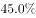
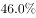
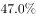

# 间接求占比（分类合计100%，减法求剩余项）

考点：[[20-考点/资料分析/比重/间接求占比（分类合计100%，减法求剩余项）|比重 / 间接求占比（分类合计100%，减法求剩余项）]]
材料：[[15-材料/资料分析/182296 2015年5月国家统计局调查队在江苏|182296 2015年5月国家统计局调查队在江苏]]

**问法模型**：题干问'三个及以上子女'的占比而材料未直接给出 → 用'子女数量分类合计100%'模型，剩余项占比=100%−已知各项占比之和

## 推理链
1. 第1步：题干要求'有三个及以上子女'的占比；材料子女数量结构仅直接给出三类：有一个子女占a%、有两个子女占b%、无子女占c%（本文本数值被隐去，a、b、c以原题卷实际百分数为准），'三个及以上'未直接给出。
2. 第2步：子女数量为互斥分类，各类占比合计为100%，故'三个及以上子女'是剩余项：占比=100%−a%−b%−c%。
3. 第3步：先合并a%+b%+c%，再用100%一次性相减得结果（严禁凭空补数或用经验值代替，须代入原卷数值）。
4. 第4步：将计算结果与四个选项对照，官方确定答案为B。

**最快解法**：⚡ 剩余项法（100%减法）：先把'有一个子女+有两个子女+无子女'三项占比合并相加，再用100%一次性相减，避免逐项连减出错；所用数值必须取自原题卷

## 易错点
- ⚠ 误以为材料直接给出'三个及以上子女'数据而在原文中反复找数——实际该数据缺失，必须用100%减法间接求出
- ⚠ 串行读错：纯文字材料一段内密集排列'子女数量''居住方式''探望频率'三套各自合计100%的占比，把居住方式或探望频率的数值误当子女数量代入
- ⚠ 漏减'无子女'一项（只减两类导致结果偏大），或多项连减时符号/抄录出错

## 母题抽象
> 🧩 当题干求某分类体系中'三个及以上/其余/其他'等未直接列出的剩余项占比时，先确认该体系各分类互斥且合计100%，用'剩余占比=100%−已知各项占比之和'一步求解，并核对所取各项确属同一套分类

**同类特征**：三个及以上子女、占比（%）、剩余项/间接求解、分类合计100%、纯文字材料、无图表读数

## 相关题
- [[10-真题/资料分析/综合/12881984 文字材料多选判断（定位+细节比对）|12881984]]（广东 2025，相关度1）
- [[10-真题/资料分析/增长/2274494 基期量计算（现期量÷(1+r)）|2274494]]（北京 2019，相关度1）

---

### 题干
受访老人中有三个及以上子女的占比（    ）。

### 选项
- A. 

- B. 

　✅
- C. 

- D. 

### 官方解析
根据题干中“有三个及以上子女的占比”和文字材料第一段中“受访老人中有一个子女的占，有两个子女的占，无子女的占。”的数据可知，受访老人中有三个及以上子女的占比为：。
故正确答案为B。

### 给定材料

        2015年5月，国家统计局调查队在江苏省某市开展了农村养老现状专项调研。受访老人中岁的占，岁的占，80岁及其以上的占。受访老人中有一个子女的占，有两个子女的占，无子女的占。受访老人中与配偶同住的占，与未婚子女同住的占，与某个已婚子女同住的占，在子女家轮流住的占，独居的占。的受访老人为男性。从不同住子女探望老人的频率看，的受访老人表示每天来探望，的表示每周来探望，的表示每月来探望，其余的表示子女遇事或根据要求来探望。

        调查显示，看电视（）、串门聊天（）、打牌（）、散步（）、听广播（）和读书看报（）是农村老人的主要闲暇活动。当问及“你想不想参加集体活动”时，的受访老人表示“想参加”，的老人表示“可参加可不参加”，还有的老人表示“不想参加”。关于受访老人对当前生活状态的满意度，从年龄层看，岁、岁，80岁及其以上的老人对当前生活状态的满意度分别为、、；从居住状态看，与子女同住、与配偶同住、独居的老人对当前生活状态的满意度分别为、、；从与村委会互动的频率看，经常互动、偶尔互动、基本不互动的老人对当前生活状态的满意度分别为、、。

