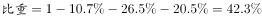

# 结构占比大小比较（含'其余'剩余项还原）

考点：[[20-考点/资料分析/比重/结构占比大小比较（含'其余'剩余项还原）|比重 / 结构占比大小比较（含'其余'剩余项还原）]]
材料：[[15-材料/资料分析/182296 2015年5月国家统计局调查队在江苏|182296 2015年5月国家统计局调查队在江苏]]

**问法模型**：题干问'占全体受访老人比重最大的是'→ 定位探望频率四分类（每天/每周/每月/其余），还原'其余'占比后直接比较四类占比大小取最大项

## 推理链
1. 第1步：从材料定位'从不同住子女探望老人的频率看'一句，结构为四类：每天来探望、每周来探望、每月来探望、其余（子女遇事或根据要求来探望），四类合计100%
2. 第2步：前三类占比材料直接给出（数值以原题卷为准），'其余'为剩余合并项，需用100%−每天占比−每周占比−每月占比间接求得
3. 第3步：将还原后的'其余'占比与每天、每周、每月三个直读占比逐一比较，按官方结论'其余（遇事或根据要求来探望）'占全体受访老人比重最大
4. 第4步：对照选项，'子女遇事或根据要求来探望的老人群体'对应D项，故正确答案为D

**最快解法**：⚡ 剩余项还原+直读比较：先用100%减法算出'其余'占比（100%−前三类之和），再与三个直读占比比大小，最大者即答案；本题为纯数值比较，无需复杂速算，关键是别漏掉'其余'这一项

## 易错点
- ⚠ 只在前三类直读占比（每天/每周/每月）中挑最大，漏掉'其余'这一合并剩余项，凭直觉误选C（每天探望）
- ⚠ 串行读数：把'探望频率'结构与'子女数量''居住方式'两套各自合计100%的占比混淆，读错归属行
- ⚠ 原材料具体百分数被隐去，必须以原题卷实际数值比较为准，不可凭经验假设'每天探望'占比一定最高

## 母题抽象
> 🧩 当题干出现'占比最大的是'且材料结构中含'其余的表示…'这类剩余合并项时，先用100%减法还原'其余'占比，再与各直读占比比较大小，最大项即为答案

**同类特征**：从不同住子女探望老人的频率看、占全体受访老人比重最大、其余的表示子女遇事或根据要求来探望、四类频率合计100%、读数比较型最大项判定

## 相关题
（暂无）

---

### 题干
从不同住子女探望老人的频率看，占全体受访老人比重最大的是（    ）。

### 选项
- A. 子女每月来探望的老人群体
- B. 子女每周来探望的老人群体
- C. 子女每天来探望的老人群体
- D. 子女遇事或根据要求来探望的老人群体　✅

### 官方解析

根据文字材料第一段中“从不同住子女探望老人的频率看，的受访老人表示每天来探望，的表示每周来探望，的表示每月来探望，其余的表示子女遇事或根据要求来探望。”可知，子女遇事或根据要求来探望的，对比起来，此为占全体受访老人比重最大的部分。

故正确答案为D。

### 给定材料

        2015年5月，国家统计局调查队在江苏省某市开展了农村养老现状专项调研。受访老人中岁的占，岁的占，80岁及其以上的占。受访老人中有一个子女的占，有两个子女的占，无子女的占。受访老人中与配偶同住的占，与未婚子女同住的占，与某个已婚子女同住的占，在子女家轮流住的占，独居的占。的受访老人为男性。从不同住子女探望老人的频率看，的受访老人表示每天来探望，的表示每周来探望，的表示每月来探望，其余的表示子女遇事或根据要求来探望。

        调查显示，看电视（）、串门聊天（）、打牌（）、散步（）、听广播（）和读书看报（）是农村老人的主要闲暇活动。当问及“你想不想参加集体活动”时，的受访老人表示“想参加”，的老人表示“可参加可不参加”，还有的老人表示“不想参加”。关于受访老人对当前生活状态的满意度，从年龄层看，岁、岁，80岁及其以上的老人对当前生活状态的满意度分别为、、；从居住状态看，与子女同住、与配偶同住、独居的老人对当前生活状态的满意度分别为、、；从与村委会互动的频率看，经常互动、偶尔互动、基本不互动的老人对当前生活状态的满意度分别为、、。

