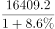
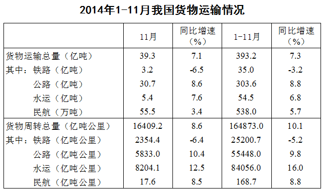

# 基期比重计算

考点：[[20-考点/资料分析/比重/基期比重计算|比重 / 基期比重计算]]
材料：[[15-材料/资料分析/182456 2014年1-11月（含11月当月）|182456 2014年1-11月（含11月当月）]]

**问法模型**：题干问'2013年11月……水运周转量占比'（基期时间+占比）→ 用基期比重模型：基期比重=现期比重×(1+总量增速)/(1+分量增速)

## 推理链
1. 第1步：从表格'货物周转量'分块取11月当月数据：水运周转量8204.1亿吨公里、同比增速12.5%；货物周转总量16409.2亿吨公里、同比增速8.6%
2. 第2步：基期比重公式：2013年11月占比=[8204.1/(1+12.5%)]÷[16409.2/(1+8.6%)]=(8204.1/16409.2)×(1.086/1.125)
3. 第3步：截位估算：8204.1/16409.2≈50%（总量的一半恰为8204.6），修正因子1.086/1.125≈0.965，故占比≈50%×0.965≈48.3%
4. 第4步：48.3%落在40%~50%区间，对照选项只有B符合，故选B

**最快解法**：⚡ 公式法+截位直除：先看现期比重8204.1/16409.2恰约为50%（16409.2的一半是8204.6），再乘修正因子(1+8.6%)/(1+12.5%)≈0.965，得约48.3%，直接锁定B；无需分别精算两个基期量

## 易错点
- ⚠ 读错分块：必须在'货物周转量'（亿吨公里）分块取数，若串行到'货物运输量'分块取水运5.4亿吨则全错
- ⚠ 修正因子方向写反：基期比重=现期比重×(1+总量增速)/(1+分量增速)=×(1.086/1.125)<1，若分子分母颠倒会得约51.7%而误选C
- ⚠ 时间口径混淆：题问11月当月，应用当月增速8.6%和12.5%，误用1-11月累计增速10.1%、16.0%则结果偏差

## 母题抽象
> 🧩 当题干出现'上年同期（基期时间）+某分量占总量的比重'特征时，用基期比重公式'现期比重×(1+总量增速)/(1+分量增速)'，先估现期比重再乘修正因子，对照选项区间验证

**同类特征**：2013年11月（基期时间）、货物周转总量、水运周转量占比、基期比重、区间范围型选项、周转量分块（非货运量分块）

## 相关题
- [[10-真题/资料分析/比重/2050986 基期比重计算|2050986]]（江西 2017，相关度3）
- [[10-真题/资料分析/比重/16593082 基期比重计算|16593082]]（甘肃 2024，相关度3）
- [[10-真题/资料分析/比重/2049856 基期比重计算|2049856]]（湖南 2017，相关度2）
- [[10-真题/资料分析/比重/2172071 基期比重计算|2172071]]（广州市考 2018，相关度2）
- [[10-真题/资料分析/比重/2188466 基期比重计算|2188466]]（黑龙江 2018，相关度2）

---

### 题干
2013年11月我国货物周转总量中，水运周转量占比在以下哪个范围之内？

### 选项
- A. 低于40%
- B. 40%~50%　✅
- C. 50%~60%
- D. 高于60%

### 官方解析

由题干“2013年11月份......水运周转量占比”可知，本题为基期比重问题。定位表格材料，查找数据代入为，即，略小于，因此水运周转量占比为~。

故正确答案为B。

### 给定材料

 

