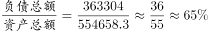
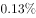

# 现期比值计算（资产负债率=负债总额÷资产总额，区间定位）

考点：[[20-考点/资料分析/比重/现期比值计算（资产负债率=负债总额÷资产总额，区间定位）|比重 / 现期比值计算（资产负债率=负债总额÷资产总额，区间定位）]]
材料：[[15-材料/资料分析/182458 2015年1-3月全国国有企业经营与|182458 2015年1-3月全国国有企业经营与]]

**问法模型**：题干出现'资产负债率（负债总额÷资产总额）在哪个范围内'且限定'2015年3月末'时点 → 直接取第4段现期两个存量绝对数相除得百分数，对照区间选项

## 推理链
1. 第1步：题干锁定'2015年3月末''中央企业''资产负债率=负债总额÷资产总额'，故只用材料第4段（3月末时点存量）中中央企业数据，与前3段1-3月累计流量无关
2. 第2步：从第4段读取中央企业两个数：负债总额363304亿元，资产总额554658.3亿元（勿串取总体685766.3/1054875.4或地方322462.3/500217.1）
3. 第3步：代入定义式：资产负债率=363304÷554658.3
4. 第4步：截位估算：36.33÷55.47≈0.654，即约65.5%（验证：554658.3×60%≈332795<363304，×2/3≈369772>363304，比率在60%~66.7%之间）
5. 第5步：65.5%落在60%-70%区间内，对照选项仅C符合，故选C

**最快解法**：⚡ 截位直除：363304÷554658.3≈36.3÷55.5，商首两位为'65'，即约65%出头（≈65.5%），直接锁定60%-70%区间选C；更快的口径验证：554658.3×2/3≈369772>363304，说明比率略小于66.7%且明显大于60%，仍落60%-70%

## 易错点
- ⚠ 时间口径混排陷阱：必须用第4段'3月末'时点存量数，若误用前3段1-3月累计的收入/成本等流量数据即全错
- ⚠ 三层数据串行错位：材料同段并列给出总体/中央/地方三套'资产/负债/所有者权益'，本题只取中央一行（363304、554658.3），读数勿串行（总体65.0%、地方约64.5%虽也接近，但取错层即口径错误）
- ⚠ 自定义指标勿颠倒分子分母：资产负债率=负债÷资产，若倒算成资产÷负债≈152.7%，或误算为负债÷所有者权益（363304÷191354.4≈190%），均落入错误量级

## 母题抽象
> 🧩 当题干给出自定义比率（A÷B）并要求'落在哪个范围'时，直接定位对应段落的现期分子分母绝对数，截位直除估首两位百分数即可锁定区间选项，无需任何增速数据

**同类特征**：资产负债率（负债总额÷资产总额）、2015年3月末（时点数）、中央企业（分层口径）、约在以下哪个范围内、区间型选项、现期存量相除

## 相关题
- [[10-真题/资料分析/平均数/10204606 现期平均数计算（多月求和÷月份数）|10204606]]（辽宁 2024，相关度1）
- [[10-真题/资料分析/增长/2264417 基期量反推+环比增长率（图外基期两步链式计算）|2264417]]（国考 2019，相关度1）
- [[10-真题/资料分析/比重/10297462 现期比重计算（部分占整体比重+区间型选项）|10297462]]（四川 2025，相关度1）
- [[10-真题/资料分析/平均数/16593070 年均量（算术平均数）计算与区间判定|16593070]]（甘肃 2024，相关度1）
- [[10-真题/资料分析/比重/4637137 现期比重之比例分配（总体受理率×部分举报量）|4637137]]（国考 2022，相关度1）

---

### 题干
2015年3月末，中央企业的资产负债率（负债总额÷资产总额）约在以下哪个范围内？

### 选项
- A. 
以下

- B. 
-

- C. 
-
　✅
- D. 
以上 

### 官方解析

根据题干中“2015年3月末······资产负债率（）”，可以判断本题为比值计算问题。参看第四段材料，中央企业负债总额363304亿元，资产总额554658.3亿元，代入资产负债率公式：

。因此在~范围内。

故正确答案为C。

### 给定材料

根据以下资料，回答下列问题。

        2015年1-3月，国有企业营业总收入103155.5亿元，同比下降。其中，中央企业收入63191.3亿元，同比下降。地方国有企业收入39964.2亿元，同比下降。

        1-3月，国有企业营业总成本100345.5亿元，同比下降，其中销售费用、管理费用和财务费用同比分别下降、增长和增长。其中，中央企业成本60216.5亿元，同比下降；地方国有企业成本40129亿元，同比下降。

        1-3月，国有企业利润总额4997.3亿元，同比下降。国有企业应交税金9383亿元，同比增长。

        3月末，国有企业资产总额1054875.4亿元，同比增长；负债总额685766.3亿元，同比增长；所有者权益合计369109.1亿元，同比增长。其中，中央企业资产总额554658.3亿元，同比增长；负债总额363304亿元，同比增长；所有者权益为191354.4亿元，同比增长。地方国有企业资产总额500217.1亿元，同比增长；负债总额322462.3亿元，同比增长；所有者权益为177754.7亿元，同比增长。

> [!warning] 疑点（官方解析可能有误，待人工复核）
> 官方解析中的比率计算式与选项A-D的区间百分数均以图片/空缺形式呈现，无法直接核读具体边界；按363304÷554658.3≈65.5%推算，选项C应对应'60%-70%'区间，与官方答案C自洽，官方结论本身无错误，仅提示作答时需回原图核读选项边界数值。
