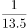
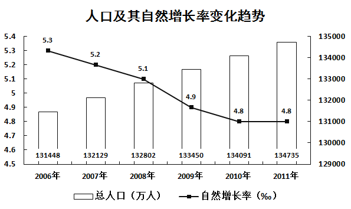
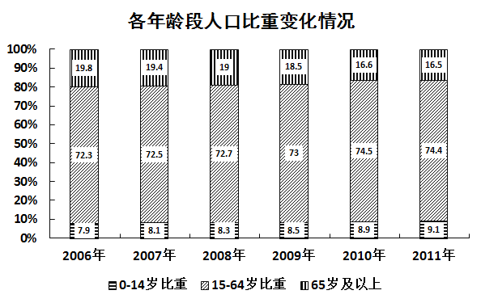

# 现期比重计算（总量×比重差求部分差）

考点：[[20-考点/资料分析/比重/现期比重计算（总量×比重差求部分差）|比重 / 现期比重计算（总量×比重差求部分差）]]
材料：[[15-材料/资料分析/182494 2006—2011年总人口规模与人口|182494 2006—2011年总人口规模与人口]]

**问法模型**：题干问'某年A部分人口比B部分大约多多少万人'且材料只给总量与比重 → 采用'总量×比重差'模型：人数差=现期总人口×（A比重−B比重）

## 推理链
1. 第1步：定位图1，提取2011年总人口=134735万人（柱形读右轴，万人）
2. 第2步：定位图2，提取2011年'65岁及以上'比重=16.5%、'0-14岁'比重=9.1%（须取2011年列，非其他年份）
3. 第3步：图2只给比重、无绝对人数，故套用公式：人数差=总人口×比重差
4. 第4步：比重差=16.5%−9.1%=7.4%
5. 第5步：代入计算：134735×7.4%≈9970万人（134735×7%+134735×0.4%≈9431+539）
6. 第6步：与选项对照：9970与D项完全吻合，A7910/B8850/C9320与其相差650万以上，排除，故选D

**最快解法**：⚡ 拆位口算+截位验证：比重差先算出16.5%−9.1%=7.4%，再拆134735×7.4%=134735×(7%+0.4%)≈9431+539≈9970万，直接命中D；或粗估13.47亿×7.4%≈1.0亿量级即可排除A/B/C

## 易错点
- ⚠ 跨图拼接陷阱：图2只给比重、无绝对人数，必须用图1的2011年总人口×图2比重差，单看任一图都无法求解
- ⚠ 年份列错位：图2六年比重并列，须取2011年列（9.1%、16.5%），若误取2006年（7.9%、19.8%）会得134735×11.9%≈16033万而选错
- ⚠ 量纲与单位：图1折线为‰、图2为%，本题用图2的%切勿掺入‰数据；总人口单位为万人，结果9970万≈1亿量级，勿再作多余换算

## 母题抽象
> 🧩 当题干出现'某年A部分比B部分多/少多少（绝对量）'而材料只给总量与各部分比重时，用'总量×比重差'模型，先验证两图取数年份一致、再验证比重差方向与问法'多/少'相符

**同类特征**：'××××年的总人口中'（现期时点限定）、'A比B大约多（　）万人'（求两构成部分绝对量之差）、材料只给比重未给各部分人数（跨图拼接信号）、选项为间隔数百的万人级数值（估算精度要求低）、现期比重计算类问法

## 相关题
（暂无）

---

### 题干
2011年的总人口中，“65岁及以上”的人口比“0-14岁”的人口大约多（    ）万人。

### 选项
- A. 7910
- B. 8850
- C. 9320
- D. 9970　✅

### 官方解析

根据题干中“2011年，‘65岁及以上’的人口比‘0-14岁’的人口”，可以判断本题为现期比重计算问题。定位图形材料1，可以得到2011年总人口为134735万人。图形材料2，可以得到“0-14岁”的比重为9.1%，“65岁及以上”的比重为16.5%。2011年“65岁及以上”的人口比“0-14岁”的人口多134735×（16.5%-9.1%）=134735×7.4%≈134735×≈9980万人，与D项最接近。

故正确答案为D。

### 给定材料

> [!warning] 疑点（官方解析可能有误，待人工复核）
> 官方解析估算值写作'≈9980万人'，精确计算134735×7.4%=9970.39万人，与D项9970完全吻合，'≈9980'应为解析笔误，不影响正确答案D的判定
