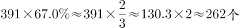

# 现期比重计算（已知整体与比重求部分量）

考点：[[20-考点/资料分析/比重/现期比重计算（已知整体与比重求部分量）|比重 / 现期比重计算（已知整体与比重求部分量）]]
材料：[[15-材料/资料分析/182478 广东省2014—2015年省级新农村|182478 广东省2014—2015年省级新农村]]

**问法模型**：题干问'第二批391个自然村中有□%实现通自来水的约有几个'→已知整体量（391个）与比重（67.0%），用部分量=整体量×比重直乘求部分

## 推理链
1. 第1步：从材料自来水建设段提取条件——第二批示范片共391个自然村，其中67.0%实现通自来水（材料原文该百分数留空，按官方解析为67.0%）
2. 第2步：判定为现期比重计算，公式为部分量=整体量×比重，整体分母必须取自来水段自己的391（而非规划编制段的386）
3. 第3步：代入计算：391×67%=261.97≈262个
4. 第4步：与选项对照，262与B吻合；A的256为首批硬底化完成个数的跨段干扰项，排除，故选B

**最快解法**：⚡ 百化分+放缩速算：67%≈2/3，391×2/3≈260.7，最接近262；或直乘391×0.67=261.97≈262，锁定B

## 易错点
- ⚠ 分母口径陷阱：'第二批'自然村在规划编制段分母为386，在自来水/环卫/硬底化/理事会段为391，本题必须用391，误用386×67%≈259会导致判断偏差
- ⚠ 数据留空陷阱：材料原文该百分数留空，若误代入其他段落比例（如环境卫生79.3%、规划编制79.5%）会算错部分量
- ⚠ 跨段落数字干扰：选项A的256恰为首批完成村巷道硬底化的自然村个数（首批通自来水为326个），勿将首批数据与第二批混淆

## 母题抽象
> 🧩 当题干出现'某总体（N个）中有□%的□实现了某项，约有几个'的特征时，用部分=整体×比重直乘速算，且整体分母必须取同一段落的口径（同一批次在不同段落分母可能不同，如386与391）

**同类特征**：第二批示范片、自然村、实现通自来水、约有……个、已知整体与比重求部分、现期比重

## 相关题
- [[10-真题/资料分析/比重/4792819 现期比重计算（多部分比重依次求解）|4792819]]（新疆 2014，相关度1）
- [[10-真题/资料分析/比重/827355 现期比重比较（部分占比过半速判）|827355]]（政法干警 2014，相关度1）
- [[10-真题/资料分析/比重/2272297 现期比重比较|2272297]]（选调 2015，相关度1）
- [[10-真题/资料分析/比重/2032972 现期比重计算（多地区占比求和）|2032972]]（吉林 2015，相关度1）
- [[10-真题/资料分析/比重/2187857 现期比重计算（部分量需先由'总量−其中量'减法间接求得）|2187857]]（山东 2018，相关度1）

---

### 题干
第二批示范片的自然村中，实现通自来水的约有（  ）个。

### 选项
- A. 256
- B. 262　✅
- C. 267
- D. 273

### 官方解析

由题目问“实现通自来水的有多少个”，结合材料第五段“第二批391个自然村中，有67.0%的自然村实现通自来水”，已知比重与整体的量求部分的量，判定本题为现期比重计算问题，则其个数为

故正确答案为B。

### 给定材料

根据下列资料，回答86~90题：

        从2014年起，我省在粤东西北地区以县（市、区）为单位遴选首批14个省级新农村连片示范建设工程，三年将建成42个省级新农村示范片（不含珠三角地区）。根据工作进度安排，示范片建设一年初见成效，两年基本实现目标。与此同时，珠三角地区每年选取6个片区开展示范片建设，为期三年。

        截至2015年年底，全省第一、二批40个示范片（含珠三角6市）启动建设项目2693个（粤东西北1539个，珠三角1154个），竣工项目1711个（粤东西北821个，珠三角890个），累计投入各类资金40亿元（粤东西北16.6亿元，珠三角23.4亿元）。

        示范片村庄规划编制：首批示范片的64个行政村和375个自然村，已完成村庄规划编制。第二批示范片的59个行政村和386个自然村中，已完成村庄规划编制的行政村55个，自然村307个，分别占和。

        示范片村庄环境卫生：首批示范片中已完成环境卫生整治的自然村357个，占。第二批391个自然村中，310个自然村已完成环境卫生整治，占。

        示范片自来水建设：首批示范片中有326个自然村实现通自来水，占。第二批391个自然村中，有的自然村实现通自来水。

        村巷道硬底化建设：首批示范片中完成村巷道硬底化建设的自然村有256个，占。第二批中有的自然村完成村巷道硬底化建设。

        群众参与共谋共建情况：首批示范片375个自然村中，成立村民理事会的占。第二批391个自然村中，成立村民理事会的占。

> [!warning] 疑点（官方解析可能有误，待人工复核）
> 材料原文第二批通自来水比例留空（'有＿的自然村实现通自来水'），本题须依赖官方解析补全的67.0%方可求解，所给材料本身无法独立验证；按67.0%计算391×67%≈262与答案B一致，官方解析本身无错误

<!-- CODEX-ANSWER-REVIEW:BEGIN -->
### 本次独立复核

**复核状态：** `resolved`（答案与解析已核定）

**计分答案：** B（可计分）

**复核解析：**

第二批自然村391个，通自来水比率67.0%；391×67.0%=261.97，约262个，选B。

**相关信息：**

部分量=整体量×比重。

**题源依据：** [固定版本原题](https://github.com/Mentat-Uran/kaogongzhentizhengliu/blob/84ab93d4b64b61d897bece8a1c0a5bab06b4feb2/10-%E7%9C%9F%E9%A2%98/%E8%B5%84%E6%96%99%E5%88%86%E6%9E%90/%E6%AF%94%E9%87%8D/1796630%20%E7%8E%B0%E6%9C%9F%E6%AF%94%E9%87%8D%E8%AE%A1%E7%AE%97%EF%BC%88%E5%B7%B2%E7%9F%A5%E6%95%B4%E4%BD%93%E4%B8%8E%E6%AF%94%E9%87%8D%E6%B1%82%E9%83%A8%E5%88%86%E9%87%8F%EF%BC%89.md)；固定内容 commit `84ab93d4b64b61d897bece8a1c0a5bab06b4feb2`，Markdown blob `b8ec7f34e2138fb30b1ac5c328354d99034f36ca`。
<!-- CODEX-ANSWER-REVIEW:END -->
