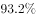
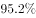
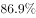
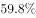
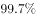

# 两批次完成率（比重）作差比较

考点：[[20-考点/资料分析/比重/两批次完成率（比重）作差比较|比重 / 两批次完成率（比重）作差比较]]
材料：[[15-材料/资料分析/182478 广东省2014—2015年省级新农村|182478 广东省2014—2015年省级新农村]]

**问法模型**：题干问'第一、二批……完成率差距最大的是'→对四个指标分别计算|首批完成率−第二批完成率|，再比大小

## 推理链
1. 第1步：从材料提取首批完成率（分母统一为375个自然村）：村庄规划编制375/375=100%，环境卫生357/375≈95.2%，自来水326/375≈86.9%
2. 第2步：提取第二批完成率：规划编制307/386≈79.5%（本项分母为386），环境卫生310/391≈79.3%（分母391），自来水67%、群众参与首批99.7%对第二批98.2%（这几处百分数原文留空，取原卷补全数据）
3. 第3步：所用公式：差距=|首批完成率−第二批完成率|，四个指标逐项作差
4. 第4步：代入计算：村庄规划编制100%−79.5%=20.5%；环境卫生95.2%−79.3%=15.9%；自来水86.9%−67%=19.9%；群众参与99.7%−98.2%=1.5%
5. 第5步：比较大小：20.5%＞19.9%＞15.9%＞1.5%，完成率差距最大的是村庄规划编制
6. 第6步：与选项对照：村庄规划编制对应A项，故正确答案为A

**最快解法**：⚡ 截位直除+作差排除：先算数据最完整的两项——规划编制差距=100%−307/386≈20.5%，环卫差距=357/375−310/391≈95.2%−79.3%=15.9%；因20.5%已大于环卫项差距，只需再确认自来水差距86.9%−67%=19.9%＜20.5%、群众参与差距仅1.5%，即可锁定A，无需精算全部四项

## 易错点
- ⚠ 第二批自然村分母前后不一致：规划编制段为386、环卫/自来水/理事会段为391，算79.5%必须用386，混用分母即口径错误
- ⚠ 首批与第二批完成个数不可直接比大小（分母375与386/391不同），如环卫357＞310但完成率为95.2%对79.3%，必须先各自化成完成率再作差
- ⚠ '行政村'与'自然村'是两套口径（规划编制另有64/55个行政村数据，本题只比自然村）；且自来水、群众参与第二批百分数原文留空，须用原卷补全值，不可臆造或凭直觉估算

## 母题抽象
> 🧩 当题干出现'两批次/两群体各指标完成率差距最大（小）'的特征时，先按各段自身分母把完成个数化为完成率，再逐项作差取绝对值比大小，并优先计算数据完整的项以锁定答案区间

**同类特征**：完成率差距最大、第一、二批对比、自然村口径、四项指标横向比较、作差比大小

## 相关题
（暂无）

---

### 题干
第一、二批示范片的自然村中，完成率差距最大的是（    ）。

### 选项
- A. 村庄规划编制　✅
- B. 村庄环境卫生
- C. 自来水建设
- D. 群众参与共谋共建情况

### 官方解析
由题目问“完成率差距最大的是”，结合材料分别给出第一、二批示范片自然村各项的完成率，判定本题为简单加减计算问题。则各项完成率在第一、二批示范片中的差距分别为：村庄规划编制：100%-79.5%=20.5%，村庄环境卫生：95.2%-79.3%=15.9%，自来水建设：86.9%-67%=19.9%，群众参与共谋共建情况：99.7%-98.2%=1.5%，完成率差距最大的是村庄规划编制。
故正确答案为A。

### 给定材料

根据下列资料，回答86~90题：

        从2014年起，我省在粤东西北地区以县（市、区）为单位遴选首批14个省级新农村连片示范建设工程，三年将建成42个省级新农村示范片（不含珠三角地区）。根据工作进度安排，示范片建设一年初见成效，两年基本实现目标。与此同时，珠三角地区每年选取6个片区开展示范片建设，为期三年。

        截至2015年年底，全省第一、二批40个示范片（含珠三角6市）启动建设项目2693个（粤东西北1539个，珠三角1154个），竣工项目1711个（粤东西北821个，珠三角890个），累计投入各类资金40亿元（粤东西北16.6亿元，珠三角23.4亿元）。

        示范片村庄规划编制：首批示范片的64个行政村和375个自然村，已完成村庄规划编制。第二批示范片的59个行政村和386个自然村中，已完成村庄规划编制的行政村55个，自然村307个，分别占和。

        示范片村庄环境卫生：首批示范片中已完成环境卫生整治的自然村357个，占。第二批391个自然村中，310个自然村已完成环境卫生整治，占。

        示范片自来水建设：首批示范片中有326个自然村实现通自来水，占。第二批391个自然村中，有的自然村实现通自来水。

        村巷道硬底化建设：首批示范片中完成村巷道硬底化建设的自然村有256个，占。第二批中有的自然村完成村巷道硬底化建设。

        群众参与共谋共建情况：首批示范片375个自然村中，成立村民理事会的占。第二批391个自然村中，成立村民理事会的占。

> [!warning] 疑点（官方解析可能有误，待人工复核）
> 材料原文中第二批自来水（67%）及两批群众参与（99.7%、98.2%）的百分数留空，官方解析数值依赖原卷补全数据，本材料版本无法直接验证C、D两项差距；但A项20.5%＞B项15.9%可由现有材料数据直接验证，且官方解析内部口径一致，答案A无疑义
