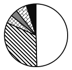

# 现期比重计算与饼图（结构图）占比判断

考点：[[20-考点/资料分析/比重/现期比重计算与饼图（结构图）占比判断|比重 / 现期比重计算与饼图（结构图）占比判断]]
材料：[[15-材料/资料分析/182576 2013年全国社会保险基金资产情况：|182576 2013年全国社会保险基金资产情况：]]

**问法模型**：题干问'哪个图形正确反映各基金占比'→ 将各险种债券投资额除以合计总额求比重，再与选项图形的模块大小逐一对照验证

## 推理链
1. 第1步：定位表格'债券投资'行，交叉读出6项数值：城镇职工养老54、居民养老26、城镇职工医疗15、居民医疗'–'（按0处理）、工伤4、失业16、生育1（单位亿元）
2. 第2步：验证合计：54+26+15+4+16+1=116亿元，与表中合计116一致，说明只有6份参与占比分配
3. 第3步：求各占比：城镇职工养老54/116≈46.6%、居民养老26/116≈22.4%、失业16/116≈13.8%、城镇职工医疗15/116≈12.9%、工伤4/116≈3.4%、生育1/116≈0.9%
4. 第4步：提取图形特征：最大模块约46.6%（接近一半但不到一半）；次大模块居民养老约22.4%（约为最大模块的一半）；失业(16)与城镇职工医疗(15)两模块相近；工伤明显小；生育最小(≈0.9%)
5. 第5步：与选项对照：最大块接近一半可排除C、D；居民养老占最大模块将近一半、职工医疗与失业两块相近，仅A项符合，故选A

**最快解法**：⚡ 截位直除＋饼图特征排除法：先算最大项54/116≈46.6%（不到一半，排除最大块过半的选项C、D）；再看居民养老26/116≈22.4%约为最大块一半、失业16与城镇职工医疗15几乎等大且均约13%~14%、生育1≈0.9%最小，锁定A

## 易错点
- ⚠ 居民基本医疗保险债券投资为'–'，应按0处理，饼图只分6份而非7份，漏看或当成缺数会把份数结构算错
- ⚠ 斜线双向交叉表读数需'行×列'交叉定位，'城镇职工养老'与'居民养老'、'城镇职工医疗'与'居民医疗'四列同名易串列，54/26/15/16极易互相错取
- ⚠ 图形判断不能只看'谁最大'，最大块46.6%不到一半是关键分水岭；还需同时验证次大块约为最大块一半、失业与职工医疗相近等多重特征，否则A、B易混

## 母题抽象
> 🧩 当题干出现'哪个图形正确反映某总额中各部分占比'时，用各分项除以合计求比重（'–'按0处理），再用'最大块是否过半、次大块相对比例、相近项关系'等特征与选项图逐一排除验证

**同类特征**：哪个图形能够正确反映、各基金的占比情况、债券投资总额、饼图/结构占比图形化判断、'–'项按零处理、部分占整体比重比较

## 相关题
（暂无）

---

### 题干
以下哪个图形能够正确反映债券投资总额中各基金的占比情况？

### 选项
- A. 

　✅
- B. 

- C. 

- D. 

### 官方解析
根据题干中“债券投资总额中各基金的占比情况”，可判定本题为现期比重问题。定位表格，债券投资各项分别为54亿元、26亿元、15亿元、4亿元、16亿元、1亿元，总额为116亿元，最大的模块占比为，排除C、D两项，居民基本养老保险26亿元占最大模块将近一半，城镇职工基本医疗保险和失业保险两个模块相近，占比，A项最接近。
故正确答案为A。

### 给定材料

根据所给资料，回答101~105题。

