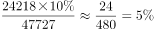

# 现期比重增量计算（资产内部转移、总量不变型）

考点：[[20-考点/资料分析/比重/现期比重增量计算（资产内部转移、总量不变型）|比重 / 现期比重增量计算（资产内部转移、总量不变型）]]
材料：[[15-材料/资料分析/182576 2013年全国社会保险基金资产情况：|182576 2013年全国社会保险基金资产情况：]]

**问法模型**：题干出现'若将A的10%转入B项，则B占资产总额的比重将增加约多少个百分点'→内部转移不改变总盘子，比重增量=转移额÷资产总额（而非新B额÷总额）

## 推理链
1. 第1步：在斜线双向表中交叉定位'财政专户存款'行×'城镇职工基本养老保险'列，读出24218亿元；同表'基金资产总额'合计为47727亿元
2. 第2步：内部转移规则：财政专户存款的10%转入协议存款只是社保基金资产内部结构挪动，资产总额47727亿元不变，协议存款比重增加量=转入额÷47727（若求新比重则为(1285+转入额)÷47727，与增重相减后结果相同）
3. 第3步：代入计算：转入额=24218×10%=2421.8亿元，比重增量=2421.8÷47727≈2422÷47700≈5.07个百分点
4. 第4步：与选项对照：5.07≈5，选B；验证陷阱路径：若误用分母29930亿元得2421.8÷29930≈8.1个百分点、或误用新协议存款额3706.8÷47727≈7.8个百分点，都会误选C，反向印证B正确

**最快解法**：⚡ 截位直除+量级排除：24218×10%≈2422，看2422/47727，由于47727×5%≈2386≈2422，故比重增量≈5个百分点，直接锁定B；全程只需一次除法，无需精确计算

## 易错点
- ⚠ 分母口径陷阱：比重的分母必须是社保基金资产总额47727亿元，误用城镇职工养老保险基金资产总额29930亿元得≈8.1个百分点，恰好误选C（官方解析明确点出的错选原因）
- ⚠ 增量vs新比重混淆：若把新协议存款额(1285+2421.8=3706.8)÷47727≈7.8个百分点当作'增加量'，也会误选C；正确的是只算转移带来的增量2421.8÷47727≈5.1
- ⚠ 分母为总额、分子用错行：误用'财政专户存款'合计行40311×10%=4031.1作分子，得4031.1÷47727≈8.4个百分点误选C；须交叉定位城镇职工养老列的24218
- ⚠ 斜线交叉表读数：'财政专户存款'是'基金资产总额'下的'其中'项，行×列必须精确交叉，勿串到居民养老(2829)或合计列

## 母题抽象
> 🧩 当题干出现'将某项资产的x%转入另一项，求后者占总额比重增加多少个百分点'时，认定内部转移不改变总盘子，比重增量=转移额÷总额，再用截位直除与选项量级对照，验证分母是否为'全部对象合计'而非'单一对象'

**同类特征**：若将……的10%转入……、比重将增加约多少个百分点、财政专户存款/协议存款（资产内部结构转移）、社会保险基金资产总额（暗示分母口径）、双向交叉表行×列定位、问'个百分点'而非'亿元'

## 相关题
（暂无）

---

### 题干
若将城镇职工基本养老保险基金中财政专户存款资产总额的10%转入协议存款，则协议存款总额占社会保险基金资产总额的比重将增加约多少个百分点？

### 选项
- A. 2
- B. 5　✅
- C. 8
- D. 12

### 官方解析

定位表格第三行可知，2013年城镇职工基本养老保险中的财政专户存款为24218亿元。若其转入协议存款，协议存款总额占社会保险基金资产总额所增加的比重即为城镇职工基本养老保险财政专户存款占社会保险基金资产总额的比重。故所求即为。（本题为现期比重问题，比重的分母应为社会保险基金资产总额47727亿元，而不是城镇职工基本养老保险基金资产总额29930亿元，所以错选C项是因为分母数据没有找对。）

故正确答案为B。

### 给定材料

根据所给资料，回答101~105题。

