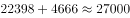
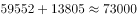
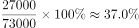

# 现期比重计算（部分÷总体，硕博分层需加总）

考点：[[20-考点/资料分析/比重/现期比重计算（部分÷总体，硕博分层需加总）|比重 / 现期比重计算（部分÷总体，硕博分层需加总）]]
材料：[[15-材料/资料分析/182578 2013-2014学年某市高等教育分|182578 2013-2014学年某市高等教育分]]

**问法模型**：题干出现'……中，××所占比例约为'且主体（工学研究生）与总体（毕业研究生）在表中均分'硕士/博士'两列 → 现期比重=部分(硕+博)÷总体(硕+博)，先加总再作除

## 推理链
1. 第1步：题干限定'毕业的研究生'，故只读表格'毕业人数'板块：工学硕士22398、博士4666；总计行硕士59552、博士13805
2. 第2步：核心读表规则——研究生=硕士+博士，分子分母各自加总：工学毕业生=22398+4666=27064人
3. 第3步：总体=全市毕业研究生=59552+13805=73357人，比重=27064÷73357
4. 第4步：截位直除：27064/73357≈27.1/73.4≈36.9%
5. 第5步：与选项对照：36.9%最接近37%，锁定B；A(32%)、C(42%)、D(47%)均偏离明显

**最快解法**：⚡ 截位直除+硕博加总：分子27064、分母73357各截前三位→27.1/73.4，商首位3、次位接近7，直得约37%，秒选B（甚至可先粗估：27/73≈0.37）

## 易错点
- ⚠ 漏加一列：只拿工学硕士22398（得30.4%）或只拿博士4666当分子，硕博必须相加
- ⚠ 口径错位：分母误用'在校'总计(193452+72204)或'招生'总计(73437+17962)，三个指标流量/存量口径不同不可互串；或分母只取硕士总计59552漏掉博士13805
- ⚠ 串行陷阱：表格13行×6列，工学数值大易与相邻'理学''管理学'行看串，定位时核对行首学科名

## 母题抽象
> 🧩 当题干出现'总体中某部分所占比例约为'且表格按'硕士/博士'分列时，先对分子、分母各自硕博加总（部分和总体口径必须一致且同板块），再用截位直除求比值对照选项

**同类特征**：毕业的研究生中、所占比例约为、现期比重、部分÷总体、硕博两列需自行加总、单一学年截面数据

## 相关题
- [[10-真题/资料分析/比重/4792819 现期比重计算（多部分比重依次求解）|4792819]]（新疆 2014，相关度1）
- [[10-真题/资料分析/比重/827355 现期比重比较（部分占比过半速判）|827355]]（政法干警 2014，相关度1）
- [[10-真题/资料分析/比重/2272297 现期比重比较|2272297]]（选调 2015，相关度1）
- [[10-真题/资料分析/比重/2032972 现期比重计算（多地区占比求和）|2032972]]（吉林 2015，相关度1）
- [[10-真题/资料分析/比重/2187857 现期比重计算（部分量需先由'总量−其中量'减法间接求得）|2187857]]（山东 2018，相关度1）

---

### 题干
2013~2014学年该市毕业的研究生中，工学研究生所占比例约为：

### 选项
- A. 32%
- B. 37%　✅
- C. 42%
- D. 47%

### 官方解析

根据题干中“工学研究生所占比例约为”，可判定本题为现期比重的计算问题。定位表格，工学研究生毕业生人数为人，总毕业生人数为人，则工学研究生所占比例为。

故正确答案为B。

### 给定材料

根据所绘资料，回答106~110题。

> [!warning] 疑点（官方解析可能有误，待人工复核）
> 官方解析原文中两处人数与算式数值显示缺失（'人数为人'），属呈现缺漏；按表格数据复算27064÷73357≈36.9%≈37%，与官方答案B一致，无需更正
