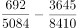
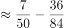

# 现期比重计算与比重差值（百分点）比较

考点：[[20-考点/资料分析/比重/现期比重计算与比重差值（百分点）比较|比重 / 现期比重计算与比重差值（百分点）比较]]
材料：[[15-材料/资料分析/182580 2014年某地区生态移民与农村居民的|182580 2014年某地区生态移民与农村居民的]]

**问法模型**：题干问'A占B的比重比C占D的比重低多少个百分点'→ 分别用部分÷整体计算两个现期比重，再作差，结果以百分点表示

## 推理链
1. 第1步：题干主体为'经营净收入占人均可支配收入的比重'，定位表1（收入表，勿取表2消费数据）：生态移民经营净收入692元、人均可支配收入总计5084元；农村居民经营净收入3645元、总计8410元
2. 第2步：现期比重公式：比重=部分/整体；所求=农村居民比重−生态移民比重（百分点）
3. 第3步：截位直除：生态移民比重=692/5084≈13.6%；农村居民比重=3645/8410≈43.3%
4. 第4步：作差：43.3%−13.6%≈29.7个百分点
5. 第5步：与选项对照，29.7与D项完全吻合，故选D

**最快解法**：⚡ 截位直除：692/5084≈69/508≈13.6%，3645/8410≈36/84≈43.3%（首位商4、次位商3），两比重直接作差≈29.7个百分点，秒选D；亦可先粗估农村比重超40%、移民比重仅一成多，差值必近30，直接锁定D

## 易错点
- ⚠ 跨表取数陷阱：材料有两张表，必须取表1'人均可支配收入'（5084/8410），若误取表2'人均生活消费支出'（5090/7676）则全盘皆错——5084与5090数值极近，极易混淆
- ⚠ '低多少个百分点'是两个比重作差，绝不能再除以基期比重换算成'增长率/降幅百分比'；结果量级应接近30，勿因粗算偏差误选C(15.7)或A/B
- ⚠ 分子分母错配：移民的692必须除以移民总计5084、居民的3645必须除以居民总计8410，交叉相除或用2953（3645−692）直接比总量均错误

## 母题抽象
> 🧩 当题干出现'A占B的比重比C占D的比重高/低多少个百分点'且材料为现期数据时，用'部分÷整体'分别求两个现期比重再作差，结果以百分点表述，配合截位直除快速锁定选项

**同类特征**：占……的比重、比……低多少个百分点、两主体（生态移民vs农村居民）对比、时间明确为现期2014年、需从同一表格取两列数据、结果用百分点而非%增速表述

## 相关题
- [[10-真题/资料分析/比重/1751688 现期比重计算|1751688]]（江苏 2015，相关度1）
- [[10-真题/资料分析/比重/12536401 两期比重连续变化趋势判断（比重升降结论+基期增速还原）|12536401]]（四川 2024，相关度1）
- [[10-真题/资料分析/比重/2033382 现期比重计算（部分需自行加总+跨表与文字拼接整体值）|2033382]]（河南 2016，相关度1）
- [[10-真题/资料分析/比重/2049300 现期比重计算（整体值未直接给出，需跨句拼凑分母）|2049300]]（选调 2017，相关度1）
- [[10-真题/资料分析/比重/2719396 现期比重之差（百分点差比较）|2719396]]（国考 2021，相关度1）

---

### 题干
2014年，该地区生态移民经营净收入占人均可支配收入的比重比农村居民低多少个百分点？

### 选项
- A. 0.6
- B. 1.1
- C. 15.7
- D. 29.7　✅

### 官方解析

根据题干中的“占······比重”以及资料时间为2014年，可判定为现期比重问题。定位表1，2014年该地区生态移民经营净收入692元，人均可支配收入总计5084元；农村居民经营净收入3645元，人均可支配收入总计8410元。则，即生态移民经营净收入所占人均可支配收入的比重比农村居民低29个百分点，D项最接近。

故正确答案为D。

### 给定材料

根据所给资料回答111~115题。

        2014年，某地区生态移民人均可支配收入5084元，其中县内移民人均可支配收入4933元，县外移民人均可支配收入5253元，2014年该地区生态移民人均可支配收入比农村居民人均可支配收入低3326元，比该地区山区九县农村居民人均可支配收入低1099元。

