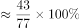

# 现期比重计算（多项部分之和占整体比重）

考点：[[20-考点/资料分析/比重/现期比重计算（多项部分之和占整体比重）|比重 / 现期比重计算（多项部分之和占整体比重）]]
材料：[[15-材料/资料分析/182580 2014年某地区生态移民与农村居民的|182580 2014年某地区生态移民与农村居民的]]

**问法模型**：题干出现'A、B、C三项支出占总消费支出的'且时间为2014年现期 → 采用现期比重模型：比重=三项部分之和÷整体总量，一步直除即可

## 推理链
1. 第1步：题干要求'农村居民'的'食品烟酒、衣着、居住'三项消费占比，判定取数范围锁定表2（人均生活消费支出表）的'农村居民'列，与表1收入表无关
2. 第2步：从表2提取数据——农村居民食品烟酒2296元、衣着602元、居住1388元，总生活消费支出（整体）为7676元
3. 第3步：应用现期比重公式：比重=（2296+602+1388）÷7676
4. 第4步：分子加总得4286，做直除：4286÷7676≈0.558，即约55.8%
5. 第5步：与选项对照，B项最接近55.8%，故选B（官方答案B与计算一致）

**最快解法**：⚡ 截位直除+区间排除法：分子先加总2296+602+1388=4286；再取半判断——7676的一半为3838，60%为约4606，4286介于两者之间且更靠近60%一侧，锁定55%~56%区间，直除4286/7676首两位商55得约55.8%，直接对应B项

## 易错点
- ⚠ 两表张冠李戴：5084元（收入）与5090元（支出）数值极近，若误用生态移民消费数据（2033+411+939=3383÷5090≈66.5%）或误用表1收入体系即错
- ⚠ 主体列错配：题干问'农村居民'，若误取表2'生态移民'列，三项为2033/411/939而非2296/602/1388
- ⚠ 分母误用：整体应为农村居民总消费支出7676元，若误用8410（农村居民收入总计）或5090（生态移民总支出）作分母即入坑

## 母题抽象
> 🧩 当题干出现'某主体在某几类分项上的合计占其总量的比重'且材料为单期表格时，先锁定对应表格的对应列（主体+指标体系），分子三项加总、分母取该主体总计，一步直除与选项对照

**同类特征**：'三项消费上支出约占总消费支出的'、主体为'农村居民'、分项名（食品烟酒、衣着、居住）来自消费八大类、时间口径为2014年现期、问'约占'即求现期比重、需跨文字段定位表2而非表1

## 相关题
（暂无）

---

### 题干
2014年，该地区农村居民在食品烟酒、衣着、居住三项消费上支出约占总消费支出的：

### 选项
- A. 

- B. 

　✅
- C. 

- D. 

### 官方解析

根据题干出现“占”，资料时间为2014 年，可以判定为现期比重问题。定位表2可得，2014年该地区农村居民食品烟酒支出2296元，衣着支出602元，居住支出1388元，总生活消费支出7676元，故三者所占总生活消费支出的比重为，B项最接近。

故正确答案为B。

### 给定材料

根据所给资料回答111~115题。

        2014年，某地区生态移民人均可支配收入5084元，其中县内移民人均可支配收入4933元，县外移民人均可支配收入5253元，2014年该地区生态移民人均可支配收入比农村居民人均可支配收入低3326元，比该地区山区九县农村居民人均可支配收入低1099元。

